# Исследование критических режимов самовозбуждающихся случайных процессов и методов их раннего обнаружения

**Отчёт по имитационному и статистическому моделированию.**

**Статус:** итоговая редакция от 22 ноября 2026 года с результатами R12, рассчитанными на снимках от 19 ноября. Выполнены моделирование, статистическая диагностика, обучение и проверка детекторов, исследование полных каскадов и применение замороженных моделей к CODE и городским данным. Прогноз «район × 6 часов» дополнен четырьмя городами, общей нейросетью, погодой и бустингом. Расширение не обеспечило заданного качества тревог; этот результат сохранён в отчёте.

[PDF отчёта с дополнением R12](output/pdf/hawkes_criticality_report.pdf).

## Аннотация

В работе исследуется, как меняются характеристики потока событий при усилении самовозбуждения и при каких условиях это изменение можно обнаружить по наблюдениям. Основной моделью служит линейный процесс Хоукса с экспоненциальным ядром. Для сравнения используются однородный процесс Пуассона и пуассоновские потоки с внешней сезонностью, трендом и скачками интенсивности.

Параметры оцениваются методом максимального правдоподобия, а точность и качество детекторов проверяются методом Монте-Карло. Раздельно рассматриваются распознавание уже высокого коэффициента ветвления и предупреждение о его первом будущем пересечении рабочего порога. Нейросетевые методы сравниваются со статистическими ориентирами; обучение, выбор параметров, калибровка и окончательная проверка разделены по целым потокам.

Полученные результаты показывают зависимость точности от длины наблюдения и интенсивности, сильное влияние спецификации фона и существенные потери информации при оконной оценке коэффициента ветвления. Причинная фильтрация умеренно уменьшила ошибку n, увеличив задержку при внезапной смене режима. Расширенная сеть с обучением на 7 800 потоках дала 5 чистых предупреждений из 600 переходов при строгой калибровке. Это улучшение относительно прежнего ориентира на той же выборке, но достаточное качество раннего предупреждения не получено. Применение к 14 городам CODE и четырём городским порталам выявляет ограничения переноса; истинные моменты критичности для них неизвестны.

Отдельный пространственно-временной эксперимент использует 1 600 059 дел/отчётов Chicago и San Francisco и прогнозирует количество на следующий шестичасовой интервал в 32 округах. На отложенных 2025/2026 адаптация фона и нейросеть улучшают прогноз среднего количества относительно фиксированного календаря. При основном лаге 7 суток нейросеть немного превосходит адаптивный фон Chicago и уступает ему в SF; полнота редких всплесков остаётся низкой. Доступность прошлых записей учтена частично по времени регистрации, ограничения ретроспективного архива сохранены.

## 1. Постановка задачи

Самовозбуждающийся поток описывает ситуации, когда произошедшее событие временно увеличивает интенсивность последующих событий. При усилении такого влияния возникают более выраженные серии событий. Однако похожие наблюдаемые серии могут появляться и при внешнем изменении интенсивности. Поэтому рост дисперсии или оценённого самовозбуждения требуется проверять на отрицательных контролях.

**Цель работы** — исследовать наблюдаемые признаки приближения самовозбуждающегося процесса к границе стационарности, точность оценки его режима и качество методов раннего обнаружения при контроле ложных тревог.

Для достижения цели решаются следующие задачи:

1. Реализовать моделирование процессов Пуассона и Хоукса.
2. Исследовать интенсивность, дисперсию, автокорреляцию и кластерную характеристику потока.
3. Оценить точность восстановления коэффициента ветвления при разных длинах окна и интенсивностях.
4. Проверить смешение самовозбуждения с нестационарным фоном.
5. Разделить оценивание текущего состояния и предупреждение о будущем переходе.
6. Реализовать и сравнить статистические и нейросетевые методы.
7. Проанализировать причины ошибок и показать ограничения применения к реальным зарегистрированным событиям.

Объектом исследования является поток событий. Предметом исследования являются его статистические характеристики и процедуры обнаружения высокого режима. В дополнительной задаче R10 исследуется наблюдаемое количество зарегистрированных происшествий по районам в шестичасовых интервалах. Прогнозирование участников или точного момента отдельного преступления в задачи работы не входит.

## 2. Математическая модель

### 2.1. Процесс Пуассона

У однородного пуассоновского процесса интенсивность постоянна. Число событий на интервале длины T имеет распределение Пуассона с параметром λT. Непересекающиеся интервалы имеют независимые приращения.

В дополнительных контролях интенсивность λ(t) задаётся извне. Она может изменяться по календарю или скачком, но не зависит от произошедших событий. Эти контроли позволяют проверить, не принимает ли метод изменение фона за самовозбуждение.

### 2.2. Процесс Хоукса

Для постоянных параметров используется условная интенсивность

<p align="center">
  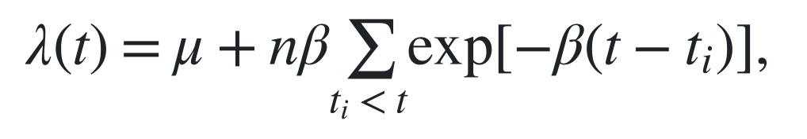
</p>

где μ>0 — фоновая интенсивность, β>0 — скорость затухания, а n — коэффициент ветвления. Интеграл ядра nβexp(−βu) по положительным u равен n. Поэтому n характеризует ожидаемое число непосредственных потомков одного события в кластерном представлении. Основы модели и её кластерная интерпретация изложены в работах [Hawkes](https://doi.org/10.1093/biomet/58.1.83) и [Hawkes, Oakes](https://doi.org/10.2307/3212693).

При постоянных параметрах стационарный режим с конечной средней интенсивностью существует при n<1. Его средняя интенсивность равна

<p align="center">
  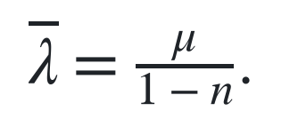
</p>

В симуляциях с контролем масштаба задаётся μ=rate·(1−n). Тогда ожидаемая стационарная интенсивность сохраняется при изменении n, а реализованное число событий остаётся случайным.

### 2.3. Критическая граница и рабочий порог

В работе исследуется приближение к границе n=1 со стороны n<1. Для задачи классификации вводится **операционный порог высокого режима** n<sup>*</sup> = 0.9. Его пересечение не тождественно достижению математической границы стационарности.

В опытах с меняющимся режимом n постоянно внутри стадии. Амплитуда вклада родительского события сохраняется после смены стадии:

<p align="center">
  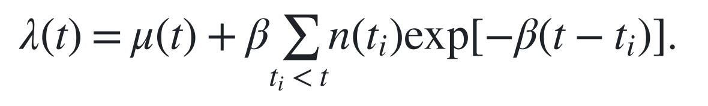
</p>

История возбуждения между стадиями не обнуляется. Соотношение μ[k]=rate·(1−n[k]) поддерживает локальную стационарную среднюю; при смене параметров фактическая интенсивность проходит переходный режим. Такой поток не объявляется глобально стационарным.

## 3. Моделирование и статистическое оценивание

### 3.1. Имитация

Для Хоукса реализовано разреживание по условной интенсивности, следующее подходу [Ogata](https://doi.org/10.1109/TIT.1981.1056305). Между событиями экспоненциальная память убывает; после принятого события к ней добавляется вклад ядра. На границе стадии меняются параметры новых событий и фона, а накопленное возбуждение сохраняется.

Перед наблюдением выполняется прогрев. В стационарной диагностике его длина составляет 8/[β(1−n)]. Это уменьшает начальное смещение, но не заменяет точную выборку из стационарного распределения. Случайные seed и параметры запуска сохраняются.

Пуассоновские количества генерируются по заданным суточным интегралам интенсивности. При необходимости точных моментов событий внутри суток используются условно равномерные времена, что соответствует кусочно постоянному суточному фону. Эта процедура не применяется для восстановления неизвестного времени реальных событий.

### 3.2. Метод максимального правдоподобия

Для временных меток на интервале [a,b) условный log-likelihood имеет вид

<p align="center">
  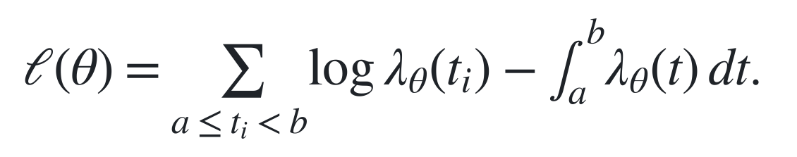
</p>

Наблюдённая история до a учитывается в интенсивности и интеграле. Экспоненциальное ядро позволяет рекурсивно обновлять память и использовать аналитические производные. Подход MLE для этой модели рассматривается у [Ozaki](https://www.ism.ac.jp/editsec/aism/pdf/031_1_0145.pdf).

В основной диагностике восстановления n скорость β=1/сутки известна и верна. Фон и n оцениваются совместно, n ограничен диапазоном [0,0.995]. В городских оценках скорость затухания также подбирается, поэтому результаты относятся к другой задаче оценивания.

Неудачная подгонка сохраняется как пропуск параметра. MAE и смещение вычисляются среди валидных оценок с отдельным указанием их доли. Вероятность получить оценку с заданной точностью включает неудачи в знаменатель. Конечные заполнители признаков нейросети сопровождаются флагами и не трактуются как нулевой оценённый n.

### 3.3. Показатели потока

Изучаются средняя интенсивность, дисперсия суточных количеств, ACF(1) и кластерная характеристика на временных бинах. Для части признаков используются нормировки на среднее число событий.

Кластерная характеристика, реализованная по занятым бинам и параметру разрыва, описывает концентрацию наблюдённых событий. При суточных бинах и используемом cluster_gap=0.5 она равна общему числу событий, делённому на число непустых суток. Она **не является восстановленным размером полного генеалогического каскада**. Генеалогия событий не наблюдается в городских данных и не восстанавливается этим показателем.

## 4. План экспериментов

| Блок | Задача | Объём и разделение |
|---|---|---|
| P0 | Пилот характеристик потока при росте n | 30 повторов на уровень; ожидаемая интенсивность 2/сутки |
| P1 | Итоговая проверка показателей потока | 500 повторов на каждый из 8 уровней n, всего 4 000 потоков |
| R1 | Точность постоянного n | 10 000 независимых потоков, 40 000 подгонок |
| R2 | Спецификация фона | 9 600 потоков, пять вариантов фона, четыре окна |
| R3 | Разделение двух целей детекции | 6 500 потоков; дополнительно 300 общих префиксов с двумя возможными будущими |
| R4 | Выбор признаков, окон и seed | 13 650 потоков в пяти непересекающихся наборах |
| R5 | Диагностика потерь чувствительности | 9 750 новых потоков, 92 варианта правил |
| R6 | Причинная фильтрация n, неопределённость и проверка обнаружения | 11 700 новых потоков, 8 настроек на валидации, 48 замороженных правил |
| R7 | Применение замороженных моделей к реальным данным | 14 городов CODE, четыре портала, 22 блока, 220 решений |
| R8 | Размеры и длительности полных генеалогических кластеров | 800 000 полных деревьев, по 100 000 на уровень n |
| R9 | Один расширенный нейросетевой вариант | 7 800 обучающих потоков, новые валидация/калибровка/тест; тест 3 900 потоков |
| R10 | Прогноз количества и всплесков «район × 6 часов» | Chicago/San Francisco: 32 округа, 1 600 059 дел/отчётов; тесты 2025 и января–сентября 2026, 40 сравнений |
| R11 | Проверка перед внедрением без внешнего пилота | Три группы, четыре даты обновления, 24 сети, районная калибровка; новый предварительный контроль октября 2026 |

Окна одной реализации могут быть вложенными или перекрывающимися. Они не считаются независимыми повторениями. Интервалы для оконных метрик строятся пересэмплированием целых потоков. Для траекторных долей сохраняются Wilson-интервалы. Разные экспериментальные блоки не объединяются в один общий тест.

### 4.1. Состояние и предупреждение

В задаче состояния на границе t оценивается n(t−) последнего завершённого интервала. В задаче предупреждения положительная цель задаётся условием

<p align="center">
  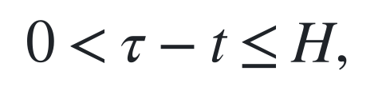
</p>

где τ — первое пересечение n<sup>*</sup>, а H=180 суток в основных опытах. Решения при t≥τ исключены из оценки раннего предупреждения. Требуется полностью наблюдаемый будущий горизонт t+H≤T. Поток, высокий с начала мониторинга, не считается примером нового первого перехода.

При 90-суточном шаге первое завершённое высокое состояние после перехода доступно на следующей границе интервала. Это ограничение частоты решений, которое нельзя представлять как раннее обнаружение.

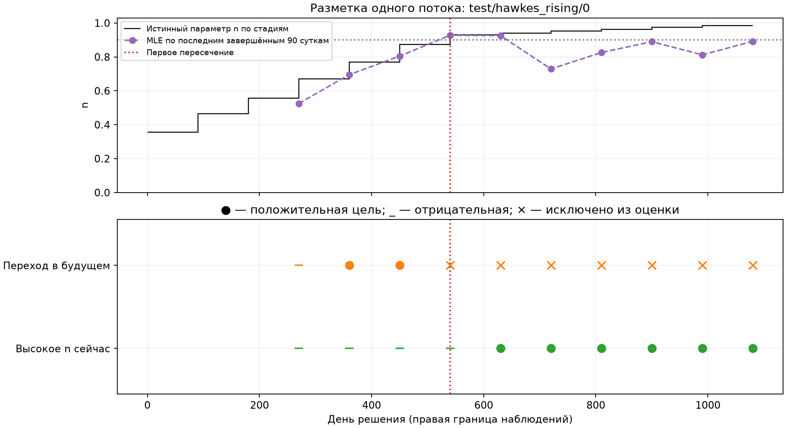

*Рисунок 1. Пример разметки R3. Точка в момент пересечения не является предупреждением с положительным упреждением.*

### 4.2. Ложные тревоги и калибровка

Основная единица контроля — вероятность хотя бы одной ложной тревоги на независимом потоке фиксированной длительности, отдельно для каждого семейства. Она отличается от доли ложноположительных окон. Для калибровки используется один максимум отрицательного score на поток. Результат не является контролем вероятности хотя бы одной тревоги за бесконечно долгий мониторинг.

Номинальный вариант выбирает семейные квантили. Более строгий вариант применяет ранговую толерантную границу с отдельно заданными покрытием и уровнем доверия; это различие описано в [NIST](https://itl.nist.gov/div898/software/dataplot/refman1/auxillar/tolelimi.htm). В R4 вероятность ошибки границы распределяется между всеми 28 сохранёнными оценками и активными семействами. Заданная цель — 5% при совместном уровне доверия 95% для той же генеративной модели и независимой калибровки. Это не гарантия для любого неизвестного процесса.

Clean recall требует, чтобы первая допустимая тревога попала в положительное окно. Последующее правильное предупреждение не отменяет преждевременную ложную тревогу. При изменении порога clean recall может вести себя немонотонно.

## 5. Результаты симуляций и восстановления параметров

### 5.1. Показатели потока при росте n

После пилота P0 проведён отдельный итоговый опыт P1: 500 независимых потоков на каждый из уровней n=0, 0.2, 0.4, 0.6, 0.75, 0.85, 0.92, 0.97. При n=0 используется однородный Пуассон. Горизонт — 365 суток, ожидаемая стационарная частота — 2/сутки, β=1/сутки. Для Хоукса μ=2(1−n), прогрев — 8/[β(1−n)].

С ростом n увеличивались дисперсия суточных количеств, ACF(1) и концентрация событий на непустые сутки. Для Пуассона средняя выборочная дисперсия равна 1.991, ACF(1) — −0.004; при n=0.97 — 27.522 и 0.771 соответственно. Средняя кластерная характеристика выросла с 2.310 до 5.512 событий на занятые сутки.

Реализованная средняя частота при n=0.97 составила 1.898/сутки. Её отклонение от заданных 2/сутки отражает разброс конечных реализаций, а не изменение уравненного математического ожидания. При приближении к единице разброс по реализациям резко увеличивается.

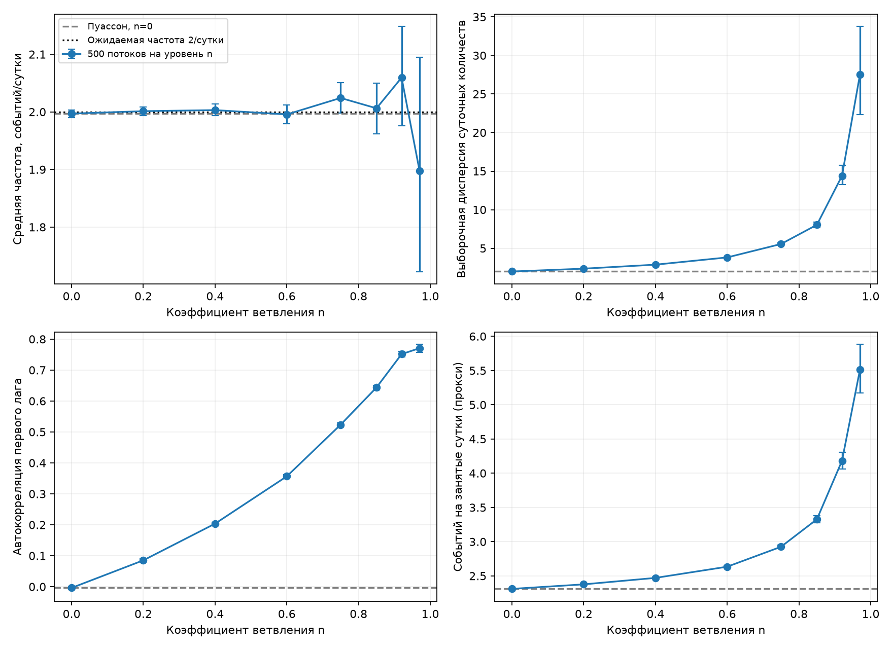

*Рисунок 2. P1: по 500 повторов на уровень n. Полосы — процентильные 95% интервалы средних показателей по потокам, 2 000 бутстреп-повторов целых потоков. Это погрешность Монте-Карло, не интервал n. Пилот P0 сохранён отдельно.*

### 5.2. Карта ошибок MLE

В R1 исследованы n=0, 0.5, 0.8, 0.9, 0.95; интенсивности 0.2, 2, 20 и 50 событий/сутки; окна 30, 90, 180 и 360 суток. Каждая пара n/интенсивность имеет 500 независимых повторов. Длины окон сравниваются на одном потоке.

Для истинного n=0.95 и интенсивности 20/сутки MAE среди валидных оценок уменьшилась с 0.059 на 90 сутках до 0.017 на 360. В последней ячейке валидны 99.2% подгонок. AUC различения оценок n=0.9 и n=0.95 увеличился примерно с 0.719 до 0.940.

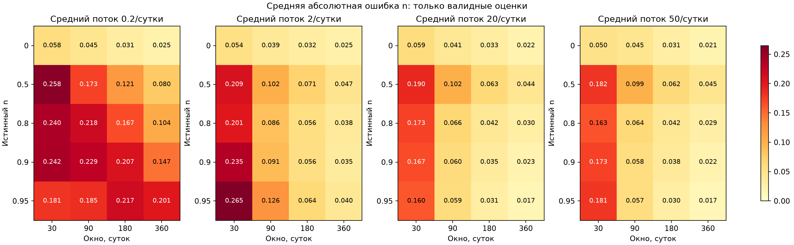

*Рисунок 3. R1: MAE среди валидных оценок. Доли неудач и вероятность точной оценки среди всех повторов сохранены отдельно.*

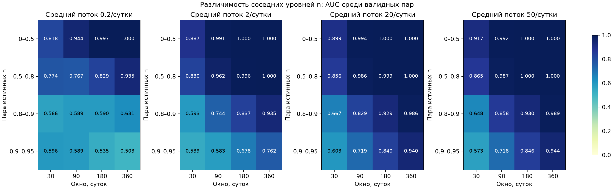

*Рисунок 4. R1: AUC оценок соседних n. Это различимость по исследуемому оценивателю, а не качество будущего предупреждения.*

Длинное стационарное наблюдение улучшает восстановление параметра, но редкие события остаются трудным случаем. В нестационарном потоке длинное окно дополнительно смешивает прошлые режимы.

### 5.3. Влияние фоновой интенсивности

Риск смешения изменения фона с самовозбуждением обсуждается у [Filimonov, Sornette](https://arxiv.org/abs/1308.6756); влияние неверно заданной иммиграции на коэффициент ветвления исследовано у [Wheatley, Filimonov, Sornette](https://arxiv.org/abs/1407.7118). В R2 этот риск проверяется на потоках с известными параметрами.

Сравниваются постоянный неизвестный фон, полностью известный фон, известная форма со свободным уровнем, полностью фиксированный прогноз по прошлому и форма этого прогноза со свободным уровнем. Истинный фон — привилегированный ориентир. Прогноз обучается только на 730 сутках предыстории и не получает будущих счётчиков или меток сценария.

| Сценарий, 20/сутки, окно 360 | Постоянный фон | Форма по прошлому, уровень оценивается |
|---|---:|---:|
| Сезонный Пуассон, истинное n=0 | 0.909 | 0.024 |
| Хоукс, истинное n=0.9 | 0.886 | 0.895 |

В таблице приведены средние валидные оценки n. Коррекция формы снижает ложное самовозбуждение в сезонном контроле и сохраняет высокий n в положительном контроле. Однако новые скачки после фонового обучения остаются проблемой.

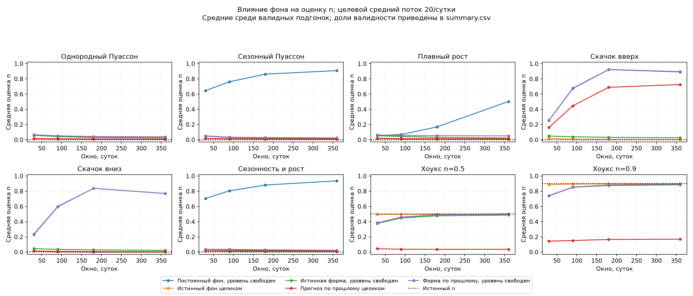

*Рисунок 5. R2: известная форма, известный уровень и оценённый по прошлому фон дают разные задачи оценивания.*

Если на Хоуксе n=0.9 зафиксировать весь пуассоновский прогноз счётчиков как μ, средняя оценка n снижается до 0.170. Прогноз общей частоты не равен иммиграционной интенсивности. Поэтому малая оценка n сама по себе не подтверждает правильную коррекцию.

### 5.4. Полные генеалогические кластеры

Отдельно от суточного прокси проведён R8: по 100 000 полных деревьев на каждый из восьми уровней n, всего 800 000. Корневое событие находится в момент 0; каждое событие имеет Poisson(n) непосредственных потомков с независимыми задержками Exp(β), β=1/сутки. Имитатор хранит родителя и поколение. Размер S включает корень и всех потомков; дерево не обрезается границей года. При превышении защитного лимита возвращается ошибка, а не усечённый кластер.

Из S=1+Σ S_j следуют m=1+nm и v=nv+nm², поэтому

<p align="center">
  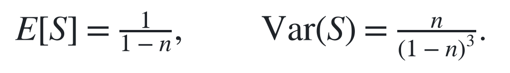
</p>

| n | Средний полный размер | Теория | 95% квантиль размера | Вероятность S≥100 |
|---:|---:|---:|---:|---:|
| 0 | 1.000 | 1.000 | 1 | 0% |
| 0.75 | 3.974 | 4.000 | 15 | 0.021% |
| 0.92 | 12.472 | 12.500 | 54 | 2.513% |
| 0.97 | 32.634 | 33.333 | 114 | 5.566% |

При n=0.97 95% квантиль длительности равен 25.57 суток. Большая разница между медианой размера 2 и средним 32.63 отражает редкие крупные каскады. Средняя оценка согласуется с теоретическим ориентиром в пределах приближённой погрешности Монте-Карло; вблизи единицы хвост тяжёлый, поэтому конечная выборка не воспроизводит все моменты точно.

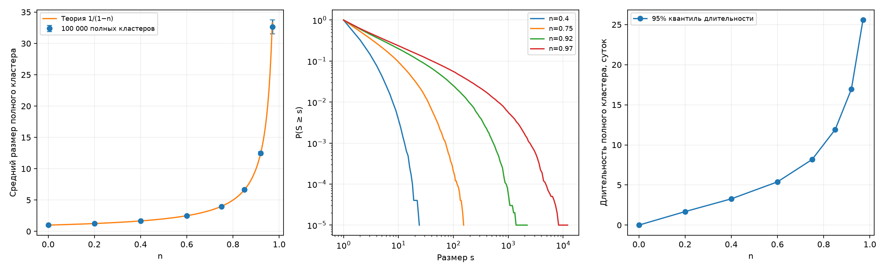

*Рисунок 6. R8: средний размер, хвостовая вероятность и длительность полных кластеров. Полосы среднего — приближённые 1.96 Monte Carlo SE. Полная генеалогия доступна в имитации и не подаётся детектору реальных событий.*

Кластерное представление согласуется с [Hawkes и Oakes](https://doi.org/10.2307/3212693) и [Bordenave и Torrisi](https://doi.org/10.1080/15326340701645959). Частота иммигрантов μ=2(1−n) сохранила бы среднюю общую интенсивность 2/сутки; размер отдельного дерева не зависит от μ. Это выборка по корневым кластерам, а не по случайно выбранным событиям, которые чаще принадлежат большим кластерам.

## 6. Нейросетевые и статистические детекторы

### 6.1. Протокол окончательной проверки R4

Использованы 13 семейств: плавные и внезапные пересечения, рост без пересечения, стабильные низкий, высокий и близкий к порогу режимы, снижение из высокого n и внешние пуассоновские изменения фона. На семейство выделено 150 обучающих, 150 предварительных калибровочных, 150 валидационных, 300 итоговых калибровочных и 300 тестовых потоков.

Для двух задач обучены отдельные MLP на трёх инициализациях — 17, 29 и 41. Сравнивались окна 30–360 суток и наборы из 16, 39 и 64 признаков. Нормировка обучалась только на train. Окно и первичный метод выбирались на validation по ансамблю всех seed; лучший seed по тесту не выбирался.

До генерации финального теста сохранены выбор, пороги и SHA-256 весов. Сведения о n и семействе использовались для меток и анализа, но не как входы реализуемых сетей.

### 6.2. Итог R4

| Задача и выбранная модель | AUC | Чувствительность высоких / положительных окон | Обнаруженные положительные потоки |
|---|---:|---:|---:|
| Состояние: календарная MLP, окно 360 | 0.972 | 2.9% | 116 из 1200 |
| Предупреждение: MLP с обычным MLE, окно 180 | 0.852 | 0.0% | 0 из 600 переходов |

116 из 1200 — вероятность хотя бы одного распознавания на положительном потоке; она имеет другой знаменатель, чем TPR окон. Для нулевого обнаружения переходов верхняя Wilson-граница 95% составляет около 0.64%. Ноль на выборке не доказывает нулевую популяционную вероятность.

Максимальная семейная доля траекторий с ложной тревогой составила 1.0% среди ансамблей и классических ориентиров и 1.7% с учётом отдельных seed. При таком контроле полезная чувствительность раннего предупреждения не подтверждена.

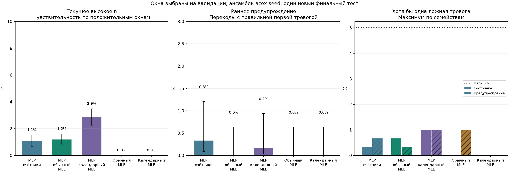

*Рисунок 7. R4: окна и первичные методы выбраны до теста. Два вида чувствительности имеют разные знаменатели.*

### 6.3. Диагностика причин R5

На новой выборке сравнивались правила калибровки одинаковых scores и парные малые MLP с одинаковой архитектурой, seed и данными. Парные модели получали три прошлых n, наклон, проекцию и флаги валидности. Источник n заменялся: истина симуляции, обычный MLE или календарный MLE последних завершённых стадий.

При строгом одинаковом правиле парная модель с истинной прошлой историей дала clean recall 31.2%, с календарными MLE — около 0.2%. Максимальные семейные ложные тревоги у обеих составили 1.0%. Это свидетельство существенных потерь при замене истинной истории оконными оценками, включая их пропуски. **31.2% не является результатом детектора на реальных наблюдениях:** истинный n там недоступен.

У одного и того же основного state-score номинальная семейная калибровка дала TPR 12.9% при максимальных ложных 4.3%; доверительная поправка на охват этапа 4 — TPR 2.2% при ложных 0.3%. Для предупреждения ослабление до номинального варианта дало clean recall только 1.3% при ложных 4.0%. Поэтому низкое качество не объясняется одной строгостью порога.

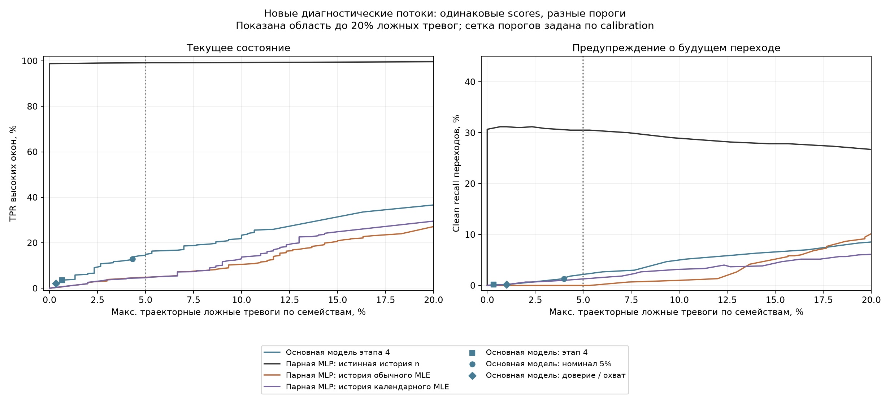

*Рисунок 8. R5: кривые описательные, сетка задана по calibration. Новый рабочий порог по evaluation не выбирается.*

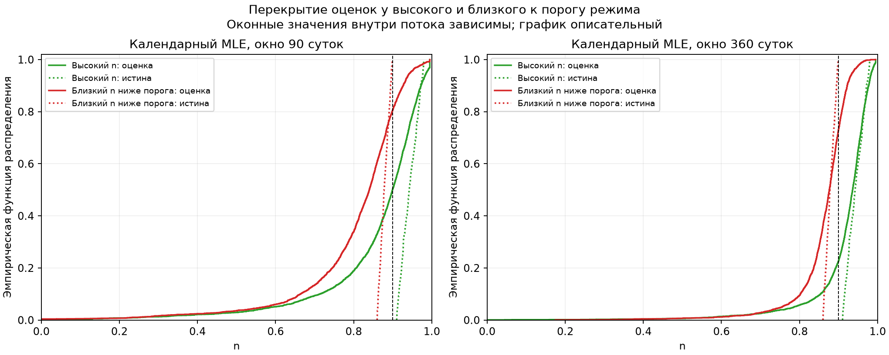

*Рисунок 9. R5: распределения оценок у высокого и близкого к порогу n перекрываются, особенно на коротком окне. Оконные наблюдения внутри потока зависимы.*

Для предупреждения максимальную границу задавал рост n без пересечения. Исключение стабильного близкого к порогу контроля из calibration порог не изменило. Общий AUC по смеси может скрывать эту трудную пару: у основной модели AUC плавного пересечения против роста без пересечения составил около 0.589, против однородного Пуассона — около 0.970.

Ошибки оценки, обучение классификатора и калибровка взаимодействуют. Парные разности R5 не складываются в точное процентное разложение ошибки исходной сети с 64 признаками.

### 6.4. Заключительная проверка причинной динамической оценки

В R6 проверен один фильтр локального линейного тренда с состоянием x=(n,s), где s — изменение за один 90-суточный шаг. Он использует только завершённые неперекрывающиеся блоки календарного MLE. Рекурсивная схема опирается на [Kalman (1960)](https://doi.org/10.1115/1.3662552), но здесь ограничение состояния и приближённая модель ошибок MLE не позволяют заявлять оптимальность для Хоукса.

Рабочая дисперсия наблюдения обучена по фактическим квадратам ошибок на обучении в 16 ячейках оценённого n и curvature SE. Из 8 сочетаний параметров на валидации выбраны q=0.1 и затухание наклона ρ=0.9. При пропуске выполняется прогноз с ростом ковариации, без обращения к будущему; допускаются не более двух подряд пропущенных блоков. Точный алгоритм и критерий пригодности заранее сохранены в [протоколе R6](results/dynamic_estimation/protocol.json).

Использованы 11 700 новых потоков: по 150 обучающих, 150 валидационных, 300 калибровочных и 300 финальных на каждое из 13 семейств. Параметры, веса и пороги заморожены до генерации финальной выборки. Все трудные отрицательные контроли сохранены.

| Оцениватель | MAE, среднее по 13 семействам | MAE на высоком/близком n | Доля допустимых оценок | Средняя ограниченная задержка внезапного перехода, сутки |
|---|---:|---:|---:|---:|
| Обычный MLE 90 суток | 0.1538 | 0.1025 | 98.37% | 215.1 |
| Календарный MLE 90 суток | 0.0875 | 0.1008 | 98.37% | 213.9 |
| Календарный MLE 360 суток | 0.0935 | 0.0426 | 99.90% | 288.0 |
| Причинный фильтр | 0.0817 | 0.0872 | 99.72% | 272.4 |

Относительно календарного MLE 90 суток ошибка уменьшилась примерно на 6.7% в среднем и на 13.5% в группе высокого/близкого n. Парная разность MAE на всех потоках равна −0.0058 с бутстреп-интервалом [−0.0065; −0.0051]. На внезапных переходах MAE, напротив, увеличилась на 0.0054 [0.0022; 0.0087]. Интервалы условны на выбранных настройках и обучении.

Задержка измеряется после истинного внезапного перехода; первый завершённый высокий блок доступен лишь через 90 суток. Пропущенные пересечения оценки n=0.9 не удаляются: используется предел T−τ+90 суток. Фильтр обнаружил 237/300 таких переходов против 250/300 у календарного MLE 90 суток. Средняя ограниченная задержка увеличилась на 58.5 суток. Заранее установленный валидационный критерий допустил такой компромисс, но он не означает улучшения всех характеристик.

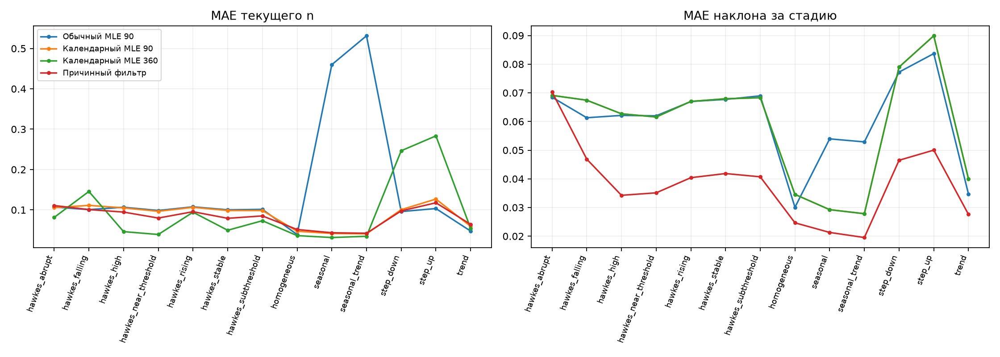

*Рисунок 10. R6: MAE текущего n и причинной секущей (n[k]−n[k−2])/2 по семействам. Для длинного окна наклон по-прежнему вычисляется по коротким блокам.*

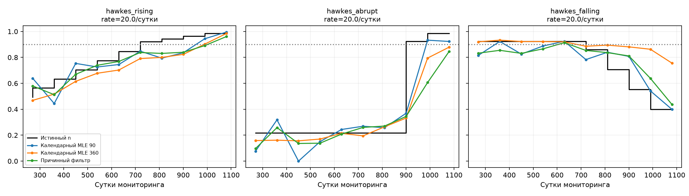

*Рисунок 11. R6: по одному примеру роста, скачка и снижения. Представитель выбирается заранее заданным правилом близости проектной интенсивности к 20/сутки, без подбора по ошибке. Точка оценки использует только события к этому моменту.*

Для проверки неопределённости отдельно откалиброваны полосы n и наклона по максимуму ошибки целой траектории. Номинальное покрытие 95% относится к новой обменной траектории того же семейства, раздельно для двух параметров; это не совместное доверие для всех семейств при фиксированной калибровке. У фильтра минимальное эмпирическое семейное покрытие n составило 96.33%, но средняя ширина полосы — 0.7909 на шкале [0,1]. Такие интервалы малоинформативны для уверенного различения n=0.9 и соседнего режима. У календарного MLE 360 суток минимальное наблюдаемое покрытие оказалось лишь 90.33%; номинальный уровень не выдаётся за достигнутый в каждом семействе финального теста.

После изменения признаков обе сопоставимые MLP обучены заново на 8 признаках с seed 61, 73, 89. При основной калибровке с общим доверием 95% для 24 оценок ансамбль с календарным MLE дал TPR состояния 2.82%, с фильтром — 2.03%. Чистых предупреждений получено 0/600 и 2/600 (0.33%) соответственно; максимальная семейная доля ложных тревог предупреждения равна 1.33% в обоих случаях. Два успешных предупреждения не подтверждают практическую надёжность или устойчивый выигрыш сети.

R6 подтверждает умеренное уменьшение ошибки параметра ценой запаздывания. Задача качественного раннего предупреждения остаётся нерешённой в проверенном протоколе. Новые модели не заменяют первичные модели R4; дальнейший подбор по тому же финальному тесту прекращён.

### 6.5. Расширенное обучение R9

После проверки исходных условий проекта проведена одна дополнительная попытка по [заранее установленному протоколу](reproducibility/documentation_archive.zip). Обучение расширено с 1 950 потоков R4 до 7 800: использованы только прежние train-части R4/R5/R6 и 1 950 новых потоков. Старые валидации, калибровки и финальные выборки в обучение не включены. Новые валидация, калибровка и тест содержат 1 950, 3 900 и 3 900 потоков соответственно.

Сеть получает 128 наблюдаемых признаков окон 90 и 360 суток. Общая часть 128→64→32 с ReLU и dropout 0.1 заканчивается тремя выходами: состояние, предупреждение и вспомогательная оценка текущего n. Потеря сочетает две взвешенные BCE и MSE текущего n; истинный n используется только как обучающая цель. AdamW, lr=0.001, weight decay=0.001; не более 200 эпох. Эпоха выбирается по новой валидационной потере. Для seed 101, 113 и 127 выбрана эпоха 200; первичный результат — среднее трёх сетей, объявленное до теста.

Основная калибровка сохраняет цель 5% ложных тревог на траекторию с совместным доверием 95% для 12 новых оценок и активных семейств. Номинальная семейная калибровка — отдельная заранее объявленная проверка чувствительности. Старые первичные R4 оцениваются на том же новом тесте с прежними весами и порогами.

| Модель на новом тесте | TPR состояния | Чистое предупреждение | Максимальная семейная ложная тревога: состояние / предупреждение |
|---|---:|---:|---:|
| Замороженные первичные R4 | 3.28% | 1/600 = 0.17% | 0.67% / 0.33% |
| R9, строгая калибровка | 3.84% | 5/600 = 0.83% | 1.00% / 0.67% |
| R9, номинальная калибровка | 13.65% | 27/600 = 4.50% | 4.33% / 5.00% |

95% Wilson-интервал чистого предупреждения R9 при строгой калибровке — [0.36%; 1.94%]. AUC состояния равен примерно 0.975, предупреждения — 0.890. Средняя MAE вспомогательной оценки n по 13 семействам составляет 0.0426, без заявления её переноса на истинный n городских событий.

Парное увеличение TPR состояния относительно старой модели на общем новом тесте равно 0.56 процентного пункта, бутстреп-интервал [0.11; 0.99]. Для предупреждения разность равна 0.67 пункта с интервалом [0; 1.47]. Пересэмплируются целые траектории; интервалы условны на обучении и калибровках. Это сравнение готовых вариантов, а не изолированное доказательство эффекта только объёма обучения: одновременно изменились признаки, архитектура, потеря и охват калибровки.

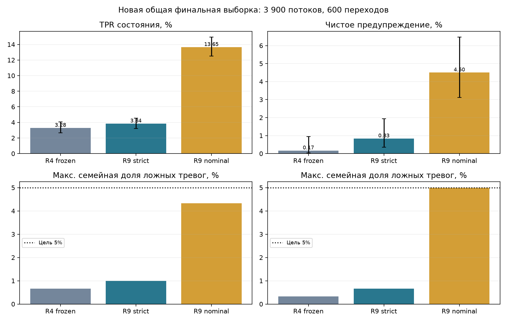

*Рисунок 12. R9: TPR, чистое предупреждение и ложные тревоги на одной новой выборке. Строгий и номинальный варианты имеют разный смысл калибровочного доверия. Победитель по тесту не выбирался.*

Расширение обучения улучшило отдельные показатели, но практически надёжное предупреждение не получено. Даже при номинальной калибровке пропущены 573 из 600 переходов. Следующий поиск архитектур по этому тесту прекращён; отрицательный результат включён в итог работы.

## 7. Эмпирическая иллюстрация

### 7.1. Источники

Первоначальный архив CODE за 2020–2021 содержит 3 753 014 записей в 17 городах. При завершении проекта напрямую проверен список файлов OSF и добавлены core за 2018, 2019 и 2022. Номинальный интервал расширенной панели — 2018–2022, 9 543 104 записи в 17 городах; фактическое покрытие каждого города проверяется отдельно. Система гармонизации CODE описана [Ashby](https://doi.org/10.1163/24523666-00401007).

Для более новых примеров использованы прямые выгрузки [City of Chicago](https://data.cityofchicago.org/Public-Safety/Crimes-2001-to-Present/ijzp-q8t2) и [NYC Open Data / NYPD](https://data.cityofnewyork.us/Public-Safety/NYPD-Complaint-Data-Historic/qgea-i56i) за 2024–2025 годы. Они не называются обновлённой версией CODE. Поля времени, число записей и правила дедупликации зафиксированы в документации данных.

Дополнительно скачаны минимальные поля времени и идентификатора из четырёх порталов: Chicago, NYC, [San Francisco](https://data.sfgov.org/Public-Safety/Police-Department-Incident-Reports-2018-to-Present/wg3w-h783) и [Seattle](https://data.seattle.gov/Public-Safety/SPD-Crime-Data-2008-Present/tazs-3rd5). Период — 2019–2025 и январь–сентябрь 2026. В актуальном наборе NYC доступно по сентябрь; поэтому общий конец назначен 1 октября 2026, исключительно. 2026 не является полным годом.

Получены 7 395 987 городских строк; после разбора времени и дедупликации осталось 7 146 403 дела/отчёта. У CODE uid — годовой идентификатор записи; он дополнен годом источника, чтобы не удалить разные записи разных лет с одинаковым числом uid. Единица CODE — правонарушение, порталов — дело/отчёт с самым ранним наблюдаемым временем. Категории порталов и CODE не унифицированы; абсолютные частоты не сравниваются как риск преступности.

### 7.2. Сравнение фоновых моделей

Модели обучались на 2024 году; условный log-likelihood проверялся на 2025 году. Пуассон и Хоукс в каждой паре имеют одинаковую календарную спецификацию. Сравнивались месяц и день недели, а затем дополнительно час суток.

| Город | Фон | Оценка n | Разность test LL: Хоукс минус Пуассон |
|---|---|---:|---:|
| Chicago | Месяц и день недели | 0.4752 | 2921.38 |
| Chicago | Дополнительно час суток | 0.0368 | −112.40 |
| New York City | Месяц и день недели | 0.7480 | 19463.88 |
| New York City | Дополнительно час суток | 0.2943 | 590.25 |

После учёта часа суток прежний выигрыш Хоукса в Chicago исчезает. В NYC остаётся небольшой выигрыш — около 0.001040 log-likelihood на событие. Это сравнение выбранных спецификаций, а не измерение истинной критичности.

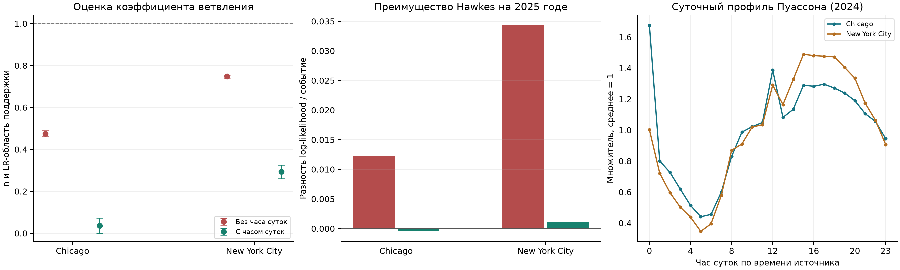

*Рисунок 13. E1: сравнение на одинаковых событиях и отложенном периоде. Источники — прямые городские выгрузки.*

### 7.3. Ограничения интерпретации

Данные содержат зарегистрированные события и отражают процессы учёта. Время преимущественно имеет минутную точность; совпадающие метки группируются без придуманного порядка. Это приближение continuous-time likelihood для округлённых наблюдений. Внутричасовая концентрация на круглых отметках и особенности локального времени полностью не моделируются.

При n=0 скорость затухания не идентифицируется. Поэтому профильная LR-область поддержки не выдаётся за доверительный интервал с гарантированным номинальным покрытием на границе.

Истинный n и моменты перехода на городских данных неизвестны. Их нельзя использовать как размеченное подтверждение полноты нейросетевого предупреждения. Первоначальная двухлетняя выгрузка не обеспечивала отдельную двухлетнюю предысторию и последующий мониторинг R4. Расширение истории устранило это ограничение там, где есть достаточное фактическое покрытие. Агрегированные городские интенсивности по-прежнему выходят за обучающий диапазон 0.2–50 событий/сутки. Нормировка признаков сама по себе не подтверждает перенос.

### 7.4. Применение замороженных детекторов к расширенной панели

В R7 каждый блок содержит 730 суток предыстории и 12 стадий по 90 суток: 10 решений состояния и 8 решений с полностью наблюдённым будущим горизонтом 180 суток. Для CODE выбран первый полный блок 1810 суток с начала 2018 года. Для каждого портала выбраны первый и последний доступные блоки той же длины; поздний заканчивается 1 октября 2026. Правило задано до просмотра scores, периоды не подбирались по наличию тревог.

У Chicago в CODE отсутствуют октябрь–декабрь 2022, у Houston и Minneapolis — весь 2018. Эти три ряда исключены из применения с требованием полной истории; пропуски не заменены нулевыми событиями. Применение выполнено для остальных 14 городов CODE и четырёх порталов, всего 22 блока и 220 решений. Ранние и поздние портальные блоки перекрываются, поэтому это не 22 независимые реализации.

| Поздний портальный блок | Средняя частота, событий/сутки | Доля признаков вне центральных 99% обучения | Срабатывания состояния / предупреждения R9 |
|---|---:|---:|---:|
| Chicago | 674.9 | 6.25% | 0/10 / 0/8 |
| NYC | 1517.2 | 11.17% | 0/10 / 0/8 |
| San Francisco | 258.9 | 6.25% | 0/10 / 0/8 |
| Seattle | 191.2 | 6.25% | 0/10 / 0/8 |

Обе замороженные модели — R4 и R9 — не пересекли рабочие пороги ни в одном из 22 блоков. Это описание работы алгоритма, а не нулевая вероятность ложной тревоги: истинная критичность неизвестна. Нельзя также заключить, что критических режимов в городах не было. Доли признаков вне центрального обучающего диапазона являются описательной диагностикой сдвига, а не формальным тестом применимости.

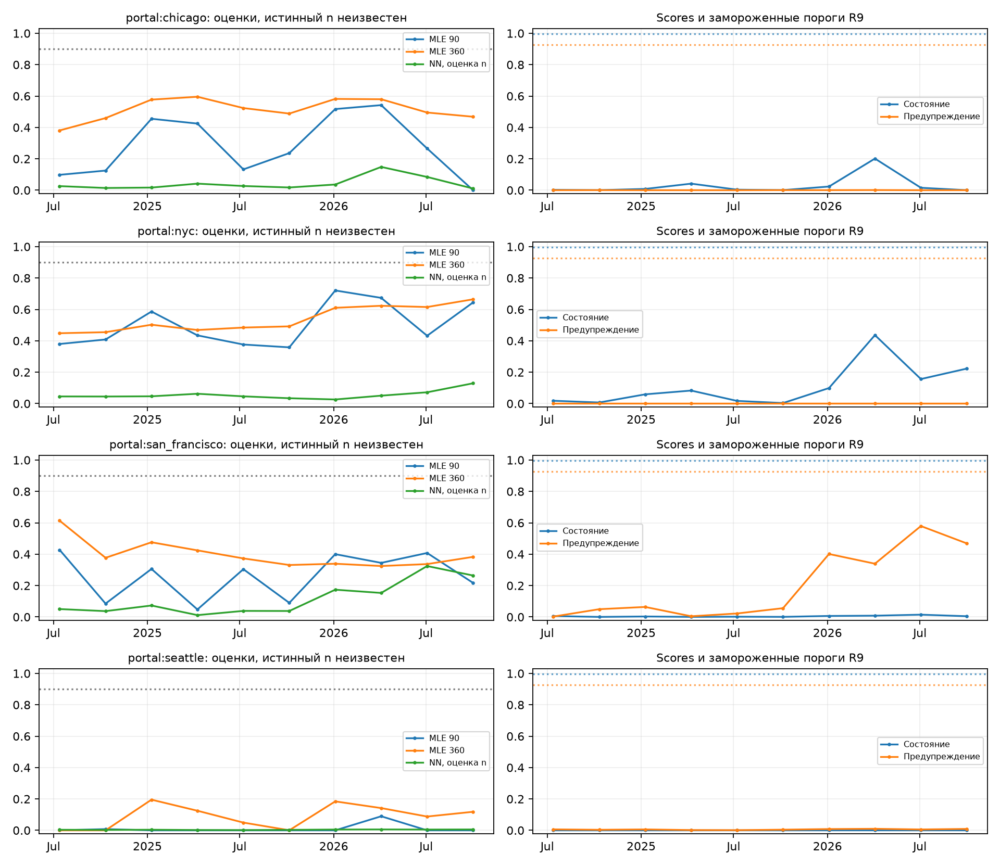

*Рисунок 14. R7: оценки и scores на поздних городских блоках, включая январь–сентябрь 2026. Пунктир справа обозначает заранее замороженные пороги; оценки слева не являются истинным n.*

Калибровочная гарантия ложных тревог из симуляции не переносится автоматически на эти источники. Неизвестные городские n не заменялись MLE или выходом сети для её дообучения. Эмпирическое применение закрывает исходную проверку на реальных данных в оговорённом иллюстративном смысле; валидация истинной критичности без разметки не заявляется.

### 7.5. Дополнение R10: прогноз «район × 6 часов»

В R10 введена отдельная наблюдаемая цель: число зарегистрированных происшествий выбранных категорий в каждом полицейском округе в следующем интервале [t,t+6 часов). В отличие от городского n, эту цель можно проверить по отложенным записям. Рассматриваются 22 округа Chicago и 10 округов San Francisco. Это прогноз агрегированного количества и вероятности высокого потока; точный момент отдельного преступления не предсказывается.

**Данные и разбиение.** Из прямых порталов отдельно выгружены поля района и времени за 2019–2025 и январь–сентябрь 2026. После очистки и удаления повторных строк одного дела осталось 1 176 356 дел Chicago и 423 703 отчёта San Francisco. Отобраны кражи, кражи со взломом, грабежи, угон транспорта и нападения; Assault/Battery Chicago объединены. Определения категорий двух источников не тождественны, поэтому модели сравниваются внутри города. Неизвестные и конфликтующие районы исключены с учётом в манифестах. Пустые интервалы представлены нулевыми количествами, но отсутствующие месяцы проверяются отдельно и не заполняются молча.

Обучение — март 2019 — декабрь 2023 после 60 суток прогрева; валидация — первое полугодие 2024; калибровка тревог — второе полугодие 2024. Веса, параметры и пороги фиксируются до расчёта итоговых метрик 2025 и января–сентября 2026. Тестовые временные строки не перемешиваются с обучением. При последовательном прогнозе используются прошлые наблюдения тестового периода по мере их доступности. Протокол, исходные хеши, выбранные эпохи и все 40 сравнений сохранены в [R10](results/spatiotemporal_forecast/protocol.json).

Основной информационный лаг — 7 суток, вариант без лага сохранён как анализ чувствительности. Для SF дополнительно известен `report_datetime`: признаки используют только уже зарегистрированные отчёты; цели обучения, валидации и калибровки ограничены датой соответствующего решения. Здесь 55.0% отчётов зарегистрированы позже шести часов от инцидента, 11.4% — позже семи суток. Поэтому дата инцидента сама по себе не означает доступность события прогнозисту. У Chicago время первичной регистрации отсутствует. Семидневный лаг — приближение, а современные архивы не восстанавливают исторические исправления обоих источников. Результаты являются ретроспективной проверкой с частичным учётом задержек, а не доказанной оценкой оперативного внедрения.

**Модели.** Сезонный фон B[d,t] учитывает район, день недели, шестичасовой слот и месяц. Адаптивный вариант корректирует его по наблюдаемой частоте последних 28 суток. Дискретные самовозбуждающиеся модели задают среднее

<p align="center">
  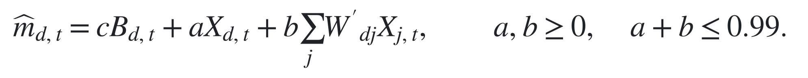
</p>

X — экспоненциальная память доступной истории; во временной версии b=0. Граф связывает три ближайших центра событий обучения, а не точные соседние границы районов. Матрица W′ масштабирована обучающими частотами. Коэффициенты этой дискретной модели не объявляются истинным непрерывным n города. MLE оценивает параметры, длина памяти выбирается по валидации из 6, 24 и 72 часов.

Нейросеть имеет embedding района и два скрытых слоя 32→16; она оценивает логарифмическую поправку к B по календарю и причинным историям собственного района, соседей и города. Обучены три заранее заданных seed, используются все три сети. Эпохи выбираются по валидационной Poisson NLL. Рабочая отрицательно-биномиальная дисперсия каждого метода оценивается только по обучению. Основной метод количества выбран по валидационной NB NLL: нейросетевой ансамбль в обоих городах. Это заранее выбранный метод, даже когда другой лучше на тесте.

| Город / период | MAE календарного фона | MAE адаптивного фона | MAE временной модели | MAE пространственной модели | MAE нейросети |
|---|---:|---:|---:|---:|---:|
| Chicago, 2025 | 1.970 | 1.856 | 1.868 | 1.868 | 1.837 |
| Chicago, январь–сентябрь 2026 | 1.988 | 1.871 | 1.878 | 1.878 | 1.858 |
| San Francisco, 2025 | 2.300 | 1.435 | 2.142 | 2.142 | 1.444 |
| San Francisco, январь–сентябрь 2026 | 2.468 | 1.415 | 2.281 | 2.281 | 1.437 |

MAE измеряется в событиях на район и шестичасовой интервал. Среднее фактическое количество в тесте 2026 — 4.74 в Chicago и 2.23 в SF. Снижение MAE нейросети относительно фиксированного календаря составило 6.6% и 41.8% соответственно, но сильный адаптивный фон в SF оказался лучше нейросети. Разность MAE «нейросеть минус адаптивный фон» на 2026 равна −0.0134 [−0.0188; −0.0081] в Chicago и +0.0213 [0.0094; 0.0341] в SF. Интервалы получены дополнительным описательным парным бутстрепом 14-суточных блоков вместе со всеми районами, 1000 повторов; они условны на выбранных моделях. Этот анализ не меняет выбор основного метода по тесту.

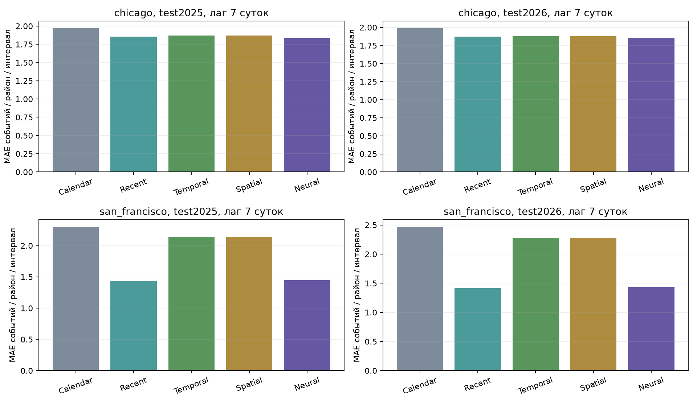

*Рисунок 15. R10: ошибка количества при лаге 7 суток. Все методы проверены на одинаковых будущих интервалах; большой выигрыш относительно фиксированного фона SF не означает преимущество над адаптивным фоном.*

Дополнительный коэффициент пространственной памяти оказался практически нулевым; пространственная версия не улучшила временную. Это результат конкретного графа, памяти и информационного лага. Сам район остаётся важным входом календарного фона и нейросети. Номинальные 95% интервалы нейросети в 2026 покрывают 97.54% количеств Chicago и 98.47% SF при средней ширине 9.15 и 6.65 событий: они широки и не дают точного знания будущего количества.

**Всплески.** Метка определяется строгим превышением обучающей 95% квантили района × дня недели × слота. Доля таких меток в будущем не обязана равняться 5%: распределение меняется. Отдельный метод всплеска выбран по валидационной AP — нейросеть Chicago и адаптивный фон SF. Порог тревоги калибруется с целью 5% FPR отрицательных ячеек второго полугодия 2024. Это контроль ячеек, отличный от траекторного контроля R4–R9; общей гарантии для всех районов и нового распределения нет.

| Город / период | Доля всплесков | AP выбранного метода | Полнота | FPR ячеек | Обнаружено всплесков |
|---|---:|---:|---:|---:|---:|
| Chicago, 2025 | 3.758% | 0.0665 | 1.326% | 0.472% | 16 / 1 207 |
| Chicago, январь–сентябрь 2026 | 4.042% | 0.0721 | 2.266% | 0.464% | 22 / 971 |
| San Francisco, 2025 | 0.767% | 0.0169 | 0.893% | 0.283% | 1 / 112 |
| San Francisco, январь–сентябрь 2026 | 0.568% | 0.0160 | 0% | 0.111% | 0 / 62 |

AP выше частоты метки, но большинство всплесков пропущено. Низкий общий FPR не означает высокий охват или соблюдение 5% в каждом районе: максимальный районный FPR выбранной сети Chicago в 2026 составляет 5.34%. Замороженные пороги не подстраивались под тест. В SF падение общего уровня уменьшило долю превышений старого порога; это иллюстрирует дрейф, а не успешное предсказание отсутствия всплесков.

Анализ чувствительности без искусственного семидневного лага даёт в 2026 MAE нейросети 1.849 в Chicago и 1.378 в SF; здесь сеть SF уже немного лучше адаптивного фона с MAE 1.391. Полнота выбранного метода всплеска Chicago возрастает до 4.43% при FPR 0.56%, у SF остаётся 0%. Таким образом, вывод о сравнении с адаптивным фоном зависит от информационного лага, а низкая полнота всплесков сохраняется. Даже при лаге 0 SF использует фактическую дату регистрации: это не предположение мгновенной доступности всех инцидентов. В Chicago отсутствие этой даты делает нулевой лаг более оптимистичным.

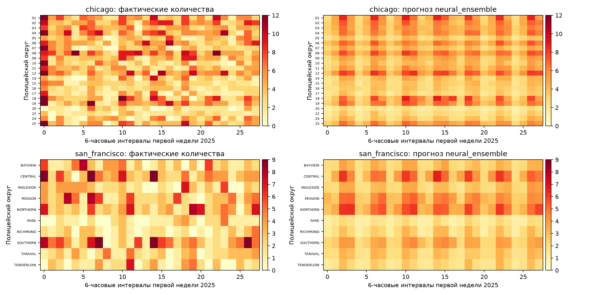

*Рисунок 16. R10: фактические и прогнозируемые количества первой недели января 2025, выбранной до оценки. По горизонтали — 28 шестичасовых интервалов, по вертикали — округа. Ожидаемое количество сглаживает случайные колебания; совпадение средних профилей не означает обнаружение отдельных всплесков.*

**Выдача прогноза.** Команда `python -m critical_processes.district_forecast --city chicago` сохраняет ожидаемое количество, рабочий интервал, вероятность и сигнал всплеска для каждого округа. По умолчанию показан следующий интервал на границе сохранённого архива — 1 октября 2026, 00:00–06:00 местного времени. Это датированный пример; для текущего ноября данных в архиве нет. Фактическое количество в этой выдаче остаётся пустым и не подменяется нулём.

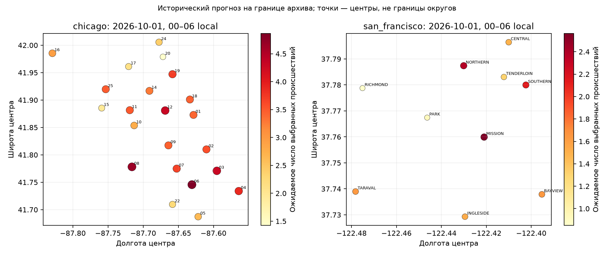

*Рисунок 17. R10: ожидаемые количества на границе архива, 1 октября 2026, 00:00–06:00. Точки — агрегированные центры обучающих событий округа, а не границы, адреса или конкретные будущие преступления. Цветовые шкалы городов различаются.*

Таким образом, пространственно-временная постановка реализована и проверена отдельно от скрытой критичности. Есть полезная предсказуемость среднего районного потока, особенно при адаптации фонового уровня. Надёжное раннее обнаружение редких всплесков на масштабе «район × 6 часов» полученными моделями не подтверждено. Все метрики и районные разрезы сохранены в [таблицах R10](results/spatiotemporal_forecast/test_metrics.csv), а сравнение с сильным фоном — в [парном анализе](results/spatiotemporal_summary/neural_vs_recent.csv).

### 7.6. R11: последовательная проверка перед внедрением без внешнего пилота

Для исследования, выполняемого самостоятельно, реализован дополнительный ретроспективный эксперимент. Он проверяет обновление моделей, качество вероятностей и работу с задержками без развёртывания в оперативной службе. [Протокол](results/offline_readiness/protocol.json) записан до вычислений, [инструкция](#воспроизведение-и-проверки) позволяет повторить опыт. R1–R10 сохранены без изменения.

**Новая наблюдаемая цель.** Кроме количества прогнозируется существенное превышение причинного фонового уровня: N ≥ ceil(B_adapt + max(2,0.5 B_adapt)), где B_adapt использует только доступную прошлую историю. Это конкретизация «повышения»: учитывается и относительное превышение, и минимум два дополнительных события. Она отличается от исторической 95% квантили R10. Сравнивать проценты полноты между R10 и R11 как улучшение одного и того же детектора некорректно.

Панель разделена на имущественные случаи и нападения/грабежи; при смешанных выбранных категориях одного дела приоритет у второй группы. Их суммы дают общий ряд, который не является независимым третьим повторением. Добавлены календарь федеральных праздников и соседних дней, длительная память и embedding группы. Внешние сведения о будущей погоде/мероприятиях не подменялись фактической будущей погодой: проверенного архива доступных тогда прогнозов в этом опыте нет.

**Разделение по времени.** Модели обновляются на 1 января 2024/2025/2026 и 1 октября 2026. У каждого винтажа отдельные прошлые обучение, валидация, калибровка вероятностей и последующая калибровка районных порогов. Обучение использует не более трёх лет; цели каждого блока имеют 28 суток на накопление регистраций. Основная история имеет лаг 7 суток, SF дополнительно report_datetime + условные 3 суток публикации; стресс-сценарий — 14 и 7 суток соответственно. Предполагаемые задержки не выдаются за фактические исторические даты публикации.

2025 и январь–сентябрь 2026 уже просматривались в R10 и здесь используются как проверки разработки. Октябрь загружен отдельно: 12 913 новых исходных строк Chicago и 2 773 SF. В расширенной панели всего 1 615 572 дела/отчёта. Новые строки известных исторических case ID не могут задним числом менять группы обучения. Основной новый контроль — 1–14 октября, дополнительный — весь октябрь. Оба предварительные: поздние регистрации и правки ещё возможны.

**Модель и журнал.** Ансамбль трёх сетей каждого винтажа имеет две головы — количество с Poisson loss и классификацию превышения с BCE. Для той же сети отдельно проверяется NB-вероятность из головы количества: это позволяет сравнить два способа получения тревоги при одинаковом прогнозе среднего. Простые ориентиры — сезонный и адаптивный фон. Методы выбираются по валидации, вероятность калибруется монотонной логистической поправкой, порог — отдельно по округу и группе на другом блоке, с целью 5% FPR отрицательных ячеек. Это не 95% верных тревог и не гарантия при дрейфе.

До расчёта метрик зафиксированы веса и 136 месячных файлов прогнозов без исходов. Сохранены хеши параметров, журнал и отметка начала оценивания. Это воспроизводимый ретроспективный прогон, а не утверждение, что прогнозы действительно были выданы в 2024–2026. Для первых двух недель октября имеется один 14-суточный блок: бутстреп не создаёт из него независимую информацию, поэтому границы таких интервалов в интерпретируемой сводке пусты.

На ранее просмотренных январе–сентябре 2026 основным count-методом по валидации оказался адаптивный фон обоих городов. Его MAE — 1.852 в Chicago и 1.306 в SF; у новой сети — 1.861 и 1.326. На новом коротком октябрьском срезе count-метод Chicago — нейросеть с MAE 1.857 против 1.862 адаптивного фона, SF — адаптивный фон с MAE 1.261 против 1.278 сети. Разность Chicago очень мала, а одного блока недостаточно для убедительного интервального вывода.

| Город, 1–14 октября | Выбранный метод превышения | Доля превышений | Полнота | Precision | FPR ячеек | Верных / ложных тревог |
|---|---|---:|---:|---:|---:|---:|
| Chicago | NB-вероятность сети | 11.93% | 5.44% | 17.02% | 3.59% | 8 / 39 |
| San Francisco | Сезонный фон | 10.00% | 12.50% | 15.22% | 7.74% | 7 / 39 |

Выбор сделан по прошлой валидации и не заменяется победителем октября. Например, вторичная NB-вероятность сети SF дала 16.07% полноты и 25.71% precision при FPR 5.16%, но она не была заранее выбранным основным методом. Прямая классификационная голова не обеспечила устойчивого преимущества над вероятностью из модели количества. Нельзя объявить, что проблема редких тревог решена: большинство превышений пропущено, большинство тревог ложные, а целевые 5% FPR не сохраняются автоматически после смены периода.

При увеличенной задержке полнота выбранного метода Chicago на том же октябре равна 6.12%, precision — 10.47%, FPR — 7.10%. Более высокая полнота здесь сопровождается ухудшением ложных тревог. Максимальный районный FPR достигает 44.23% в коротком стресс-срезе. Это подчёркивает необходимость районной проверки и контроля доступности. Основной и полный октябрьский срезы перекрываются и не считаются независимыми тестами.

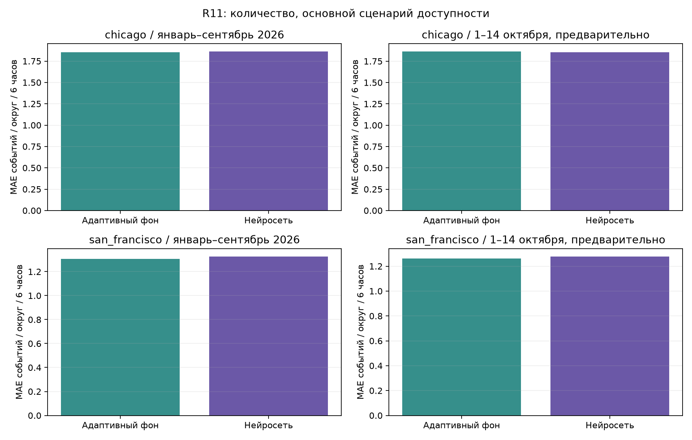

*Рисунок 18. R11: MAE адаптивного фона и нейросети на ранее просмотренном периоде разработки и новом предварительном срезе октября. Все выбранные категории, основной сценарий доступности.*

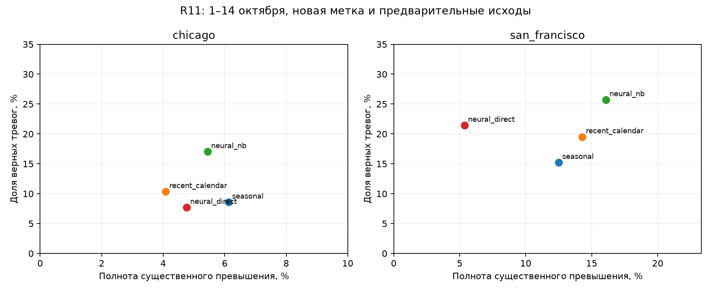

*Рисунок 19. R11: полнота и доля верных тревог на 1–14 октября. Метка — существенное превышение адаптивного уровня, отличная от R10. Доверие к короткому срезу ограничено; все методы сохранены независимо от результата.*

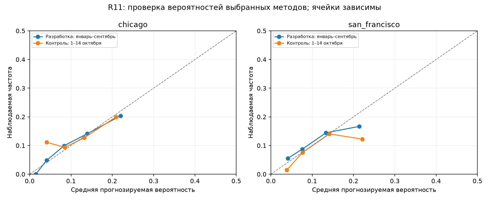

*Рисунок 20. R11: средние прогнозируемые вероятности и наблюдаемые частоты в фиксированных диапазонах scores выбранного метода. Диагональ означает совпадение средних. Ячейки зависимы; кривая не доказывает универсальную условную калибровку.*

**Фактическая доступность и границы внедрения.** Начат собственный журнал наблюдения публичных строк с 10 ноября: 4 304 строки Chicago по updated_on и 568 SF по report_datetime. Сохраняются уникальный идентификатор строки, реальные first_seen/last_seen и хеш содержимого; частичное окно не интерпретируется как удаление отсутствующих строк. Окно SF не обнаруживает все поздние правки старых отчётов. Эти новые наблюдения не используются для выдумывания прошлых дат доступности.

R11 сохраняет статус исследовательского прототипа. Выполнены доступные самостоятельные проверки программы и архивных прогнозов. Эффект применения, полная историческая доступность и качество на длительной независимой будущей истории не подтверждены. Это ограничение эмпирических оснований, а не требование получить разрешение на полицейский пилот для завершения учебного исследования. [Полные результаты](results/offline_readiness/metrics.csv), [месячные разрезы](results/offline_readiness/monthly_metrics.csv), [параметры готовности](results/offline_readiness/readiness.json).

### 7.7. R12: четыре города, общая нейросеть, погода и бустинг

**Объём и назначение данных.** К прежним двум городам добавлены районные записи New York и Seattle за 2019–2026. Общий сопоставимый период — январь 2019 — сентябрь 2026; в нём **4 036 805 зарегистрированных случаев и 114 полицейских округов**, в 2.52 раза больше случаев, чем в R10. Это общий массив обучения, настройки, калибровки и проверок. События теста не объявляются обучающими примерами. Число реально использованных обучающих случаев приведено отдельно в [учёте данных](results/expanded_district_detector/data_summary.csv).

| Город | Округа | Случаи в общем периоде |
|---|---:|---:|
| Chicago | 22 | 1 176 356 |
| San Francisco | 10 | 423 703 |
| New York | 77 | 2 053 043 |
| Seattle | 5 | 383 703 |

Обучающая часть содержит 2 354 861 случай с учётом доступности меток, прогрева и исключений для накопления регистраций. Остальные записи относятся к другим временным ролям либо к исключённым промежуткам; весь общий массив не используется для подгонки весов.

Выбираются сопоставимые широкие группы имущественных событий и нападений/ограблений. Юридические классификации городов различаются. Смешанное дело относится к группе нападений/ограблений; строки отдельных правонарушений не считаются независимыми делами. Сохраняются три цели R11: общая группа и две составляющие. Эти цели зависимы и не являются независимыми повторениями. Адреса, персональные характеристики и индивидуальные координаты в новую выгрузку не включены.

**Дополнительные признаки и методы.** Из NOAA GHCN-Daily загружены данные четырёх станций: TMAX, TMIN, PRCP, SNOW. Отбрасываются значения с флагом ошибки качества; пропуски имеют отдельные индикаторы. Используются наблюдения пятидневной давности, в стресс-сценарии — десятидневной. Фактическая погода будущего интервала не используется; историческое время выпуска и последующих исправлений NOAA неизвестно. Архив прогнозов погоды, массовые мероприятия и мобильность в этом опыте не добавлены.

Заранее заданы семь методов: календарь, адаптивный фон, локальная нейросеть, общая сеть четырёх городов, общая сеть с погодой и два варианта градиентного бустинга. Нейросеть имеет эмбеддинги района/города/группы, слои 64–32 и две головы — количества и превышения. Для каждой версии объединяются seed 331/337/349; в сумме сохранены 18 сетей и два бустинга. Общие сети обучаются со сбалансированным вкладом городов. Нейросетевое обучение критичности R9 при этом не изменяется: здесь прогнозируется наблюдаемая метка R11, истинный n реальных преступлений неизвестен.

**Проверка и доступность.** Обучающие события относятся к 2019–2023, валидация — к первому полугодию 2024, последующие прошлые блоки 2024 используются для отдельной калибровки вероятностей и порогов. Метод для города и группы выбирается по AP валидации; простой ориентир также выбирается по валидации. На калибровке задаётся 5% отрицательных районных ячеек; это не гарантия будущего FPR. Сохранённые прогнозы всех методов зафиксированы без исходов до расчёта тестовых таблиц 2025 и января–сентября 2026. Chicago/SF уже использовались в предыдущей разработке. Для NYC/Seattle районная проверка проводится впервые; весь опыт остаётся ретроспективным, а данные 2026 предварительны. [Протокол](results/expanded_district_detector/protocol.json), [замороженный план](results/expanded_district_detector/frozen_plan.json).

При проверке официальных метаданных обнаружено, что открытый NYPD YTD публикуется **поквартально**. На 19 ноября максимальная опубликованная дата регистрации — 30 сентября. Для NYC условная публикация задаётся концом квартала плюс 45 суток, в стресс-сценарии — плюс 90; это допущения, а не восстановленные фактические версии. История заканчивается за 150 суток до прогноза, в стрессе — за 210, чтобы ещё не опубликованные недавние записи не превращались в нулевые количества. Для NYC добавлен прогрев до сентября 2019; обучение и отбор используют только метки, доступные к фактической дате подгонки 1 января 2025, калибровка тревог ограничена августом–сентябрём 2024. Остальные города сохраняют основной лаг 7 суток и стресс-лаг 14; для SF/Seattle дополнительно учитываются даты регистрации и условные 3/7 суток публикации. [Официальный источник NYPD](https://data.cityofnewyork.us/resource/5uac-w243), [проверка частоты и свежести источников](results/expanded_district_detector/source_availability.json).

Поправки доступности сохранены явно: [квартальная публикация](reproducibility/r12_pretest_amendment.json), [наблюдаемость окна истории](reproducibility/r12_history_availability_amendment.json). Реальные тестовые метрики исправляемых вариантов не просматривались; второй дефект найден по сохранённым прогнозам и покрытию истории. Затронутые сети переобучены. Первые варианты учтены как разработка; их результаты не подменяют итоговый опыт.

**Ориентир улучшенного детектора.** До просмотра тестовых метрик заданы совместные условия: минимум 30% верных тревог, полнота от 10%, FPR до 5%, AP выше выбранного простого фона и верхняя граница парного 95% интервала разности Brier ниже нуля. Это исследовательский инженерный фильтр, а не доказательство пользы применения. Интервалы используют 14-суточные блоки со всеми районами вместе и условны на выбранных моделях. Полные результаты: [основные срезы](results/expanded_district_detector/headline_all.csv), [все методы](results/expanded_district_detector/metrics.csv), [оценка условий](results/expanded_district_detector/assessment.json).

**Результат.** Основные рабочие точки выбранных по валидации методов на январе–сентябре 2026:

| Город | Выбранный детектор | Верных среди тревог | Полнота | FPR | Максимальный районный FPR |
|---|---|---:|---:|---:|---:|
| Chicago | локальная нейросеть | 19.1% | 13.5% | 8.6% | 14.5% |
| San Francisco | адаптивный фон | 16.0% | 6.3% | 3.3% | 10.1% |
| New York | календарь | 16.1% | 31.3% | 20.3% | 96.4% |
| Seattle | локальная нейросеть | 18.7% | 20.2% | 16.7% | 42.8% |

FPR — доля тревог среди ячеек без целевого превышения; она отличается от доли ложных среди выданных тревог. Например, в Seattle найдено 176 из 873 превышений, выдано 941 предупреждение, из них 765 ложных. Калибровочные 5% не удержались в будущем. Ни один из 48 срезов «город × группа × период × сценарий» не выполнил все условия; среди четырёх основных срезов новых городов также 0 из 4. Данные не подтверждают готовность улучшенного детектора к практическим решениям.

Есть частичные улучшения. AP локальной сети Seattle в 2026 — 0.2258 против 0.1932 адаптивного фона и 0.1786 календаря. Общая сеть Chicago имеет MAE 1.853 против 1.871 адаптивного фона; для SF — 1.354 против 1.409. Это описательные результаты всех заранее заданных вариантов, а не новый выбор основного метода по тесту. Добавление погоды и объединение городов не дают устойчивого преимущества для тревог. Более точный средний поток или лучшее ранжирование не обеспечивают требуемые точность и частоту срабатываний фиксированного порога.

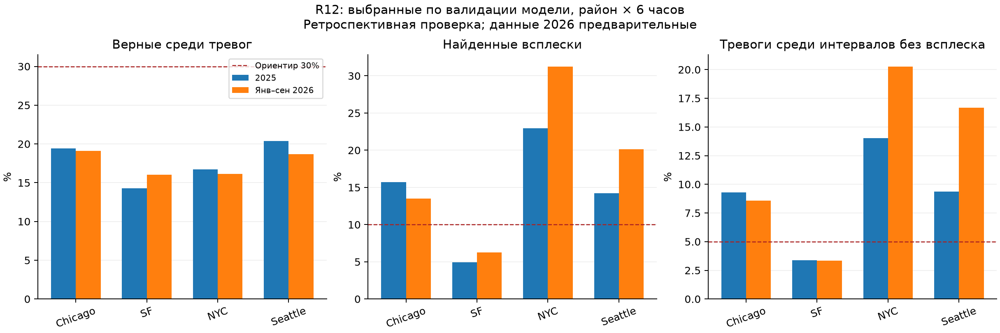

*Рисунок 21. R12: верные тревоги, полнота и FPR выбранных по валидации моделей. Пунктиром показаны заранее заданные ориентиры. Общий FPR не гарантирует такой же уровень в каждом районе.*

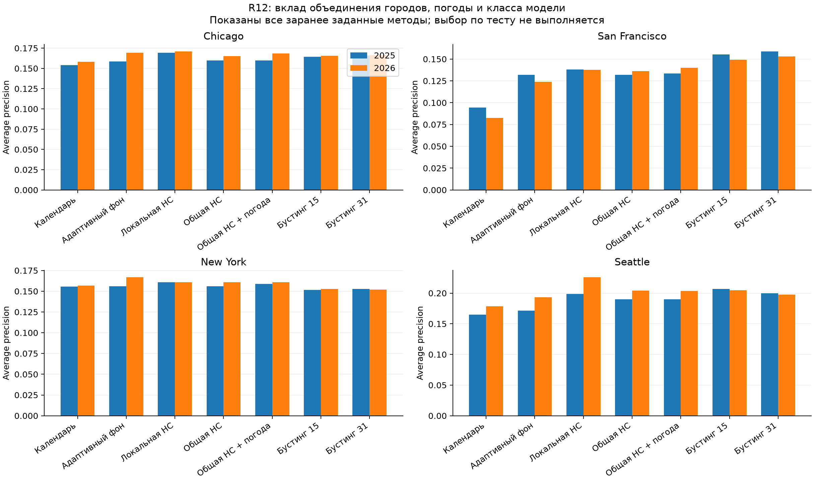

*Рисунок 22. R12: AP всех заранее заданных методов. График описывает вклад объединения городов, погоды и класса модели; выбор победителя по тесту не выполняется. Частоты превышений городов и периодов различаются.*

Для последующей проверки начат фактический журнал наблюдений Seattle: 2 402 публичные строки за ноябрь сохранены 19 ноября. Для такого же ноябрьского окна NYC опубликованных строк нет; это не означает отсутствия преступлений. Разовый сбор first-seen не выдаётся за проспективную проверку прогнозов. Результаты R1–R11 сохранены, исходная задача скрытой критичности и районная наблюдаемая цель остаются отдельными задачами.

## 8. Обсуждение и ограничения исследования

Стационарная различимость параметров, распознавание текущего режима и прогноз будущего перехода — разные задачи. Рост наблюдаемой дисперсии и корреляции не является специфичным доказательством самовозбуждения: внешняя интенсивность также создаёт неоднородный ряд.

Основные ограничения выполненной работы:

- одномерная линейная модель и экспоненциальное ядро;
- известная верная скорость затухания в основной симуляционной диагностике;
- заданные семейства и законы изменения n, которые не исчерпывают возможные реальные режимы;
- операционный порог 0.9 при математической границе 1;
- ошибки и задержка оконных оценок, особенно при редких событиях и смене режима;
- зависимость результатов от фоновой модели и определения временного кластера;
- модельно обусловленная статистическая гарантия ложных тревог;
- отсутствие истинной разметки критичности и особенности регистрации городских событий.

Нейросетевые scores критичности R4–R9 не проверялись как откалиброванные вероятности. В R10 вероятность всплеска вычисляется из рабочей отрицательно-биномиальной модели; её Brier, AP и результаты фиксированного порога проверены отдельно, но универсальная калибровка также не доказана. AUC характеризует ранжирование, а выбранная рабочая точка — отдельный результат. Диагностические ориентиры с известным n показывают роль доступной информации, но не являются универсальным пределом или реализуемым решением.

## 9. Итоговые выводы

1. Реализован воспроизводимый комплекс моделирования, оценивания и проверки детекторов на синтетических потоках с известным режимом.
2. Получена карта ошибок MLE. Точность зависит от длины наблюдения и интенсивности; высокая точность стационарной оценки не гарантирует раннего предупреждения.
3. Показано, что неверный фон может создавать высокую оценку n даже при истинном n=0. Коррекция формы помогает в проверенных сезонных режимах, но не устраняет новые скачки автоматически.
4. Разделены текущий высокий режим и первый будущий переход. Исключены решения без положительного упреждения и полного горизонта проверки.
5. На финальном тесте R4 соблюдались низкие выборочные ложные тревоги, но достаточная чувствительность предупреждения не подтверждена.
6. R5 показал существенные потери при оценке истории n и дополнительную цену строгой калибровки. Трудным отрицательным случаем предупреждения оказался рост без пересечения.
7. На городских рядах оценки существенно зависят от календарной базы. Эти примеры иллюстрируют чувствительность модели, не доказывая критичность реальных процессов.
8. Заключительный фильтр R6 уменьшил среднюю MAE n с 0.0875 до 0.0817, однако увеличил задержку внезапного перехода с 213.9 до 272.4 суток. Переобученная сеть дала лишь 2 чистых предупреждения из 600, а полосы n остались широкими. Повышение точности параметра не решило задачу предупреждения.
9. Полные генеалогические кластеры исследованы отдельно на 800 000 деревьев. При n=0.97 средний размер 32.63 близок к теоретическим 33.33, а крупные редкие каскады определяют тяжёлый хвост. Суточный прокси и полная генеалогия имеют разные смыслы.
10. Расширенное обучение R9 на 7 800 потоках дало 5 чистых предупреждений из 600 при строгой калибровке; максимум выборочных семейных ложных тревог — 0.67%. Номинальная калибровка дала 27/600 при максимуме 5%. Даже после расширения обучение не обеспечило высокую полноту предупреждения.
11. Применение к 14 городам CODE и четырём свежим порталам выполнено с достаточной предысторией и зафиксированными весами. Пороговых тревог нет, но из-за отсутствия истинной разметки и сдвига интенсивностей это не является доказательством корректности или отсутствия критичности.

12. В отдельной наблюдаемой задаче R10 реализован прогноз количества по 32 округам на следующий шестичасовой интервал. На отложенных 2025/2026 есть выигрыш относительно фиксированного фона; при основном лаге 7 суток нейросеть превосходит адаптивный фон лишь в Chicago, при лаге 0 в тесте 2026 — также в SF. Пространственная память в проверенной модели не дала выигрыша. Полнота всплесков остаётся низкой; это не прогноз отдельного преступления и не доказательство истинной критичности.

13. R11 реализовал доступную самостоятельную проверку перед внедрением: обновление моделей по времени, отдельную цель превышения, группы, калибровку и журнал публичных наблюдений. Новый предварительный октябрьский контроль выявил низкую полноту и высокую долю ложных тревог. Более сложная сеть не дала устойчивого преимущества над адаптивным фоном. Готовность к оперативным решениям и польза вмешательства не подтверждены.

14. R12 расширил районную панель до 4 036 805 случаев и 114 округов, обучающую часть — до 2 354 861 случая. Проверены локальные и общие сети, погода и бустинг. Получены отдельные улучшения средних и ранжирования, но ни один из 48 срезов не прошёл совместный фильтр полезности; среди основных срезов новых городов — 0 из 4. Проверка частоты публикации оказалась необходимой частью постановки: регистрация события и появление записи в открытом источнике — разные даты. Практическая пригодность не подтверждена увеличением объёма данных.

Исходная исследовательская постановка выполнена: реализованы модели и детекторы, проверены предвестники, точность, ложные тревоги, каскады и эмпирическое применение. Готовый надёжный прогноз будущих критических переходов не получен. Это количественно установленное ограничение, а не скрытый незавершённый эксперимент. Выводы относятся к зафиксированным генеративным семействам, объёмам наблюдения и правилам калибровки; отрицательные результаты сохранены наравне с положительными.

## Литература и источники

1. Hawkes A. G. *Spectra of some self-exciting and mutually exciting point processes*. Biometrika, 58(1), 83–90, 1971. [DOI](https://doi.org/10.1093/biomet/58.1.83).
2. Hawkes A. G., Oakes D. *A cluster process representation of a self-exciting process*. Journal of Applied Probability, 11(3), 493–503, 1974. [DOI](https://doi.org/10.2307/3212693).
3. Ozaki T. *Maximum likelihood estimation of Hawkes' self-exciting point processes*. Annals of the Institute of Statistical Mathematics, 31, 145–155, 1979. [Оригинальная статья](https://www.ism.ac.jp/editsec/aism/pdf/031_1_0145.pdf).
4. Ogata Y. *On Lewis' simulation method for point processes*. IEEE Transactions on Information Theory, 27(1), 23–31, 1981. [DOI](https://doi.org/10.1109/TIT.1981.1056305).
5. Filimonov V., Sornette D. *Apparent criticality and calibration issues in the Hawkes self-excited point process model: application to high-frequency financial data*. Препринт, версия 2014 года. [arXiv:1308.6756](https://arxiv.org/abs/1308.6756).
6. Wheatley S., Filimonov V., Sornette D. *Estimation of the Hawkes Process With Renewal Immigration Using the EM Algorithm*. Препринт, 2014. [arXiv:1407.7118](https://arxiv.org/abs/1407.7118).
7. Ashby M. P. J. *Studying Crime and Place with the Crime Open Database*. Research Data Journal for the Humanities and Social Sciences, 2019. [DOI](https://doi.org/10.1163/24523666-00401007).
8. NIST. *Tolerance Limits*. Dataplot Reference Manual. [Документация](https://itl.nist.gov/div898/software/dataplot/refman1/auxillar/tolelimi.htm).
9. Crime Open Database. [Репозиторий данных OSF](https://osf.io/zyaqn/).
10. City of Chicago. [Crimes — 2001 to Present](https://data.cityofchicago.org/Public-Safety/Crimes-2001-to-Present/ijzp-q8t2).
11. NYC Open Data. [NYPD Complaint Data Historic](https://data.cityofnewyork.us/Public-Safety/NYPD-Complaint-Data-Historic/qgea-i56i).
12. Kalman R. E. *A New Approach to Linear Filtering and Prediction Problems*. Journal of Basic Engineering, 82(1), 35–45, 1960. [DOI](https://doi.org/10.1115/1.3662552).
13. Bordenave C., Torrisi G. L. *Large Deviations of Poisson Cluster Processes*. Stochastic Models, 23, 593–625, 2007. [DOI](https://doi.org/10.1080/15326340701645959).
14. DataSF. *Police Department Incident Reports: 2018 to Present*. [Официальный набор](https://data.sfgov.org/Public-Safety/Police-Department-Incident-Reports-2018-to-Present/wg3w-h783).
15. Seattle Open Data. *SPD Crime Data: 2008–Present*. [Официальный набор](https://data.seattle.gov/Public-Safety/SPD-Crime-Data-2008-Present/tazs-3rd5).
16. NYC Open Data. *NYPD Complaint Data Current (Year To Date)*. [Официальный набор](https://data.cityofnewyork.us/Public-Safety/NYPD-Complaint-Data-Current-Year-To-Date-/5uac-w243).

Собственные результаты и условия их получения приведены в [архиве первичных материалов](reproducibility/documentation_archive.zip). Полные протоколы, исходные таблицы и проверки доступны в проекте; команды для проверки перечислены в том же реестре.

## Воспроизведение и проверки

Этот README содержит полный итоговый отчёт. В проекте оставлен один Markdown-файл. Прежние инструкции, протоколы и экспериментальные тексты сохранены побайтово в [архиве документации](reproducibility/documentation_archive.zip); их пути и SHA-256 перечислены в [индексе](reproducibility/documentation_archive.json). Численные результаты, веса и исходники моделей сохранены.

[Отчёт в PDF](output/pdf/hawkes_criticality_report.pdf).

Установка и проверка компактного клона:

```powershell
python -m venv .venv
.\.venv\Scripts\python.exe -m pip install -e ".[neural,fast]"
.\.venv\Scripts\python.exe scripts/verify_repository_snapshot.py
.\.venv\Scripts\python.exe -m unittest discover -s tests
```

Активация PowerShell не требуется. В Git включены компактные результаты и манифесты; большие CSV.GZ, NPZ и SQLite загружаются или воспроизводятся отдельно. Полная сверка отчёта на машине с архивными данными:

```powershell
.\.venv\Scripts\python.exe scripts/verify_report.py
```

Исторические команды, проверяющие хеши старых текстовых отчётов, запускаются через обёртку. Она временно восстанавливает нужные файлы из архива и убирает их после завершения; изменённые командой файлы сохраняются для проверки:

```powershell
.\.venv\Scripts\python.exe scripts/with_archived_docs.py scripts/verify_spatiotemporal.py
.\.venv\Scripts\python.exe scripts/with_archived_docs.py -m critical_processes.spatial_experiment
.\.venv\Scripts\python.exe scripts/with_archived_docs.py -m critical_processes.extended_training
```

R11 не требует внешнего полицейского пилота. Для сохранённого опыта:

```powershell
.\.venv\Scripts\python.exe -m critical_processes.offline_experiment
.\.venv\Scripts\python.exe scripts/verify_offline.py
```

Новый снимок районных данных следует создавать в новых каталогах:

```powershell
.\.venv\Scripts\python.exe scripts/prepare_spatiotemporal_data.py --raw data/raw/spatial_local --out data/processed/spatial_local
.\.venv\Scripts\python.exe -m critical_processes.spatial_experiment --panel-dir data/processed/spatial_local --out runs/spatial_local
.\.venv\Scripts\python.exe scripts/prepare_offline_data.py --history data/raw/spatial_local --centroids data/processed/spatial_local --raw data/raw/offline_local --out data/processed/offline_local
.\.venv\Scripts\python.exe -m critical_processes.offline_experiment --panels data/processed/offline_local --out runs/offline_local
```

Новая дата загрузки означает другую версию изменяемых источников. Настройка по уже просмотренному октябрю потребует другого финального периода. Журнал фактической доступности публичных строк начинается с реальных загрузок, а не с дат происшествий. Пример самостоятельного следующего снимка с новым каталогом:

```powershell
.\.venv\Scripts\python.exe scripts/capture_public_observations.py --city chicago --since 2026-11-01 --until 2026-11-17 --out data/raw/observed_20261116/chicago
.\.venv\Scripts\python.exe scripts/capture_public_observations.py --city san_francisco --since 2026-11-01 --until 2026-11-17 --out data/raw/observed_20261116/sf
```

Это команды для ручного запуска, автоматическое расписание не настроено. Все ограничения доступности, предварительных меток и качества тревог сохраняются.

Для R12 установите дополнительные зависимости и выполните проверку сохранённого опыта при наличии исходных панелей:

```powershell
.\.venv\Scripts\python.exe -m pip install -e ".[expanded]"
.\.venv\Scripts\python.exe -m critical_processes.expanded_experiment
.\.venv\Scripts\python.exe scripts/verify_expanded_detector.py
.\.venv\Scripts\python.exe scripts/summarize_expanded_detector.py
```

В компактном репозитории сырые CSV, NOAA DLY, большие панели и файлы прогнозов внешние; доступны их манифесты, показатели, веса и хеши. Для нового снимка используйте новые каталоги; другой снимок изменяемого портала создаёт новый эксперимент:

```powershell
.\.venv\Scripts\python.exe scripts/prepare_expanded_districts.py --raw data/raw/expanded_local --out data/processed/expanded_local
.\.venv\Scripts\python.exe -m critical_processes.expanded_experiment --panels data/processed/expanded_local --history data/processed/offline_local --out runs/expanded_local
.\.venv\Scripts\python.exe scripts/capture_expanded_observations.py --since 2026-11-01 --until 2026-11-20 --out data/raw/observed_expanded_local
```

Историческую панель Chicago/SF `offline_local` предварительно подготовьте командами R11 выше. Новые публикации в журнале не используются задним числом как прошлые обучающие признаки. Полная программная проверка включает 110 тестов; [сверка R12](results/expanded_district_detector/verification.json) отдельно воспроизводит прогнозы и таблицы из сохранённых моделей. PDF содержит исходную редакцию R1–R11 и отдельное дополнение R12; сборка дополнения доступна в `scripts/append_expanded_pdf.py` при наличии исходного PDF из указанной Git-ревизии и дополнительных пакетов `.[report]`.
