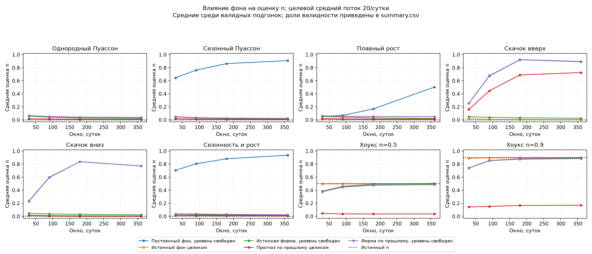
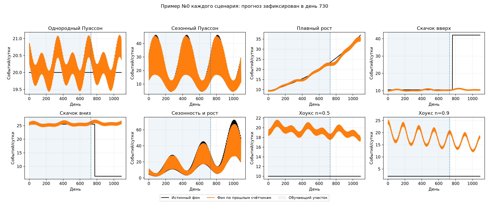

# Этап 2. Фоновая нестационарность и оценка коэффициента ветвления

Эксперимент: 9600 независимых потоков, 192000 подгонок, по 300 повторов на сценарий и интенсивность. Seed=20261115. Интенсивности [0.2, 2.0, 20.0, 50.0] событий/сутки; окна [30, 90, 180, 360] суток. Обучающий префикс фона — 730 суток, затем все окна начинаются на одной границе. Окна вложены, а пять способов используют одни и те же события; независимость — между потоками.

## Протокол

Интенсивность Хоукса: λ(t)=μ(t)+nβΣ exp(−β(t−tᵢ)), tᵢ<t. β=1/сутки известен и верен. Оценивается постоянный n∈[0,0.995] в каждом завершённом окне с учётом наблюдённой истории до левой границы. В вариантах со свободным уровнем μ(t)=a×форма(t), форма нормируется до среднего 1 внутри окна; a и n оцениваются совместно. Likelihood делится на число событий для численной устойчивости. Архивный оцениватель и результаты этапа 1 не изменялись.

Пуассоновские сценарии имеют истинный n=0, кусочно постоянный суточный фон и точные условно равномерные внутрисуточные моменты событий. Профиль нормирован на заданную среднюю интенсивность за весь горизонт. Это не принудительная фиксация реализованного числа событий. Сезонность включает неделю и год, плавный тренд — экспоненциальный рост. Скачок в четыре раза размещён строго после обучения, в первые 1–120 суток проверяемого участка (с ограничением по длине максимального окна). У стационарных контролей Хоукса n=0.5 и 0.9, μ=rate×(1−n), прогрев 8/[β(1−n)].

| Метод | Что известно и что подгоняется |
|---|---|
| constant_joint | Постоянный неизвестный фон и n — по завершённому окну |
| oracle_fixed | Весь истинный μ(t) известен, подгоняется только n |
| oracle_shape_joint | Истинная форма μ(t) известна, общий уровень и n подгоняются по окну |
| past_fixed | Весь прогноз μ̂(t) зафиксирован по префиксу, подгоняется только n |
| past_shape_joint | Форма прогноза зафиксирована по префиксу, уровень и n подгоняются по окну |

Два oracle — привилегированные диагностические ориентиры, включая знание будущего скачка. Разница constant_joint/oracle_fixed объединяет эффект правильной формы и известного уровня. oracle_shape_joint отделяет эффект формы при одинаковом числе оцениваемых параметров.

Прогноз фона — пуассоновская GLM: день недели, две годовые гармоники, линейный тренд в log μ и свободная константа. На вход поступают исключительно суточные счётчики префикса; сценарий, истинные n и μ, будущие события и будущие счётчики недоступны. Формула дизайна задана до эксперимента. Слабый L2-штраф 1e−5, кроме константы, и границы коэффициентов описаны в run_config.json. Фон не переобучается между окнами. В past_shape_joint уровень всё же оценивается на текущем завершённом окне: это причинная оценка на его правой границе, но не полностью замороженный фон.

Для Хоукса пуассоновский прогноз счётчиков оценивает общую частоту, а не интенсивность иммиграции μ. Если зафиксировать этот уровень как μ, самовозбуждение может подавляться. Поэтому малые оценки на n=0 проверяются вместе с сохранением ненулевого n на положительных контролях.

## Результаты

Ниже средняя оценка n среди валидных подгонок при целевой интенсивности 20/сутки. Полная сетка и доли валидности — в summary.csv.

| Сценарий | Окно | Постоянный | Истинный целиком | Истинная форма | Прошлый целиком | Прошлая форма |
|---|---:|---:|---:|---:|---:|---:|
| Однородный Пуассон | 90 | 0.043 | 0.010 | 0.043 | 0.013 | 0.052 |
| Однородный Пуассон | 360 | 0.024 | 0.004 | 0.024 | 0.009 | 0.039 |
| Сезонный Пуассон | 90 | 0.762 | 0.009 | 0.029 | 0.013 | 0.034 |
| Сезонный Пуассон | 360 | 0.909 | 0.005 | 0.015 | 0.011 | 0.024 |
| Плавный рост | 90 | 0.069 | 0.008 | 0.043 | 0.015 | 0.057 |
| Плавный рост | 360 | 0.504 | 0.004 | 0.022 | 0.013 | 0.051 |
| Скачок вверх | 90 | 0.674 | 0.008 | 0.039 | 0.446 | 0.679 |
| Скачок вверх | 360 | 0.892 | 0.003 | 0.026 | 0.726 | 0.896 |
| Скачок вниз | 90 | 0.596 | 0.011 | 0.036 | 0.004 | 0.600 |
| Скачок вниз | 360 | 0.770 | 0.006 | 0.023 | 0.000 | 0.770 |
| Сезонность и рост | 90 | 0.805 | 0.008 | 0.028 | 0.015 | 0.036 |
| Сезонность и рост | 360 | 0.937 | 0.003 | 0.013 | 0.012 | 0.024 |
| Хоукс n=0.5 | 90 | 0.449 | 0.498 | 0.449 | 0.037 | 0.460 |
| Хоукс n=0.5 | 360 | 0.487 | 0.500 | 0.487 | 0.037 | 0.503 |
| Хоукс n=0.9 | 90 | 0.853 | 0.895 | 0.853 | 0.152 | 0.855 |
| Хоукс n=0.9 | 360 | 0.886 | 0.898 | 0.886 | 0.170 | 0.895 |

Наблюдения при 20/сутки и окне 360 суток:

- На сезонном Пуассоне среднее n̂ снижается с 0.909 до 0.024, если использовать форму по прошлому и подгонять уровень. При известной истинной форме оно равно 0.015.
- На настоящем Хоуксе n=0.9 форма по прошлому сохраняет высокий коэффициент: среднее n̂=0.895. Если зафиксировать весь пуассоновский прогноз как фон, оно падает до 0.170. Малая оценка при фиксированном прогнозе сама по себе не означает хорошую коррекцию фона.
- Новый скачок не устранён: при форме по прошлому n̂ в среднем 0.896 для роста и 0.770 для падения при истинном n=0. Предыдущий календарный профиль не описывает новый разрыв.
- Лишняя гибкость фона имеет цену: на однородном Пуассоне среднее n̂ меняется с 0.024 до 0.039. Поэтому сезонную модель нельзя считать безусловным улучшением для всех потоков.

Чувствительность к плотности потока: форма фона по прошлому со свободным уровнем, окно 360 суток. Вероятность ошибки ≤0.1 включает неудачные подгонки как ошибки.

| Сценарий | Поток/сутки | Среднее n̂ | MAE | Валидно | Ошибка ≤0.1 |
|---|---:|---:|---:|---:|---:|
| Сезонный Пуассон | 0.2 | 0.035 | 0.035 | 99.7% | 88.0% |
| Сезонный Пуассон | 2 | 0.034 | 0.034 | 100.0% | 90.3% |
| Сезонный Пуассон | 20 | 0.024 | 0.024 | 100.0% | 99.0% |
| Сезонный Пуассон | 50 | 0.017 | 0.017 | 99.7% | 99.0% |
| Хоукс n=0.9 | 0.2 | 0.782 | 0.145 | 99.7% | 59.0% |
| Хоукс n=0.9 | 2 | 0.889 | 0.032 | 98.7% | 95.7% |
| Хоукс n=0.9 | 20 | 0.895 | 0.022 | 100.0% | 99.7% |
| Хоукс n=0.9 | 50 | 0.895 | 0.022 | 99.0% | 99.0% |

Редкие потоки остаются трудными даже после коррекции формы. Длинное окно снижает ошибку стационарной оценки, но не проверяет задержку при меняющемся n.

Парное уменьшение MAE при переходе от постоянного фона к форме по прошлому, окно 360 суток, поток 20/сутки. Положительное значение означает улучшение. Интервалы Монте-Карло 95% рассчитаны по независимым разностям на потоках, где обе подгонки валидны; это описательные интервалы без поправки на множество сравнений.

| Сценарий | Пар валидно | Уменьшение MAE | Интервал Монте-Карло |
|---|---:|---:|---:|
| Однородный Пуассон | 300 | -0.0149 | [-0.0171, -0.0127] |
| Сезонный Пуассон | 299 | +0.8857 | [+0.8824, +0.8891] |
| Плавный рост | 300 | +0.4531 | [+0.4470, +0.4593] |
| Скачок вверх | 300 | -0.0042 | [-0.0060, -0.0024] |
| Скачок вниз | 296 | -0.0005 | [-0.0008, -0.0002] |
| Сезонность и рост | 299 | +0.9129 | [+0.9091, +0.9167] |
| Хоукс n=0.5 | 300 | +0.0003 | [-0.0023, +0.0029] |
| Хоукс n=0.9 | 299 | +0.0016 | [-0.0001, +0.0033] |

## Как читать метрики и ограничения

MAE, RMSE, bias и среднее n рассчитаны только среди валидных оценок; неудачи сохранены как NaN, а не как нулевое n. Доля |n̂−n|≤0.1 рассчитана по всем реализациям, включая неудачи как ошибки. Таблица содержит долю валидности и отдельные причины отказа, квантили n̂, интервалы Монте-Карло для bias и Wilson-интервалы для долей. Относительная ошибка прогноза фона сравнивается с истинной μ; на Хоуксе она включает отличие общей интенсивности от иммиграционной.

Доли n̂≥0.5 и n̂≥0.9 — описательные частоты высоких оценок при фиксированных порогах. Они не являются результатом калибровки детектора на 5% ложных тревог и не измеряют предупреждение о будущем переходе. Неудачная подгонка не создаёт высокий сигнал, поэтому одновременно нужно смотреть долю валидности и частоту высоких оценок среди валидных. Вложенные окна нельзя складывать как независимые испытания. Доверительные интервалы отдельных n здесь не строятся.

Новый скачок после обучающего участка нельзя предсказать только по прежнему фону. Oracle показывает достижимое при знании фона, а прогноз по прошлому — ограничение выбранной GLM. Результат не доказывает, что любой сезонный фон восстановлен верно или что агрегация городских событий имеет такое ядро. Все проверки здесь синтетические; CODE и новые городские выгрузки сохраняют статус эмпирической иллюстрации зарегистрированных событий.

Следующий этап — отдельно оценивать текущее высокое n и предупреждение о будущем пересечении. Выбор окон и признаков, калибровка 5% ложных тревог и повторное нейросетевое обучение должны использовать выделенные обучение/валидацию, затем новый финальный тест. Эта диагностика не заменяет независимую проверку детектора.

Смещение branching ratio при неверном задании иммиграционной интенсивности обсуждается в [Wheatley, Filimonov, Sornette (2014)](https://arxiv.org/abs/1407.7118). Численные результаты в этом отчёте получены локальным экспериментом.

## Артефакты и воспроизведение

- replicates.csv — все оценки, причины отказа, seed и ошибки прогноза.
- summary.csv — показатели по сценарию, интенсивности, окну и способу задания фона.
- paired_comparison.csv — парные разности MAE относительно постоянного фона.
- baseline_examples.csv — префикс и прогноз реализации №0 для каждого сценария и интенсивности.
- run_config.json — фиксированный протокол, версии и SHA-256 сырых результатов и примеров.

Проверка: `.\.venv\Scripts\python.exe scripts/verify_background_comparison.py`. Отчёт можно пересоздать функцией background_report.write_background_report без новых симуляций.
