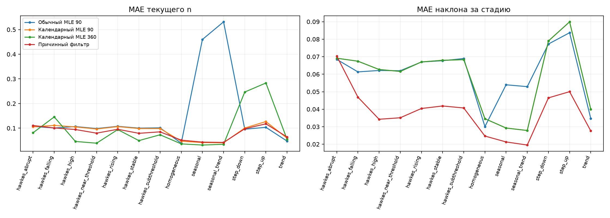

# R6. Причинная динамическая оценка коэффициента ветвления

Отдельный завершённый эксперимент. Результаты R4 и R5 не заменяются и не используются для нового подбора.

## Протокол

Семейств: 13. На семейство: обучение 150, валидация 150, калибровка 300, финальная проверка 300. Фон оценивается по отдельной предыстории; известная скорость затухания β=1/сутки. Оценки коротких блоков не перекрываются, шаг решений — 90 суток.

Один фильтр локального линейного тренда оценивает n и наклон только по завершённым блокам. Дисперсия наблюдения обучена по фактическим квадратам ошибок в ячейках оценённого n и curvature SE; curvature SE не объявляется готовой дисперсией ошибки. Ковариация фильтра служит рабочим масштабом. Проекция состояния на допустимые границы делает фильтр приближённым.

На валидации выбраны q=0.1, затухание наклона ρ=0.9 из 8 заранее заданных сочетаний. Критерий — средняя MAE по семействам, затем задержка. Истинный n используется для обучения и проверки, но не подаётся фильтру при оценке.

Наклон сравнивается с причинной секущей (n[k]−n[k−2])/2 на один 90-суточный шаг. Это не производная ступенчатой функции n и не знание будущего изменения.

## Ошибка текущего n на новом holdout

| Метод | MAE, среднее по 13 семействам | MAE, высокий/близкий n | MAE наклона | Доля допустимых оценок |
|---|---:|---:|---:|---:|
| Обычный MLE 90 | 0.1538 | 0.1025 | 0.0608 | 98.37% |
| Календарный MLE 90 | 0.0875 | 0.1008 | 0.0588 | 98.37% |
| Календарный MLE 360 | 0.0935 | 0.0426 | 0.0588 | 99.90% |
| Причинный фильтр | 0.0817 | 0.0872 | 0.0384 | 99.72% |

Парная разность MAE: фильтр минус исходная оценка. Отрицательное значение означает меньшую ошибку. Интервалы получены бутстрепом целых траекторий и условны на выбранных настройках и обучении.

| Группа | Сравнение | Разность MAE | Парный 95% интервал |
|---|---|---:|---|
| all | Фильтр − Календарный MLE 90 | -0.0058 | [-0.0065; -0.0051] |
| all | Фильтр − Календарный MLE 360 | -0.0119 | [-0.0143; -0.0093] |
| near_high | Фильтр − Календарный MLE 90 | -0.0136 | [-0.0155; -0.0117] |
| near_high | Фильтр − Календарный MLE 360 | 0.0446 | [0.0417; 0.0482] |
| abrupt | Фильтр − Календарный MLE 90 | 0.0054 | [0.0022; 0.0087] |
| abrupt | Фильтр − Календарный MLE 360 | 0.0294 | [0.0255; 0.0332] |
| rising | Фильтр − Календарный MLE 90 | -0.0109 | [-0.0137; -0.0082] |
| rising | Фильтр − Календарный MLE 360 | 0.0013 | [-0.0030; 0.0052] |
| falling | Фильтр − Календарный MLE 90 | -0.0104 | [-0.0131; -0.0077] |
| falling | Фильтр − Календарный MLE 360 | -0.0449 | [-0.0499; -0.0387] |



## Задержка при внезапном переходе

Используется пересечение оценки n≥0.9 после истинного перехода. Первый доступный завершённый высокий блок появляется через 90 суток. Пропущенные переходы не удаляются: их задержка заменена заранее заданным пределом T−τ+90 суток. Средняя ограниченная задержка сравнима между методами, но не является несмещённой оценкой неограниченного времени обнаружения.

| Метод | Обнаружено | Средняя задержка с пределом, сутки | Медиана среди обнаруженных, сутки |
|---|---:|---:|---:|
| Обычный MLE 90 | 251/300 | 215.1 | 180 |
| Календарный MLE 90 | 250/300 | 213.9 | 180 |
| Календарный MLE 360 | 235/300 | 288.0 | 270 |
| Причинный фильтр | 237/300 | 272.4 | 270 |

## Неопределённость

На независимой калибровке строится максимум нормированной абсолютной ошибки по всей траектории. Общий множитель — максимум семейных ранговых квантилей ceil((m+1)×0.95). Номинальное покрытие 95% относится к целой новой траектории того же семейства при обменности; для n и наклона оно заявляется раздельно. Это не совместный интервал для двух параметров и не условная гарантия при каждом моменте времени. Пропуски исключены из области покрытия, а доля допустимых оценок сохранена. Если допустимых калибровочных траекторий недостаточно для нужного ранга, используется весь допустимый диапазон параметра.

| Метод | Минимальное семейное покрытие траектории n | Средняя ширина интервала n | Минимальное покрытие наклона |
|---|---:|---:|---:|
| Обычный MLE 90 | 94.67% | 1.0000 | 95.00% |
| Календарный MLE 90 | 94.00% | 1.0000 | 94.00% |
| Календарный MLE 360 | 90.33% | 0.9995 | 94.00% |
| Причинный фильтр | 96.33% | 0.7909 | 95.33% |

Семейные доверительные интервалы эмпирического покрытия сохранены в `interval_coverage.csv`. Высокое покрытие при широкой полосе не означает точную оценку n.

## Проверка обнаружения

После изменения признаков MLP обучены заново: одинаковые 8 признаков истории оценённого n, одинаковая архитектура, 100 эпох, seed [61, 73, 89]. У фильтра используется оценённый наклон состояния; у исходного MLE — секущая трёх блоков. Все инициализации и заранее заданное среднее сохранены.

Основная калибровка контролирует цель 5% ложных тревог на траекторию отдельно по семействам, с совместным уровнем доверия 95% для 24 оценок. Доверие распределено между оценками и активными семействами. Номинальная семейная калибровка приведена отдельно как заранее объявленная проверка чувствительности. Порог, параметры фильтра, интервалы и веса заморожены до генерации holdout.

| Задача | Метод | Полнота состояния / чистое предупреждение | Макс. семейная ложная тревога | AUC |
|---|---|---:|---:|---:|
| state | stat_calendar90 | 0.00% | 0.00% | 0.934 |
| state | stat_calendar360 | 1.66% | 1.67% | 0.931 |
| state | stat_dynamic_calendar | 0.00% | 0.00% | 0.940 |
| state | mlp_calendar90_ensemble | 2.82% | 3.00% | 0.957 |
| state | mlp_dynamic_calendar_ensemble | 2.03% | 2.33% | 0.952 |
| warning | stat_calendar90 | 0.00% | 0.00% | 0.719 |
| warning | stat_calendar360 | 0.00% | 2.67% | 0.722 |
| warning | stat_dynamic_calendar | 0.00% | 1.00% | 0.735 |
| warning | mlp_calendar90_ensemble | 0.00% | 1.33% | 0.845 |
| warning | mlp_dynamic_calendar_ensemble | 0.33% | 1.33% | 0.861 |

Полнота предупреждения требует первой допустимой тревоги внутри окна 0<τ−t≤180 суток. Внезапные и плавные переходы учитываются вместе; ложная тревога до правильного предупреждения не отменяется. Итоги отдельных seed и обеих калибровок находятся в `operating_metrics.csv`.

## Решение по заранее установленному критерию

Условие перехода к рекомендации нового метода по валидации: **выполнено**.

- Выполнено: `near_high_mae_improves_at_least_5pct`.
- Выполнено: `macro_mae_no_more_than_5pct_worse`.
- Выполнено: `maximum_family_mae_no_more_than_002_worse`.
- Выполнено: `mean_capped_abrupt_delay_no_more_than_one_stage_worse`.

Решение принято до holdout. Диагностическое сравнение переобученных сетей сохранено независимо от результата. Этот опыт не меняет выбранные модели R4 и не обосновывает перенос на городские данные. Если критерий не выполнен, добавление фильтра в основной метод не рекомендуется; новый перебор на этом holdout не проводится.

## Воспроизведение

```powershell
.\.venv\Scripts\python.exe -m critical_processes.dynamic_experiment --workers 4
.\.venv\Scripts\python.exe scripts/verify_dynamic_estimation.py
```

Повторный запуск завершённого протокола проверяет хеши и возвращает сохранённый результат. Изменение параметров или кода требует отдельного каталога. Точные семена всех потоков и их непересечение с R4/R5 проверяются отдельно.

Основа рекурсивной оценки: R. E. Kalman (1960), [A New Approach to Linear Filtering and Prediction Problems](https://doi.org/10.1115/1.3662552). Конкретная калибровка ошибок и ограничения состояния — реализация данного проекта, без заявления оптимальности для Хоукса.
