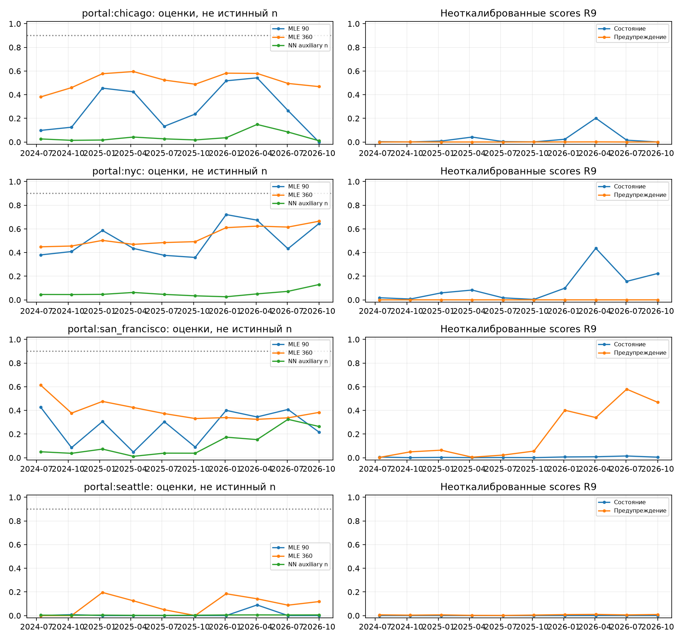

# R7. Применение замороженных детекторов к CODE и свежим городским данным

CODE дополнен ежегодными core за 2018, 2019 и 2022; подготовлен период 2018–2022. Четыре городских портала выгружены за 2019–2025 и январь–сентябрь 2026. Это разные источники с разными единицами регистрации. 2026 год неполный; его числа не сравниваются с полным годом без учёта экспозиции.

В каждом блоке 730 суток отдельной предыстории и 1080 суток мониторинга: 10 решений состояния и 8 решений с полностью наблюдённым будущим горизонтом 180 суток. Периоды назначены механически до просмотра scores. Ранний и поздний городские периоды перекрываются и не являются независимыми повторениями.

Для CODE анализируется первая полная последовательность 1810 суток с 2018 года, для порталов — первый и последний доступные блоки такой длины. Модель фоновой формы получает только префикс; будущие счётчики не участвуют в её обучении. Сохраняется минутная точность, равные метки не раздвигаются случайным шумом.

| Источник / период | Событий/сутки | Доля признаков вне центральных 99% обучения | Срабатывания состояния R9 из 10 | Срабатывания предупреждения R9 из 8 |
|---|---:|---:|---:|---:|
| portal:chicago / early | 651.0 | 6.2% | 0 | 0 |
| portal:chicago / latest | 674.9 | 6.2% | 0 | 0 |
| portal:nyc / early | 1318.4 | 9.2% | 0 | 0 |
| portal:nyc / latest | 1517.2 | 11.2% | 0 | 0 |
| portal:san_francisco / early | 298.2 | 6.2% | 0 | 0 |
| portal:san_francisco / latest | 258.9 | 6.2% | 0 | 0 |
| portal:seattle / early | 200.9 | 6.2% | 0 | 0 |
| portal:seattle / latest | 191.2 | 6.2% | 0 | 0 |
| CODE:Austin / archive | 222.7 | 6.2% | 0 | 0 |
| CODE:Boston / archive | 95.9 | 3.0% | 0 | 0 |
| CODE:Charlotte / archive | 144.9 | 6.2% | 0 | 0 |
| CODE:Colorado Springs / archive | 118.9 | 6.2% | 0 | 0 |
| CODE:Detroit / archive | 216.8 | 6.2% | 0 | 0 |
| CODE:Kansas City / archive | 248.3 | 8.4% | 0 | 0 |
| CODE:Los Angeles / archive | 618.8 | 6.8% | 0 | 0 |
| CODE:Louisville / archive | 102.1 | 5.5% | 0 | 0 |
| CODE:Memphis / archive | 257.3 | 6.2% | 0 | 0 |
| CODE:Mesa / archive | 90.3 | 5.2% | 0 | 0 |
| CODE:Nashville / archive | 217.2 | 6.2% | 0 | 0 |
| CODE:New York / archive | 1237.1 | 8.0% | 0 | 0 |
| CODE:San Francisco / archive | 262.8 | 6.2% | 0 | 0 |
| CODE:Seattle / archive | 190.1 | 7.4% | 0 | 0 |

Срабатывания — превышения замороженного порога, а не подтверждённые критические события. Истинный n и время первого перехода неизвестны: accuracy, TPR, вероятность ложной тревоги и качество раннего предупреждения на этих данных не вычисляются. Отсутствие тревог также не доказывает отсутствие критичности. Scores сети не откалиброваны как вероятности.

Симуляционный диапазон 0.2–50 событий/сутки существенно меньше многих городских интенсивностей. Доля признаков вне центрального обучающего диапазона — описательный показатель сдвига распределения, не формальный тест применимости. Популяционная калибровочная гарантия симуляционного эксперимента не переносится автоматически на города.

У CODE единица — запись правонарушения с годовым uid; у порталов — дело/отчёт после дедупликации. Сравнение абсолютных частот между источниками не является сравнением риска преступности. Календарная дневная база может оставлять часовую сезонность и задержки регистрации; чувствительность к часу суток показана отдельно в E1.

Проанализировано 22 блоков; пропущено источников с недостаточным календарным покрытием: 3. Причины перечислены в `skipped.json`, происхождение и годовые объёмы — в манифестах подготовленной панели. Неизвестные метки не заменялись оконными MLE для дообучения.

Воспроизведение: `python -m critical_processes.empirical_transfer`; проверка: `python scripts/verify_empirical_transfer.py`. Повторный запуск проверяет хеши и возвращает сохранённую таблицу.
