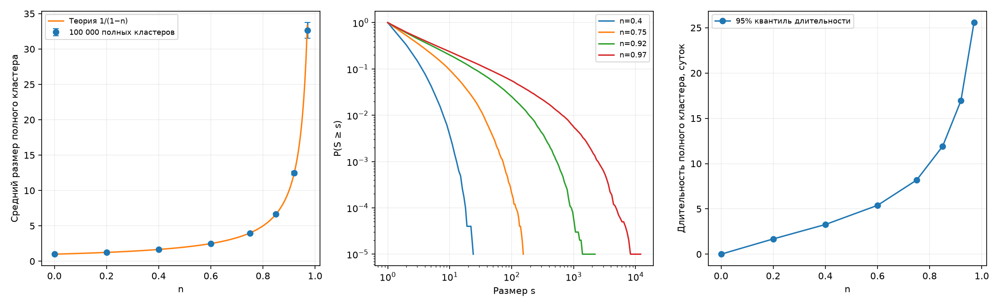

# Полные генеалогические кластеры Хоукса

100 000 независимых полных деревьев на каждый из 8 уровней n, всего 800 000 кластеров. У каждого события число непосредственных потомков имеет распределение Poisson(n), задержки потомков — Exp(β), β=1/сутки. Родитель каждого события сохраняется в имитаторе; размер включает корневое событие и всех потомков. Дерево не обрезается годовым окном. При превышении лимита имитация останавливается с ошибкой, вместо молчаливого усечения.

Это отдельное исследование полного семейства одного иммигранта. Оно дополняет суточный прокси P1 и не означает восстановления генеалогии зарегистрированных преступлений. Частота иммигрантов μ в потоке могла бы задаваться как 2(1−n), сохраняя среднюю общую интенсивность; размер одного дерева от μ не зависит.

При Poisson(n) потомстве E[S]=1/(1−n), Var(S)=n/(1−n)^3. Эти формулы следуют из равенства S=1+Σ S_j: m=1+nm, v=nv+nm². Сравниваются полные размеры, а не число потомков только первого поколения.

| n | Средний размер | Теория | 95% квантиль размера | P(S≥100) | 95% квантиль длительности, сутки |
|---:|---:|---:|---:|---:|---:|
| 0.00 | 1.000 | 1.000 | 1 | 0.000% | 0.000 |
| 0.20 | 1.252 | 1.250 | 2 | 0.000% | 1.683 |
| 0.40 | 1.665 | 1.667 | 4 | 0.000% | 3.274 |
| 0.60 | 2.513 | 2.500 | 8 | 0.000% | 5.391 |
| 0.75 | 3.974 | 4.000 | 15 | 0.021% | 8.182 |
| 0.85 | 6.673 | 6.667 | 28 | 0.568% | 11.923 |
| 0.92 | 12.472 | 12.500 | 54 | 2.513% | 16.953 |
| 0.97 | 32.634 | 33.333 | 114 | 5.566% | 25.571 |



Полосы среднего — приближённые 1.96 Monte Carlo SE по независимым деревьям; при тяжёлом хвосте их точность ограничена. Для хвостовых долей сохранены Wilson-интервалы. Полная генеалогия известна только в имитации, поэтому её показатели не подаются детектору реальных событий.

Кластерное представление: [Hawkes и Oakes (1974)](https://doi.org/10.2307/3212693); [Bordenave и Torrisi (2007)](https://doi.org/10.1080/15326340701645959).

```powershell
.\.venv\Scripts\python.exe scripts/complete_genealogy.py --verify
```
