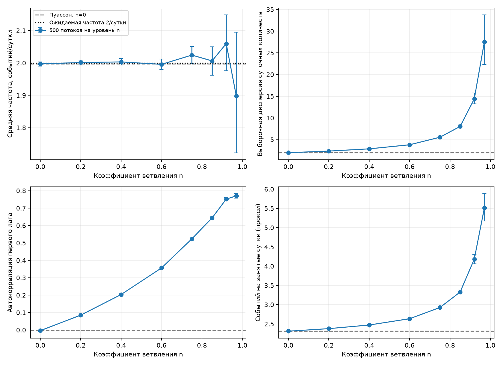

# Итоговый Монте-Карло эксперимент показателей

500 независимых повторов на уровень n; 8 уровней с однородным Пуассоном n=0, всего 4000 потоков. Горизонт 365 суток, β=1/сутки, μ=2(1−n), ожидаемая стационарная частота 2 события/сутки. Прогрев Хоукса — 8/[β(1−n)].

Полосы — процентильные 95% интервалы для средних показателей по 500 потокам, бутстреп 2000 раз целых потоков. Они характеризуют ошибку Монте-Карло и не являются доверительным интервалом n отдельного потока. При n близком к 1 конечный год наблюдений не гарантирует устойчивую оценку теоретических моментов каждого потока.

| n | Частота | Дисперсия | ACF(1) | Событий на занятые сутки |
|---:|---:|---:|---:|---:|
| 0.00 | 1.9970 | 1.9907 | -0.0039 | 2.3104 |
| 0.20 | 2.0013 | 2.3591 | 0.0852 | 2.3764 |
| 0.40 | 2.0031 | 2.8771 | 0.2037 | 2.4708 |
| 0.60 | 1.9956 | 3.8160 | 0.3566 | 2.6342 |
| 0.75 | 2.0242 | 5.5540 | 0.5235 | 2.9252 |
| 0.85 | 2.0062 | 8.0420 | 0.6437 | 3.3267 |
| 0.92 | 2.0595 | 14.3918 | 0.7515 | 4.1820 |
| 0.97 | 1.8977 | 27.5222 | 0.7706 | 5.5117 |



Кластерная характеристика прежней реализации при суточных бинах и cluster_gap=0.5 равна числу событий, делённому на число непустых суток. Она показывает концентрацию событий во времени и не оценивает размер генеалогического каскада. Оценка MLE в этом опыте не повторяется: её точность исследована отдельно в R1.

Пилот `simulation_v2` с 30 повторами сохранён. Новый график предназначен для основного текста отчёта.

```powershell
.\.venv\Scripts\python.exe scripts/finalize_indicators.py --verify
```
