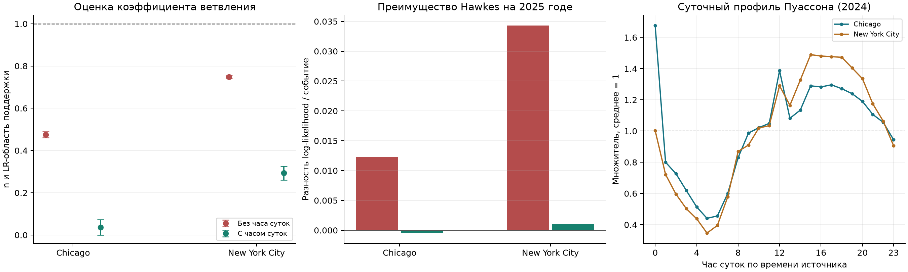

# Проверка суточной сезонности: Chicago и New York City

Обучение: 2024 год; условная проверка: 2025 год. Оба варианта пересчитаны одной версией кода с одинаковыми событиями, несколькими стартами оптимизации и одинаковой процедурой профилирования. Квартальные оценки получены без переобучения, с использованием только предшествующей истории событий.

Исходная базовая интенсивность учитывает день недели и месяц. В новом варианте добавлены 23 индикатора часа суток. Базовая интенсивность постоянна внутри часа; ее интеграл считается с экспозицией 1/24 суток. Пуассон и Hawkes в каждой паре используют одинаковую спецификацию календаря и один и тот же test-период. Единица всех интенсивностей: события/сутки.

| Город | База | n | LR-область поддержки | Прирост test LL к Пуассону | Прирост на событие |
| --- | --- | ---: | --- | ---: | ---: |
| Chicago | Месяц + день недели | 0.4752 | [0.4606; 0.4900] | 2921.38 | 0.012269 |
| Chicago | + час суток | 0.0368 | [0.0000; 0.0729] | -112.40 | -0.000472 |
| New York City | Месяц + день недели | 0.7480 | [0.7409; 0.7551] | 19463.88 | 0.034287 |
| New York City | + час суток | 0.2943 | [0.2605; 0.3258] | 590.25 | 0.001040 |

В Chicago почасовая модель дает n=0.0368, с областью поддержки, включающей ноль. Найденное слабое возбуждение затухает медленно (beta=0.0132 в день), а на тестовом году Hawkes уступает почасовому Пуассону на 112.40 log-likelihood. Прежний выигрыш после учета только дня недели и месяца не сохраняется.

Для New York City n снижается до 0.2943. Выигрыш сохраняется, но составляет 0.001040 на событие при beta=0.9288 в день. Таким образом, большая часть прежнего преимущества объясняется добавленной суточной структурой базы; оставшуюся зависимость нужно проверять отдельно.

Границы получены по профилю likelihood с LR-порогом 3.8415, поиском на всем диапазоне n и несколькими стартами для параметров-помех. Это оболочка области поддержки; сетка профиля сохранена в каждом estimates.json. Она может охватывать несколько областей. На границе n=0 скорость затухания не идентифицируется, а номинальное 95%-покрытие такой оболочки не гарантируется. Узкую область вокруг одного локального максимума нельзя автоматически считать надежным доверительным интервалом.

Изменение оценки n и прироста likelihood после добавления часа суток показывает чувствительность прежних выводов к выбранной базовой интенсивности. Нулевой выигрыш следует читать как отсутствие практического преимущества данной Hawkes-спецификации над соответствующим Пуассоном. Это не доказывает отсутствия любых зависимостей в данных. Небольшой оставшийся выигрыш тоже не доказывает критичности или причинного каскада.

## Проверка по кварталам

Разность условного test log-likelihood Hawkes минус Пуассон с почасовой базой:

| Город | Квартал 2025 | Событий | Разность LL |
| --- | --- | ---: | ---: |
| Chicago | 2025-Q1 | 54980 | -116.83 |
| Chicago | 2025-Q2 | 61481 | -17.90 |
| Chicago | 2025-Q3 | 64504 | 8.49 |
| Chicago | 2025-Q4 | 57146 | 13.84 |
| New York City | 2025-Q1 | 137138 | 123.40 |
| New York City | 2025-Q2 | 148453 | 112.77 |
| New York City | 2025-Q3 | 147855 | 47.51 |
| New York City | 2025-Q4 | 134222 | 306.56 |

## Ограничения и следующий этап

Временные метки имеют минутную точность, а совпадающие времена обрабатываются одной группой без выдуманного порядка. Это приближение для округленных данных, не точная likelihood механизма округления. Отдельно остаются неучтенными внутричасовая концентрация на круглых отметках, различия между районами и категориями событий, тренды и особенности регистрации. Шкала — локальное время источника с сутками по 24 часа; неоднозначности переходов на летнее время не восстанавливаются из CSV без часового пояса.

Следующая проверка детектора должна включать отрицательные контроли: пуассоновские потоки с суточной сезонностью, трендом и изменением уровня интенсивности. Частоту ложных тревог и время упреждения следует измерять на симуляциях с известным режимом. Для реальных зарегистрированных событий истинные моменты критичности не размечены.

Обоснование контроля нестационарной базы: [Filimonov & Sornette, Apparent criticality and calibration issues in the Hawkes self-excited point process model](https://arxiv.org/abs/1308.6756). В работе рассматриваются смещения оценки n из-за изменений режима и сезонности; здесь этот риск проверяется отдельным сравнением на двух городских рядах.

Источники исходных выгрузок: [City of Chicago](https://data.cityofchicago.org/Public-Safety/Crimes-2001-to-Present/ijzp-q8t2) и [NYPD Complaint Data Historic](https://data.cityofnewyork.us/Public-Safety/NYPD-Complaint-Data-Historic/qgea-i56i). Это прямые городские выгрузки за 2024–2025, а не обновленная версия гармонизированного CODE. Фильтры и параметры повторного запуска сохранены в run_config.json каждого нового расчета.

Повторное построение отчета: `.\.venv\Scripts\python.exe scripts/compare_intraday_models.py`.
