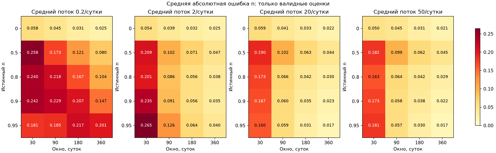
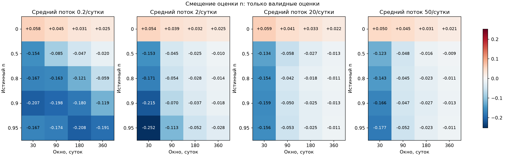
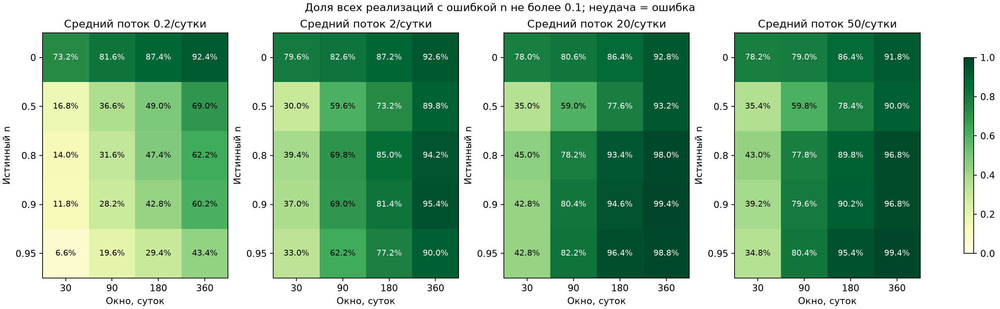
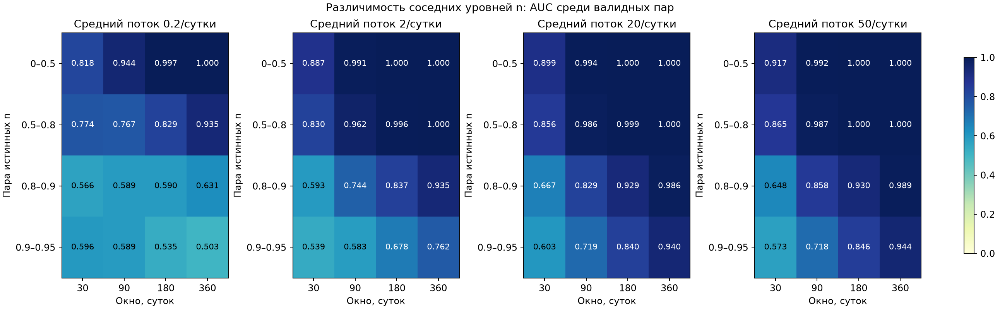

# Этап 1. Точность оценки текущего коэффициента ветвления

Проверены n=[0.0, 0.5, 0.8, 0.9, 0.95], средние интенсивности [0.2, 2.0, 20.0, 50.0] событий/сутки и окна [30, 90, 180, 360] суток. Для каждой пары n/интенсивность сгенерированы 500 независимых потоков: всего 10000 потоков и 40000 оконных подгонок. Окна разных длин вложены в один поток; их нельзя считать независимыми повторениями.

## Протокол

Для каждого n задано mu=rate*(1-n). Таким образом, стационарная ожидаемая интенсивность rate=mu/(1-n) одинакова для всех n при фиксированном rate. Реализованные количества событий случайны и не нормируются к заранее заданному числу. n=0 соответствует однородному Пуассону.

Симулятор: прореживание Огаты, экспоненциальное ядро, beta=1/сутки. Прогрев: 8 времен релаксации 1/(beta*(1-n)). До левой границы всех окон наблюдаются дополнительные 30 суток истории. Оцениватель использует только события до правой границы окна, включая доступную историю перед левой границей.

Оцениваются mu и n совместно методом условного максимального правдоподобия; beta задано верно и известно. Это диагностика в благоприятной правильно специфицированной стационарной модели, а не проверка сезонного фона, неизвестного ядра или раннего прогноза. Истинный n и истинное mu не передаются оценивателю. Граница оптимизации для n — [0; 0.995].

## Как читать ошибки

Bias, MAE, RMSE и квантили n_hat рассчитаны только среди валидных оценок. Если событий меньше трех или оптимизация не удалась, n_hat отсутствует, а не заменяется нулем. При редких событиях условные ошибки могут выглядеть благоприятнее из-за отбора удачных подгонок, поэтому рядом обязательно учитывается valid_fraction.

Дополнительно показана доля всех реализаций, для которых получена оценка с ошибкой <=0.05 и <=0.10: неудачная подгонка считается неуспехом. 95%-интервалы Wilson относятся к этим долям. bias_mc_ci95_* — интервал Монте-Карло для среднего смещения, а не доверительный интервал неизвестного n отдельного потока. Кривизна likelihood не используется как гарантированный интервал покрытия.

## Окно максимальной длины

| Средний поток | Истинный n | Валидных оценок | Среднее n_hat | Bias | MAE | Ошибка <=0.1 среди всех |
| --- | ---: | ---: | ---: | ---: | ---: | ---: |
| 0.2 | 0 | 99.8% | 0.025 | +0.025 | 0.025 | 92.4% |
| 2 | 0 | 99.6% | 0.025 | +0.025 | 0.025 | 92.6% |
| 20 | 0 | 99.2% | 0.022 | +0.022 | 0.022 | 92.8% |
| 50 | 0 | 97.2% | 0.021 | +0.021 | 0.021 | 91.8% |
| 0.2 | 0.5 | 100.0% | 0.480 | -0.020 | 0.080 | 69.0% |
| 2 | 0.5 | 99.0% | 0.490 | -0.010 | 0.047 | 89.8% |
| 20 | 0.5 | 100.0% | 0.487 | -0.013 | 0.044 | 93.2% |
| 50 | 0.5 | 97.0% | 0.491 | -0.009 | 0.045 | 90.0% |
| 0.2 | 0.8 | 100.0% | 0.741 | -0.059 | 0.104 | 62.2% |
| 2 | 0.8 | 99.8% | 0.786 | -0.014 | 0.038 | 94.2% |
| 20 | 0.8 | 99.2% | 0.789 | -0.011 | 0.030 | 98.0% |
| 50 | 0.8 | 97.6% | 0.789 | -0.011 | 0.029 | 96.8% |
| 0.2 | 0.9 | 99.2% | 0.781 | -0.119 | 0.147 | 60.2% |
| 2 | 0.9 | 100.0% | 0.882 | -0.018 | 0.035 | 95.4% |
| 20 | 0.9 | 99.8% | 0.887 | -0.013 | 0.023 | 99.4% |
| 50 | 0.9 | 97.2% | 0.887 | -0.013 | 0.022 | 96.8% |
| 0.2 | 0.95 | 90.4% | 0.759 | -0.191 | 0.201 | 43.4% |
| 2 | 0.95 | 99.8% | 0.922 | -0.028 | 0.040 | 90.0% |
| 20 | 0.95 | 99.2% | 0.939 | -0.011 | 0.017 | 98.8% |
| 50 | 0.95 | 99.6% | 0.939 | -0.011 | 0.017 | 99.4% |

## Различимость уровней

AUC — вероятность, что валидная оценка из потока с большим истинным n выше оценки из потока с меньшим n, с половинным весом совпадений. AUC=0.5 соответствует случайному порядку. Это диагностика различимости распределений оценок, не вероятность успешного раннего предупреждения и не доказательство оптимальной классифицируемости по всем доступным данным.

AUC и bootstrap-интервалы условны на валидности обеих оценок. valid_pair_probability в CSV показывает вероятность получить обе оценки. Дополнительно сравнивается заранее заданный порог посередине двух истинных уровней: неудачная оценка считается ошибкой/воздержанием, а не удаляется из знаменателя. Ни один порог не выбирается по максимуму тестового качества.

### Уровни 0.9 и 0.95

| Средний поток | Окно | Вероятность двух валидных оценок | AUC | 95% bootstrap AUC |
| --- | ---: | ---: | ---: | --- |
| 0.2 | 90 | 25.1% | 0.589 | [0.541; 0.637] |
| 0.2 | 360 | 89.7% | 0.503 | [0.467; 0.538] |
| 2 | 90 | 99.8% | 0.583 | [0.548; 0.619] |
| 2 | 360 | 99.8% | 0.762 | [0.732; 0.795] |
| 20 | 90 | 99.2% | 0.719 | [0.684; 0.752] |
| 20 | 360 | 99.0% | 0.940 | [0.927; 0.952] |
| 50 | 90 | 96.8% | 0.718 | [0.685; 0.744] |
| 50 | 360 | 96.8% | 0.944 | [0.928; 0.957] |

## Основные наблюдения

При среднем потоке 20/сутки и истинном n=0.95 MAE среди валидных оценок уменьшается с 0.059 на 90 сутках до 0.017 на 360. AUC оценок для уровней 0.9 и 0.95 возрастает с 0.719 до 0.940. Это результат стационарной правильно заданной модели с известным затуханием.

Условия редких событий нужно читать по доле точных оценок среди всех потоков, а не только по MAE удачных подгонок. Изменение условной MAE при увеличении окна может отражать изменение состава валидных потоков. AUC около 0.5 означает слабую различимость именно по исследуемой оценке n, а не доказанную невозможность различить процессы любым методом.

При выборе окна для меняющегося процесса дополнительно потребуется измерить задержку: длинное окно может смешивать несколько режимов. Улучшение стационарной точности само по себе не подтверждает качество прогноза будущего пересечения.

## Воспроизводимость и следующий этап

replicates.csv содержит каждую оценку и уникальный seed симулятора; summary.csv — ошибки и неудачи; distinguishability.csv — AUC и качество по заранее выбранным серединам уровней; run_config.json — полный протокол и SHA-256 исходной таблицы. Отдельные потоки имеют разные uint32 seeds. Неопределенность относится к повторениям внутри одной ячейки; интервалы не одновременные по всей сетке.

Этот этап отвечает только на вопрос о точности оценки постоянного текущего n. Он не обучает нейросеть, не прогнозирует будущее пересечение и не использует городские данные. Следующий этап — отдельно сравнить известный и оцененный фон, включая сезонность и изменение интенсивности. Выбор окон для следующих моделей следует делать по этой диагностике и валидации, а итоговый тест генерировать заново.
