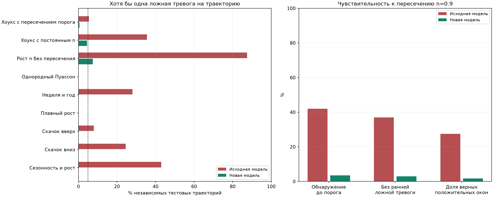

# Переобучение детектора с отрицательными контролями

Результат: доля ложных тревог на отрицательных окнах снизилась с 10.0% до 0.2%, но предупреждение получили лишь 7 из 200 пересечений (3.5%). Медиана упреждения 90 суток относится только к этим обнаруженным пересечениям. Это существенная потеря чувствительности; новую модель нельзя считать достаточным решением задачи раннего обнаружения.

Целевая вероятность ложной тревоги на траекторию при калибровке — 5%. На независимом тесте максимальная точечная оценка по семействам — 7.5%. Она превышает целевой уровень; перенос калибровочного ограничения на этот тест не подтвердился по всем семействам.

Новая модель обучена на 2700 траекториях. Калибровочная и тестовая выборки содержат по 200 и 200 новых траекторий каждого из девяти семейств. Разбиение выполнено до генерации, с независимыми SeedSequence потоками и непересекающимися ID. Средние интенсивности лежат в [0.2; 50] событий/сутки; часть траекторий использует опорные значения 2, 20 и 50.

Используется прежняя архитектура MLP 32–16–1 с исправленной нормировкой всех lookback-блоков (версия 2). Параметры нормировки вычислены только на обучении. Число эпох фиксировано заранее; калибровка и тест не используются для градиентного обучения или выбора эпохи. Исходная модель со своей нормировкой и порогом оценена на тех же новых тестовых реализациях.

## Генерация и определение упреждения

Положительные траектории: процесс Хоукса с растущим n, пересекающим заданный порог. Трудные отрицательные контроли: стационарный Хоукс и рост n без достижения порога. Остальные контроли: однородный, сезонный и трендовый Пуассон, скачки интенсивности вверх/вниз, сезонность вместе с ростом. Чисто внутрисуточный контроль не дублируется в обучении, поскольку его суточный ряд совпадает по распределению с однородным Пуассоном.

Хоукс моделируется непрерывно методом прореживания: история возбуждения сохраняется между этапами. Событие, родившееся на этапе k, вносит вклад n[k]*beta*exp(-beta*age) и после последующих границ. Поэтому n[k] определяет ожидаемое число прямых потомков этого события. Базовая интенсивность на этапе равна rate*(1-n[k]); beta=1/сутки. Начальный режим прогревается на 8 времен релаксации. На переходах параметры не задают точной стационарности среднего потока.

Решение принимается только после завершения 90-суточного блока, lookback=3. Успешное предупреждение: 0 < день пересечения − день решения <= 180 суток. При таком шаге положительное упреждение дискретно. Решение ровно в момент пересечения и все последующие решения исключены из оценки раннего обнаружения. На траекториях без пересечения режим остается ниже порога и за концом наблюдаемого горизонта.

«Чистое обнаружение» означает, что первая тревога на траектории попала в допустимое окно предупреждения. Если модель сначала тревожилась слишком рано, а затем предупредила правильно, обычное обнаружение засчитывается, но чистое — нет. Упреждение усредняется только по обнаруженным пересечениям; пропуски показаны отдельно.

## Калибровка порога

Цель: вероятность хотя бы одной ложной тревоги <= 5% для каждого известного семейства. Для каждой калибровочной траектории вычислен максимальный score на отрицательных допустимых окнах. Для каждого семейства взята порядковая статистика с рангом ceil((m+1)*(1-alpha)); общий порог строго выше наибольшей из этих статистик. Для растущего Хоукса отрицательными считаются только допустимые решения до окна упреждения.

Это применение к максимумам траекторий квантильной калибровки с поправкой на конечную выборку, см. [Angelopoulos & Bates](https://arxiv.org/abs/2107.07511). Интерпретация ограничения требует обменности калибровочных и новых траекторий внутри того же семейства и распределения параметров. Это маргинальное ограничение по случайной калибровке, а не 95%-гарантия для одного фиксированного порога, всех интенсивностей по отдельности или реальных городских данных.

Полученный порог: 0.971766. Максимальная калибровочная доля траекторий с ложной тревогой: 4.5%. Тестовые значения не использовались для изменения порога.

## Общий независимый тест

| Показатель | Исходная модель | Новая модель |
| --- | ---: | ---: |
| Доля ложных тревог на отрицательных окнах | 10.0% | 0.2% |
| Чувствительность по положительным окнам | 27.5% | 1.8% |
| Хотя бы одно предупреждение до пересечения | 42.0% | 3.5% |
| Обнаружение без преждевременной тревоги | 37.0% | 3.0% |
| Максимальная доля траекторий с ложной тревогой среди семейств | 87.5% | 7.5% |
| Медиана упреждения среди обнаруженных | 90 суток | 90 суток |

## Ложные тревоги по семействам

| Семейство | Исходная модель | Новая модель | 95% Wilson для новой модели |
| --- | ---: | ---: | --- |
| Хоукс с пересечением порога | 5.5% | 0.5% | [0.1; 2.8]% |
| Хоукс с постоянным n | 35.5% | 4.5% | [2.4; 8.3]% |
| Рост n без пересечения | 87.5% | 7.5% | [4.6; 12.0]% |
| Однородный Пуассон | 0.0% | 0.0% | [0.0; 1.9]% |
| Неделя и год | 28.0% | 0.0% | [0.0; 1.9]% |
| Плавный рост | 0.0% | 0.0% | [0.0; 1.9]% |
| Скачок вверх | 8.0% | 0.0% | [0.0; 1.9]% |
| Скачок вниз | 24.5% | 0.0% | [0.0; 1.9]% |
| Сезонность и рост | 43.0% | 0.0% | [0.0; 1.9]% |

## Отдельные пуассоновские контроли

Обе модели дополнительно проверены на одинаковых новых потоках с seed=20261112, по 300 реализаций для каждой пары сценарий/средняя интенсивность. Этот seed не использовался для обучения или калибровки. Ни порог, ни веса после проверки не менялись.

| Сценарий | Событий/сутки | FPR окон: исходная | FPR окон: новая | Хотя бы одна: исходная | Хотя бы одна: новая |
| --- | ---: | ---: | ---: | ---: | ---: |
| Неделя и год | 20 | 78.4% | 0.0% | 100.0% | 0.0% |
| Скачок вниз | 50 | 7.5% | 0.0% | 66.7% | 0.0% |
| Плавный рост | 680 | 0.0% | 14.4% | 0.0% | 83.0% |
| Плавный рост | 1560 | 0.0% | 80.1% | 0.0% | 100.0% |

Вне диапазона обучения перенос не получился: при высоких средних интенсивностях трендовый Пуассон вызывает множество тревог новой модели, хотя n=0. Поэтому эту модель пока нельзя переносить на агрегированные городские потоки. Подробные таблицы и интервалы: [новая модель](poisson_audit/analysis.md), [исходная модель на тех же потоках](baseline_poisson_audit/analysis.md).

Изменения включают исправленную нормировку, новый состав обучения, непрерывную историю и строгую разметку предупреждений. Это не абляционный эксперимент, позволяющий приписать эффект одной правке. Малое число ложных тревог нужно читать вместе с чувствительностью и долей пропущенных пересечений; подавление всех сигналов не является успешным ранним обнаружением.

Синтетические положительные сценарии задают операционный порог n=0.9, а не достижение математической границы n=1. Все n остаются ниже единицы. Данные городов в обучении не участвуют; качество на реальных данных и на новых типах изменения режима этой проверкой не установлено. Интервалы по семействам точечные, не одновременные.

Воспроизводимость: `model.pt`, `run_config.json`, `metrics.json`, `calibration.csv`, `calibration_scores.csv`, `family_test_metrics.csv`, `trajectory_test_metrics.csv`, оба `*_test_scores.csv` и исходные симуляции в `data/*.npz`. SHA-256 данных и моделей сохранены в конфигурации. Прежние результаты и веса сохранены отдельно.

