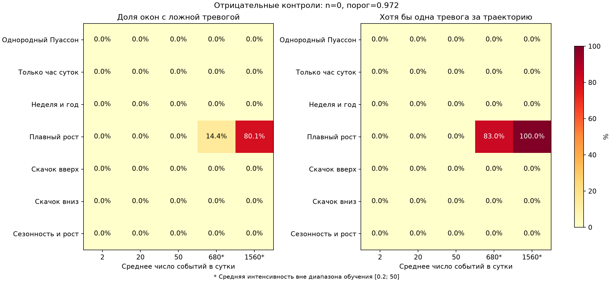

# Ложные тревоги нейросетевого детектора: отрицательные контроли

Модель: `results\neural_detector_robust_90d\model.pt`. SHA-256 и параметры сохранены в `run_config.json`. Веса и порог (0.972) зафиксированы до эксперимента; переобучения и подбора порога по этим контролям не было.

На каждую пару сценарий/средняя интенсивность создано 300 реализаций по 1080 суток. Каждый блок признаков использует 90 суток; lookback=3. Решения вычисляются после завершения полного блока, с тем же шагом, что и блок. Все процессы имеют n=0 на всем горизонте, поэтому каждая тревога ложная относительно задачи обнаружения критичности.

Суточные количества моделируются непосредственно независимыми пуассоновскими величинами с заданными интегралами интенсивности. Для суточного детектора это точное моделирование наблюдаемого входа, без необходимости генерировать каждую временную отметку. Фазы сезонности и момент скачка выбираются независимо от потока; все профили нормированы к одному заданному среднему по времени. Скачки четырехкратные, плавный рост — от 0.5 до 2 в относительных единицах.

Контроль «Только час суток» имеет тот же суточный интеграл, что и однородный Пуассон. Эти два контроля специально используют одни и те же суточные количества и потому дают одинаковые scores. Это проверка инвариантности агрегации; их нельзя объединять как независимые наблюдения. Из одного внутрисуточного ритма нельзя получить изменение суточного ряда при сохранении его интеграла.

Диапазон средних интенсивностей при обучении: [0.2; 50] событий/сутки. Отметка * обозначает среднюю интенсивность вне этого диапазона. Колонка `mean_daily_expected_rate_outside_training_range_fraction` также показывает долю дней, чья ожидаемая интенсивность выходит за диапазон: она может быть положительной даже при допустимом среднем.

## Результаты

FPR окон — доля решений с ложной тревогой; P(хотя бы одна) — доля независимых траекторий с одной или несколькими тревогами. Для FPR окна 95%-интервал получен bootstrap целых траекторий, сохраняя зависимость соседних окон. При полном отсутствии/наличии тревог использована консервативная относительно окон граница Wilson по независимым траекториям. Для P(хотя бы одна) используются интервалы Wilson. Интервалы точечные для каждой строки, не одновременные по всей таблице.

| Сценарий | Событий/сутки | FPR окон | 95% интервал FPR | P(хотя бы одна) | 95% интервал P |
| --- | ---: | ---: | --- | ---: | --- |
| Однородный Пуассон | 2 | 0.0% | [0.0; 1.3]% | 0.0% | [0.0; 1.3]% |
| Однородный Пуассон | 20 | 0.0% | [0.0; 1.3]% | 0.0% | [0.0; 1.3]% |
| Однородный Пуассон | 50 | 0.0% | [0.0; 1.3]% | 0.0% | [0.0; 1.3]% |
| Однородный Пуассон | 680* | 0.0% | [0.0; 1.3]% | 0.0% | [0.0; 1.3]% |
| Однородный Пуассон | 1560* | 0.0% | [0.0; 1.3]% | 0.0% | [0.0; 1.3]% |
| Только час суток | 2 | 0.0% | [0.0; 1.3]% | 0.0% | [0.0; 1.3]% |
| Только час суток | 20 | 0.0% | [0.0; 1.3]% | 0.0% | [0.0; 1.3]% |
| Только час суток | 50 | 0.0% | [0.0; 1.3]% | 0.0% | [0.0; 1.3]% |
| Только час суток | 680* | 0.0% | [0.0; 1.3]% | 0.0% | [0.0; 1.3]% |
| Только час суток | 1560* | 0.0% | [0.0; 1.3]% | 0.0% | [0.0; 1.3]% |
| Неделя и год | 2 | 0.0% | [0.0; 1.3]% | 0.0% | [0.0; 1.3]% |
| Неделя и год | 20 | 0.0% | [0.0; 1.3]% | 0.0% | [0.0; 1.3]% |
| Неделя и год | 50 | 0.0% | [0.0; 1.3]% | 0.0% | [0.0; 1.3]% |
| Неделя и год | 680* | 0.0% | [0.0; 1.3]% | 0.0% | [0.0; 1.3]% |
| Неделя и год | 1560* | 0.0% | [0.0; 1.3]% | 0.0% | [0.0; 1.3]% |
| Плавный рост | 2 | 0.0% | [0.0; 1.3]% | 0.0% | [0.0; 1.3]% |
| Плавный рост | 20 | 0.0% | [0.0; 1.3]% | 0.0% | [0.0; 1.3]% |
| Плавный рост | 50 | 0.0% | [0.0; 1.3]% | 0.0% | [0.0; 1.3]% |
| Плавный рост | 680* | 14.4% | [13.4; 15.5]% | 83.0% | [78.3; 86.8]% |
| Плавный рост | 1560* | 80.1% | [78.9; 81.2]% | 100.0% | [98.7; 100.0]% |
| Скачок вверх | 2 | 0.0% | [0.0; 1.3]% | 0.0% | [0.0; 1.3]% |
| Скачок вверх | 20 | 0.0% | [0.0; 1.3]% | 0.0% | [0.0; 1.3]% |
| Скачок вверх | 50 | 0.0% | [0.0; 1.3]% | 0.0% | [0.0; 1.3]% |
| Скачок вверх | 680* | 0.0% | [0.0; 1.3]% | 0.0% | [0.0; 1.3]% |
| Скачок вверх | 1560* | 0.0% | [0.0; 1.3]% | 0.0% | [0.0; 1.3]% |
| Скачок вниз | 2 | 0.0% | [0.0; 1.3]% | 0.0% | [0.0; 1.3]% |
| Скачок вниз | 20 | 0.0% | [0.0; 1.3]% | 0.0% | [0.0; 1.3]% |
| Скачок вниз | 50 | 0.0% | [0.0; 1.3]% | 0.0% | [0.0; 1.3]% |
| Скачок вниз | 680* | 0.0% | [0.0; 1.3]% | 0.0% | [0.0; 1.3]% |
| Скачок вниз | 1560* | 0.0% | [0.0; 1.3]% | 0.0% | [0.0; 1.3]% |
| Сезонность и рост | 2 | 0.0% | [0.0; 1.3]% | 0.0% | [0.0; 1.3]% |
| Сезонность и рост | 20 | 0.0% | [0.0; 1.3]% | 0.0% | [0.0; 1.3]% |
| Сезонность и рост | 50 | 0.0% | [0.0; 1.3]% | 0.0% | [0.0; 1.3]% |
| Сезонность и рост | 680* | 0.0% | [0.0; 1.3]% | 0.0% | [0.0; 1.3]% |
| Сезонность и рост | 1560* | 0.0% | [0.0; 1.3]% | 0.0% | [0.0; 1.3]% |

## Интерпретация

Наибольшая доля ложных тревог среди проверенных средних интенсивностей в диапазоне обучения: сценарий «Однородный Пуассон», средняя интенсивность 2, FPR окон 0.0%, хотя бы одна тревога у 0.0% траекторий. Коэффициент ветвления n=0 известен по конструкции. В этих контролях наблюдаемых ложных тревог не было.

Этот аудит измеряет специфичность сохраненной модели на известных некритических потоках. Он не измеряет чувствительность, время упреждения или вероятность критичности по score: для них нужны независимые положительные сценарии с известным приближением n к порогу. Значения на средних интенсивностях вне диапазона обучения характеризуют перенос на другой масштаб, отдельно от устойчивости к нестационарности при допустимом среднем. Отсутствие наблюдаемых тревог не означает нулевую вероятность тревоги и не подтверждает чувствительность модели на городском масштабе.

Версия нормировки признаков сохраненной модели: 2. Каждый lookback-блок нормируется отдельно; это соответствует обучению новых весов. Порог и веса в этом аудите не изменяются.

Результат отрицательных контролей следует сопоставлять с чувствительностью и упреждением на положительных сценариях с известным n. Проверенные здесь test-контроли не должны использоваться для повторной калибровки порога или переобучения с последующей оценкой на тех же реализациях.

Результаты: `negative_control_summary.csv` содержит групповые оценки и интервалы, `trajectory_metrics.csv` — эпизоды и время первой ложной тревоги по реализациям, `window_scores.csv` — каждое решение. Набор `intraday` не является дополнительной независимой выборкой относительно `homogeneous`.

Основание моделирования: независимые приращения неоднородного Пуассона и интегральная интенсивность, см. [лекцию University of Chicago](https://www.stat.uchicago.edu/~yibi/teaching/stat317/2021/Lectures/Lecture11.pdf). Формула интервала Wilson: [NIST](https://www.itl.nist.gov/div898/handbook/prc/section2/prc241.htm).

