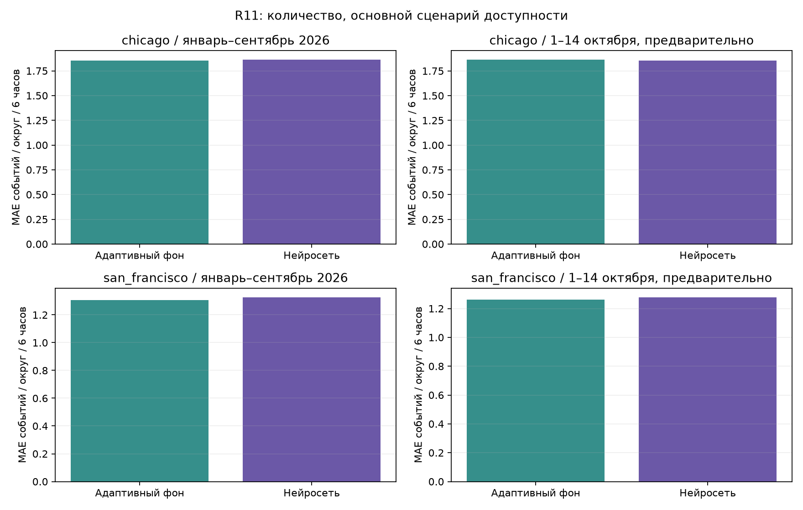
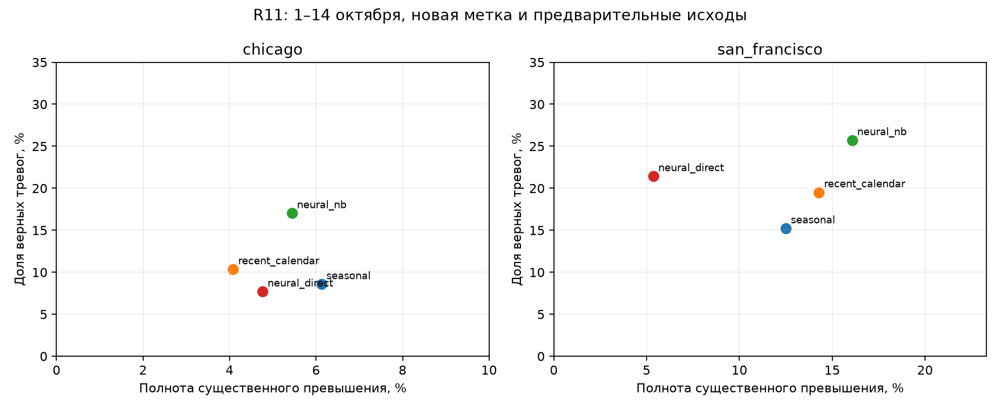
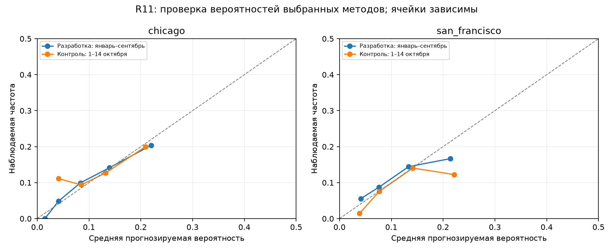

# R11. Проверка перед внедрением без институционального пилота

Результаты получены самостоятельным ретроспективным прогоном. Модели, нормировка, эпохи, калибровка и районные пороги фиксируются по прошлым блокам. 2025 — сентябрь 2026 уже просматривались в R10; они не считаются новым независимым тестом.

Новая цель: число происшествий и N ≥ ceil(B_adapt + max(2,0.5 B_adapt)) на округ × 6 часов. Это существенное превышение доступного фонового уровня, не прежняя 95% историческая квантиль R10 и не скрытый n. Поэтому проценты полноты R10/R11 нельзя напрямую объявлять улучшением одного детектора.

Основная доступность — инцидент старше 7 суток; SF дополнительно report_datetime + условные 3 суток публикации. Стресс — 14 и 7 суток соответственно. Даты публикации исторически не восстановлены. Обучающие/валидационные/калибровочные цели имеют 28 суток на накопление регистраций, но это не гарантирует окончательную полноту.

Новый октябрьский снимок предварительный. Основной срез 1–14 октября имеет всего один 14-суточный блок: информативный бутстреп-интервал по нему невозможен. В интерпретируемой таблице соответствующие границы оставлены пустыми. Полный октябрь сохранён отдельно с более незрелыми метками.

## Основные результаты, все выбранные категории

| Город / период | Count-метод | MAE | MAE адаптивного фона | Метод превышения | Полнота | Precision | FPR | Верных / ложных тревог |
|---|---|---:|---:|---|---:|---:|---:|---:|
| chicago / development2026 | recent_calendar | 1.852 | 1.852 | neural_nb | 9.8% | 19.5% | 6.3% | 316 / 1306 |
| chicago / new_october_first14 | neural_nb | 1.857 | 1.862 | neural_nb | 5.4% | 17.0% | 3.6% | 8 / 39 |
| san_francisco / development2026 | recent_calendar | 1.306 | 1.306 | seasonal | 11.8% | 15.1% | 8.3% | 144 / 808 |
| san_francisco / new_october_first14 | recent_calendar | 1.261 | 1.261 | seasonal | 12.5% | 15.2% | 7.7% | 7 / 39 |

Count- и rise-методы выбраны на валидации каждого винтажа. Порог тревоги оценивается на отдельной части калибровки каждого округа и группы, с целью 5% FPR отрицательных ячеек. Это не означает 95% верных тревог или сохранение 5% при дрейфе. Абсолютные числа тревог и частота цели показаны в CSV.

Группы property и assault_robbery разбираются отдельно в headline.csv и исходных таблицах; группа all включает обе и не является независимым дополнительным повторением. Месячные флаги дрейфа диагностические, не автоматические команды для оперативных служб.

## Что реализовано и что остаётся

Реализованы отдельная наблюдаемая цель, категории, причинные признаки с известным календарём, обновление по времени, multihead-сеть, калибровка вероятностей/районных порогов, журнал прогнозов без исходов, задержки и стресс-сценарий, районный/месячный контроль ошибок и реальный журнал первых наблюдений публичных строк.

Статус — исследовательский прототип. Реального пилота нет. Нельзя подтвердить пользу вмешательства, полностью восстановить доступность архива или объявить готовность к оперативным решениям. Самостоятельное наблюдение публичных обновлений начато 10 ноября; оно не подменяет исторические даты публикации.

Команды и ограничения — report/OFFLINE_GUIDE.md и report/OFFLINE_PROTOCOL.md. Источники чисел — results/offline_readiness; текущая сводка не меняет модели после просмотра октября.
