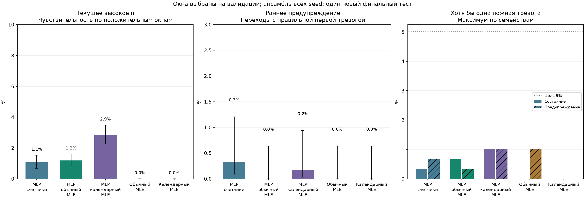

# Этап 4. Выбор признаков и окон, несколько seed, замороженный финальный тест

Фиксированная сетка окон: [30, 90, 180, 360] суток. Seed инициализации сетей: [17, 29, 41]. Эпох: 100. Размеры на каждое из 13 семейств: {'train': 150, 'validation_calibration': 150, 'validation': 150, 'calibration': 300, 'test': 300}. Seed данных 20261117, отдельно заранее задан seed финального теста 20261118.

## Основной результат

Выбранный до теста метод состояния — MLP: календарный MLE, окно 360 суток. AUC=0.972, но чувствительность по высоким окнам лишь 2.9% (bootstrap 95%: 2.2%–3.5%). Хотя бы одно правильное распознавание имеется на 116 из 1200 положительных потоков; это другой знаменатель.

Выбранный до теста метод предупреждения — MLP: обычный MLE, окно 180 суток. Обнаружено 0 из 600 будущих переходов, Wilson 95%: [0.0%, 0.6%]. Это не доказывает, что популяционная вероятность обнаружения равна нулю.

На этой финальной выборке максимальная семейная доля ложных тревог среди ансамблей и классических ориентиров — 1.0%; среди всех отдельных seed тоже учтённых в калибровке — 1.7%. Чувствительность раннего предупреждения при таком контроле пока недостаточна. Порог после просмотра теста не менялся; метод с лучшим тестовым числом обнаружений не подменяет первичный.

## Разделение данных и фиксация решений

Используются пять непересекающихся наборов полных потоков: train, validation_calibration, validation, calibration и test. Только train используется для градиентов и нормировки. Предварительные пороги выбираются на validation_calibration, окна и первичный метод — на validation. Итоговые пороги выбираются на отдельной calibration уже после выбора окон. Тест до этого не генерируется. selection.json и frozen_plan.json сохраняют выбор, все пороги и SHA-256 весов до появления test.npz. final_test_started.json связывает тест с неизменяемым планом; final_test_complete.json фиксирует результаты. Повтор команды после завершения возвращает сохранённые метрики без нового теста.

Для каждого набора признаков выбирается одно окно по ансамблю всех seed: сначала допустимость максимальной валидационной траекторной частоты ложных тревог ≤5%, затем качество (state TPR или warning clean recall), AUC и более короткое окно. Если допустимого варианта нет, сначала минимизируется нарушение и оно сохраняется явно. Первичный метод для каждой задачи выбирается тем же правилом на валидации. Лучший seed по тесту не выбирается. Все нейросетевые seed имеют одни и те же данные и различаются инициализацией; их разброс не является интервалом по независимым тестовым выборкам.

## Признаки и модельные предположения

Перед мониторингом имеется 730 суток наблюдаемой предыстории. По её счётчикам однократно обучается Poisson GLM (день недели, две годовые гармоники, log-тренд), без сценария, истинного n и будущих событий. Её форма заморожена на весь мониторинг; уровень оценивается вместе с n внутри текущего завершённого окна. Прогноз общей частоты не фиксируется как иммиграционная μ.

Для имеющихся городских выгрузок за два года такая отдельная двухлетняя предыстория и последующий мониторинг пока не обеспечены. Перенос потребует более длинного ряда или отдельной проверки более короткого фонового протокола; эти городские данные здесь не оценивались.

Наборы: 16 признаков счётчиков (три последние стадии и выбранное окно); 39 признаков с обычными оконными MLE; 64 признака с дополнительными календарными MLE и флагом прогноза. MLE имеет известное верное β=1/сутки. Быстрый Newton с аналитическим Hessian решает тот же условный likelihood, что и прежний SciPy-оцениватель, с резервным SciPy-решением при несходимости. Curvature SE — признак информации, не откалиброванный доверительный интервал. Неудачи имеют отдельные флаги; их конечные заполнители для сети не трактуются как оценённый нулевой n.

Классический ориентир использует текущий n для состояния и проекцию n по трём последним стадиям для предупреждения; окно тоже выбирается на валидации. Сохраняется возбуждение между стадиями. μ=rate×(1−n) поддерживает локальную стационарную среднюю, но не фиксирует число событий при переходах. Пуассоновские скачки происходят после фонового обучения. Генератор с префиксом отличается от этапа 3, поэтому цифры этапов нельзя читать как чистый эффект только нового обучения.

Состояние — n(t−)≥0.9; предупреждение — первое пересечение строго после t в течение 180 суток с полностью наблюдённым горизонтом. Изначально высокий режим исключён из задачи первого будущего перехода. Время решений в таблицах отсчитывается от начала мониторинга после предыстории. Порог 0.9 ниже математической границы n=1.

## Контроль ложных тревог

Для каждого семейства берётся один максимум score на отрицательных eligible-решениях каждого независимого потока. Ранг k выбирается до просмотра значений: верхний квантиль Beta(m+1−k,k) должен быть не выше 0.05. Затем порог ставится строго выше k-й порядковой статистики. Берётся максимум семейных порогов; совпадающие scores обрабатываются консервативно. При нехватке калибровочных данных используется воздержание от всех тревог, а не неподтверждённый порог.

На финальной calibration вероятность ошибки границы распределяется между всеми 28 заранее фиксированными потоками scores и активными семействами. Совместный уровень доверия — 95.0%. Это утверждение о популяционных траекторных ложных тревогах при независимой калибровке и той же генеративной модели. Оно не требует, чтобы каждая конечная тестовая доля обязательно оказалась ≤5%, и не распространяется на неизвестные городские процессы.

Ранговые непараметрические границы описаны в [NIST](https://itl.nist.gov/div898/software/dataplot/refman1/auxillar/tolelimi.htm); [JMP](https://www.jmp.com/support/help/en/19.2/jmp/statistical-details-for-tolerance-intervals.shtml) приводит связь односторонней границы с биномиальным квантилем. Формула и поправка на все сохранённые scores реализованы в confident_calibration.py и проверяются тестами.

## Выбор до финального теста

| Задача | Набор | Окно | Качество validation | Макс. ложные validation | Допустим | Первичный |
|---|---|---:|---:|---:|---|---|
| state | MLP: счётчики | 360 | 2.2% | 1.3% | True | False |
| state | MLP: обычный MLE | 360 | 2.4% | 2.7% | True | False |
| state | MLP: календарный MLE | 360 | 4.9% | 2.7% | True | True |
| state | Статистика: обычный MLE | 180 | 2.4% | 2.0% | True | False |
| state | Статистика: календарный MLE | 180 | 2.8% | 1.3% | True | False |
| warning | MLP: счётчики | 180 | 0.7% | 2.0% | True | False |
| warning | MLP: обычный MLE | 180 | 1.3% | 0.7% | True | True |
| warning | MLP: календарный MLE | 30 | 0.7% | 1.3% | True | False |
| warning | Статистика: обычный MLE | 90 | 0.0% | 1.3% | True | False |
| warning | Статистика: календарный MLE | 180 | 0.0% | 0.7% | True | False |

## Финальный тест

Состояние: чувствительность по положительным окнам. Предупреждение: обычный и clean recall по переходам. Clean recall требует, чтобы первая eligible-тревога была правильной; позднее обнаружение не отменяет прежнюю ложную тревогу. Знаменатели этих задач различаются.

| Задача | Метод | Окно | TPR окон | Recall потоков | Clean recall | Макс. ложные |
|---|---|---:|---:|---:|---:|---:|
| state | MLP: счётчики | 360 | 1.1% | 2.9% | 2.9% | 0.3% |
| state | MLP: обычный MLE | 360 | 1.2% | 4.6% | 4.6% | 0.7% |
| state | MLP: календарный MLE | 360 | 2.9% | 9.7% | 9.7% | 1.0% |
| state | Статистика: обычный MLE | 180 | 0.0% | 0.0% | 0.0% | 0.0% |
| state | Статистика: календарный MLE | 180 | 0.0% | 0.0% | 0.0% | 0.0% |
| warning | MLP: счётчики | 180 | 0.2% | 0.3% | 0.3% | 0.7% |
| warning | MLP: обычный MLE | 180 | 0.0% | 0.0% | 0.0% | 0.3% |
| warning | MLP: календарный MLE | 30 | 0.2% | 0.2% | 0.2% | 1.0% |
| warning | Статистика: обычный MLE | 90 | 0.0% | 0.0% | 0.0% | 1.0% |
| warning | Статистика: календарный MLE | 180 | 0.0% | 0.0% | 0.0% | 0.0% |

## Разброс и сравнение

Таблица test_metrics.csv содержит все отдельные seed и ансамбли. Интервалы оконных метрик получены bootstrap полных потоков; для событий и семейных траекторных долей сохранены Wilson-интервалы. Нельзя объединять один и тот же тест для трёх seed как три независимые выборки. Парные разности ниже вычислены на тех же потоках относительно ансамбля по счётчикам; интервалы описательные, без поправки на четыре сравнения.

У нулевого числа успехов обычный bootstrap наблюдаемых окон может дать вырожденный интервал [0,0]; он не доказывает нулевую популяционную чувствительность. Для нулевых обнаружений переходов используется также невырожденная верхняя Wilson-граница по независимым потокам.

Разброс качества между инициализациями при одних и тех же данных и выбранном окне (для состояния — TPR окон, для предупреждения — clean recall):

| Задача | Набор | Минимум seed | Медиана seed | Максимум seed | Ансамбль |
|---|---|---:|---:|---:|---:|
| state | MLP: счётчики | 1.0% | 1.1% | 1.4% | 1.1% |
| state | MLP: обычный MLE | 0.9% | 0.9% | 1.7% | 1.2% |
| state | MLP: календарный MLE | 1.5% | 2.0% | 3.4% | 2.9% |
| warning | MLP: счётчики | 0.2% | 0.3% | 0.8% | 0.3% |
| warning | MLP: обычный MLE | 0.0% | 0.3% | 0.3% | 0.0% |
| warning | MLP: календарный MLE | 0.0% | 0.2% | 0.5% | 0.2% |

Парное сравнение с ансамблем по счётчикам:

| Задача | Метод | Разность качества | Парный bootstrap 95% |
|---|---|---:|---:|
| state | MLP: обычный MLE | +0.001 | [-0.002, +0.004] |
| state | MLP: календарный MLE | +0.018 | [+0.012, +0.024] |
| warning | MLP: обычный MLE | -0.003 | [-0.008, +0.000] |
| warning | MLP: календарный MLE | -0.002 | [-0.007, +0.003] |

Метрики финального теста не используются для смены окна, метода, seed или порога. Следующие изменения потребуют новых обучающих решений и нового финального теста. Реальные зарегистрированные преступления остаются эмпирической иллюстрацией и в этом эксперименте не используются.

## Артефакты и воспроизведение

- protocol.json — параметры и SHA-256 исходного кода до генерации данных.
- validation_candidates.csv, validation_calibration.csv, selection.json — все варианты и правило выбора.
- frozen_plan.json, calibration.csv — выбранные веса, окна и защищённые пороги до теста.
- data/*.npz — полные непересекающиеся потоки, признаки и scores с seed.
- models/*.pt, training/*.csv — все инициализации и кривые обучения.
- metrics.json, test_metrics.csv, family_test_metrics.csv, trajectory_test_metrics.csv — финальные результаты.
- primary_*_decisions.csv — решения заранее выбранных первичных моделей.
- paired_comparison.csv — сравнение ансамблей на одних и тех же тестовых потоках.

Проверка: `.\.venv\Scripts\python.exe scripts/verify_selected_training.py`. Перестроение отчёта: selected_report.write_selected_report, без нового выбора и теста.
