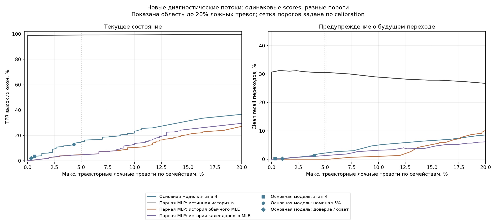
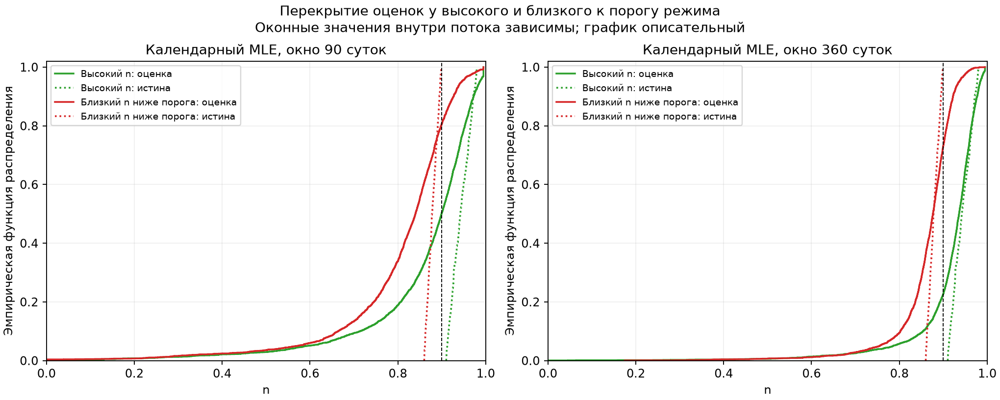

# Этап 5. Где теряется чувствительность: n, модель предупреждения и порог

Новые диагностические данные: {'train': 150, 'calibration': 300, 'evaluation': 300} потоков на каждое из 13 семейств. Seed данных 20261119, seed оценки 20261120. Все исходные веса, выбор и финальные результаты этапа 4 проверяются SHA-256 и остаются неизменными. Старый holdout не используется для подгонки или выбора; из его архива читаются только seed для исключения совпадений.

## Что установлено

**Ошибки информации об n существенны.** При одинаковой архитектуре и строгом правиле калибровки парные модели дают для состояния 98.8% TPR с истинными n последних трёх стадий и 0.7% с календарными MLE. Для предупреждения clean recall — 31.2% против 0.2%; максимальные семейные ложные тревоги соответственно 1.0% и 1.0%. Это контролируемое сравнение источников n в малой модели, а не точное разложение ошибки исходной сети.

**Строгий порог тоже снижает чувствительность.** У одного и того же основного state-score TPR меняется с 12.9% при номинальных семейных 5% до 2.2% при доверительной поправке на охват этапа 4. Максимальные ложные тревоги на новых данных — 4.3% и 0.3%. Сравниваемые правила имеют разную статистическую гарантию; номинальный вариант не подменяет прежний рабочий порог.

**Плохое предупреждение не объясняется только строгостью порога.** У основной модели его ослабление до номинальных семейных 5% даёт clean recall всего 1.3% при 4.0% ложных тревог, против 0.2% и 1.0% у доверительного варианта. Предельные отрицательные режимы и временная неопределённость будущего остаются частью задачи.

Разности этих экспериментов взаимодействуют и не складываются в проценты единой причины. Результаты ниже относятся к новым диагностическим потокам, а не к повторной оценке старого финального теста.

## Что сравнивается

1. **Один score, разные пороги.** Основные модели этапа 4 сохранены. На одной новой calibration сравниваются общий квантиль максимумов потоков, семейные номинальные 5%, доверительная граница для одной оценки и для охвата всех оценок этапа 4. Старый порог показан отдельно: его отличие от новой калибровки включает случайность калибровочных данных.
2. **Одна архитектура, разные сведения о n.** Шесть новых диагностических MLP получают восемь признаков: последние три n, наклон, линейную проекцию и три флага валидности. Источник n — истинная прошлая история, обычный MLE или календарный MLE по последним завершённым стадиям. Данные, архитектура, начальные веса, число эпох и цели одинаковы; нормировка обучается на train отдельно для каждого источника. Разница отражает замену информации о n, включая пропуски. Она не является точным процентным разложением ошибки исходной MLP с 64 признаками.
3. **Разделимость и сглаживание.** Сохраняются ошибки MLE для всех окон, распределения высоких и близких к порогу режимов, условные AUC и семейства, задающие порог. Среднее истинного n по окну — описательный ориентир сглаживания, а не утверждение, что MLE при меняющемся n обязан оценивать именно арифметическое среднее.

Парные модели обучаются 100 эпох при фиксированном seed 53; hyperparameter search по diagnostic evaluation не проводится. Истинные n доступны только диагностическим ориентирам. Они не являются реализуемыми детекторами на реальных данных.

Sigmoid-scores сетей не проверялись как откалиброванные вероятности. Порог 0.5 — исходный классификационный ориентир; в остальных вариантах калибруется правило тревоги, а не вероятность n.

## Цена разных правил калибровки

Все частоты ниже проверяются на полной новой evaluation, включая контроль близкого к порогу n. Порог «без близкого контроля» исключает это семейство только из calibration: его ложные тревоги остаются в оценке качества. Преимущество после исключения нельзя объявлять улучшением на полной задаче.

| Задача | Порог | Значение | TPR окон | Recall переходов / потоков | Clean recall | Макс. ложные |
|---|---|---:|---:|---:|---:|---:|
| state | Порог этапа 4 | 0.997850 | 3.5% | 12.4% | 12.4% | 0.7% |
| state | Фиксированный исходный порог | 0.500000 | 96.2% | 99.9% | 87.8% | 100.0% |
| state | 5% потоков, общая смесь | 0.953665 | 45.3% | 81.0% | 80.4% | 30.3% |
| state | 5% потоков, каждое семейство | 0.992281 | 12.9% | 34.9% | 34.8% | 4.3% |
| state | 95% доверие, одна оценка | 0.996582 | 5.6% | 18.5% | 18.5% | 1.3% |
| state | 95% доверие, весь охват этапа 4 | 0.998475 | 2.2% | 8.1% | 8.1% | 0.3% |
| state | Калибровка без близкого к порогу контроля | 0.988969 | 18.3% | 45.5% | 45.4% | 7.0% |
| warning | Порог этапа 4 | 0.939495 | 0.1% | 0.2% | 0.2% | 0.3% |
| warning | Фиксированный исходный порог | 0.500000 | 85.4% | 93.0% | 3.2% | 100.0% |
| warning | 5% потоков, общая смесь | 0.865743 | 7.2% | 13.3% | 12.0% | 24.0% |
| warning | 5% потоков, каждое семейство | 0.906032 | 0.7% | 1.3% | 1.3% | 4.0% |
| warning | 95% доверие, одна оценка | 0.913661 | 0.3% | 0.7% | 0.7% | 2.3% |
| warning | 95% доверие, весь охват этапа 4 | 0.924446 | 0.1% | 0.2% | 0.2% | 1.0% |
| warning | Калибровка без близкого к порогу контроля | 0.906032 | 0.7% | 1.3% | 1.3% | 4.0% |

Доверительные варианты используют ту же ранговую границу, что и этап 4. Вариант «одна оценка» защищает семейства одного score; следующий дополнительно делит вероятность ошибки на охват 28 оценок исходного эксперимента. Это контролируемое сравнение правил. Оно не означает одновременную гарантию для всех диагностических политик, включая номинальные и специально ослабленные. Нельзя автоматически интерпретировать рост recall при ослаблении правила как улучшение при прежнем ограничении ложных тревог.

Clean recall не обязан монотонно расти при снижении порога: ранняя ложная тревога может опередить последующее правильное предупреждение. Повышение порога иногда удаляет такую преждевременную тревогу. Поэтому показанные кривые clean recall не являются обычной ROC-кривой.

## Парные модели с известной и оценённой историей n

Для состояния качество — TPR высоких окон; для предупреждения — clean recall по переходам. Столбец ложных тревог имеет траекторный знаменатель и считается по худшему семейству.

| Задача | Источник | Политика | Качество | Макс. ложные | AUC |
|---|---|---|---:|---:|---:|
| state | Парная MLP: истинная история n | 5% потоков, каждое семейство | 99.2% | 5.3% | 1.000 |
| state | Парная MLP: история обычного MLE | 5% потоков, каждое семейство | 4.4% | 4.0% | 0.940 |
| state | Парная MLP: история календарного MLE | 5% потоков, каждое семейство | 4.4% | 4.0% | 0.957 |
| state | Парная MLP: истинная история n | 95% доверие, весь охват этапа 4 | 98.8% | 0.0% | 1.000 |
| state | Парная MLP: история обычного MLE | 95% доверие, весь охват этапа 4 | 0.6% | 0.7% | 0.940 |
| state | Парная MLP: история календарного MLE | 95% доверие, весь охват этапа 4 | 0.7% | 0.7% | 0.957 |
| warning | Парная MLP: истинная история n | 5% потоков, каждое семейство | 30.5% | 4.3% | 0.927 |
| warning | Парная MLP: история обычного MLE | 5% потоков, каждое семейство | 0.0% | 5.3% | 0.799 |
| warning | Парная MLP: история календарного MLE | 5% потоков, каждое семейство | 1.8% | 7.0% | 0.841 |
| warning | Парная MLP: истинная история n | 95% доверие, весь охват этапа 4 | 31.2% | 1.0% | 0.927 |
| warning | Парная MLP: история обычного MLE | 95% доверие, весь охват этапа 4 | 0.0% | 1.3% | 0.799 |
| warning | Парная MLP: история календарного MLE | 95% доверие, весь охват этапа 4 | 0.2% | 1.0% | 0.841 |

Прямые ориентиры с истинным n не обучают будущую метку: текущий n использует только последнее завершённое значение; линейная проекция — три прошлых значения. Даже точная история не задаёт закон будущего перехода. Линейная проекция предполагает продолжение наклона, а парная MLP учится на конкретном генераторе; ни один ориентир не является универсальным верхним пределом.

| Задача | Ориентир | Политика | TPR окон | Recall | Макс. ложные |
|---|---|---|---:|---:|---:|
| state | Истинный текущий n | Фиксированный исходный порог | 100.0% | 100.0% | 0.0% |
| state | Истинный текущий n | 5% потоков, каждое семейство | 100.0% | 100.0% | 5.3% |
| warning | Истинный текущий n | Фиксированный исходный порог | 0.0% | 0.0% | 0.0% |
| warning | Истинный текущий n | 5% потоков, каждое семейство | 0.0% | 0.0% | 5.3% |
| warning | Проекция истинной истории n | Фиксированный исходный порог | 17.3% | 34.7% | 0.0% |
| warning | Проекция истинной истории n | 5% потоков, каждое семейство | 17.8% | 35.5% | 5.3% |

## Перекрытие оценок n

MAE ниже вычислена среди валидных оценок календарного MLE. Неудачи не заменяются нулевым параметром; валидность показана отдельно. Граничная доля — n̂≥0.995−10⁻⁸.

| Семейство | Окно | Валидно | MAE к текущему n | Доля на верхней границе |
|---|---:|---:|---:|---:|
| Постоянно высокий n | 30 | 86.2% | 0.194 | 4.4% |
| Постоянно высокий n | 90 | 95.0% | 0.093 | 3.2% |
| Постоянно высокий n | 180 | 97.8% | 0.059 | 1.9% |
| Постоянно высокий n | 360 | 99.6% | 0.041 | 1.2% |
| Постоянный n рядом с порогом | 30 | 90.4% | 0.196 | 2.4% |
| Постоянный n рядом с порогом | 90 | 98.1% | 0.094 | 0.7% |
| Постоянный n рядом с порогом | 180 | 99.6% | 0.062 | 0.1% |
| Постоянный n рядом с порогом | 360 | 99.9% | 0.041 | 0.0% |

Для меняющегося n длинное окно уменьшает шум и одновременно усредняет прошлые режимы. В таблице — календарный MLE на тех же динамических потоках; ошибка и сглаживание не являются аддитивным разложением.

| Семейство | Окно | MAE текущего n среди валидных | Средний модуль сдвига n по окну |
|---|---:|---:|---:|
| Хоукс с пересечением порога | 30 | 0.201 | 0.000 |
| Хоукс с пересечением порога | 90 | 0.105 | 0.000 |
| Хоукс с пересечением порога | 180 | 0.080 | 0.029 |
| Хоукс с пересечением порога | 360 | 0.093 | 0.090 |
| Снижение из высокого n | 30 | 0.188 | 0.000 |
| Снижение из высокого n | 90 | 0.112 | 0.000 |
| Снижение из высокого n | 180 | 0.118 | 0.027 |
| Снижение из высокого n | 360 | 0.144 | 0.069 |

Условные AUC основной модели: одинаковая положительная группа сравнивается с разными отрицательными. Общий AUC по смеси может скрывать трудную пару, которая задаёт траекторный порог. AUC здесь описательная, без интервала из предположения независимости окон.

| Задача | Положительное семейство | Отрицательное семейство | AUC |
|---|---|---|---:|
| state | Постоянно высокий n | Однородный Пуассон | 1.000 |
| state | Постоянно высокий n | Постоянный n рядом с порогом | 0.810 |
| state | Постоянно высокий n | Рост n без пересечения | 0.989 |
| warning | Хоукс с пересечением порога | Однородный Пуассон | 0.970 |
| warning | Хоукс с пересечением порога | Постоянный n рядом с порогом | 0.949 |
| warning | Хоукс с пересечением порога | Рост n без пересечения | 0.589 |
| warning | Внезапное пересечение | Однородный Пуассон | 0.961 |
| warning | Внезапное пересечение | Постоянный n рядом с порогом | 0.930 |
| warning | Внезапное пересечение | Рост n без пересечения | 0.361 |

## Какое семейство задаёт порог

| Задача | Правило | Семейство с максимальной границей | Отрицательных потоков | Порог |
|---|---|---|---:|---:|
| state | 5% потоков, каждое семейство | Постоянный n рядом с порогом | 300 | 0.992281 |
| state | 95% доверие, одна оценка | Снижение из высокого n | 300 | 0.996582 |
| state | 95% доверие, весь охват этапа 4 | Снижение из высокого n | 300 | 0.998475 |
| state | Калибровка без близкого к порогу контроля | Снижение из высокого n | 300 | 0.988969 |
| warning | 5% потоков, каждое семейство | Рост n без пересечения | 300 | 0.906032 |
| warning | 95% доверие, одна оценка | Рост n без пересечения | 300 | 0.913661 |
| warning | 95% доверие, весь охват этапа 4 | Рост n без пересечения | 300 | 0.924446 |
| warning | Калибровка без близкого к порогу контроля | Рост n без пересечения | 300 | 0.906032 |

Для задачи state максимальную доверительную границу на этой calibration задаёт: Снижение из высокого n.

Для задачи warning максимальную доверительную границу на этой calibration задаёт: Рост n без пересечения.

Исключение стабильного близкого к порогу контроля из calibration не изменило порог предупреждения. Его задаёт другое отрицательное семейство; проблема не сводится к наличию стабильного n чуть ниже 0.9.

Для текущего состояния следует различать номинальный и более высокий доверительный квантили: их могут задавать разные отрицательные семейства. Для предупреждения важно отдельно сравнивать постепенный рост с пересечением и рост без пересечения. Исключение одного трудного семейства не заменяет проверку на остальных.

## Парные эффекты и пределы вывода

Положительная разность означает больше TPR состояния или clean recall предупреждения у первого варианта. Интервалы получены bootstrap полных потоков на одинаковых траекториях; они описательные и не исправлены на множество диагностических сравнений. Изменение политики одновременно изменяет частоту ложных тревог; она сохранена в paired_effects.csv.

| Задача | Контраст | Разность | Bootstrap 95% |
|---|---|---:|---:|
| state | confidence_cost (family_nominal) | +0.073 | [+0.065, +0.081] |
| state | multiplicity_cost (family_confident) | +0.034 | [+0.029, +0.040] |
| state | near_control_cost (family_nominal_without_near) | +0.054 | [+0.048, +0.060] |
| state | known_vs_calendar (family_nominal) | +0.948 | [+0.938, +0.956] |
| state | known_vs_calendar (family_confident_source_scope) | +0.981 | [+0.977, +0.985] |
| warning | confidence_cost (family_nominal) | +0.007 | [+0.002, +0.013] |
| warning | multiplicity_cost (family_confident) | +0.005 | [+0.000, +0.011] |
| warning | near_control_cost (family_nominal_without_near) | +0.000 | [+0.000, +0.000] |
| warning | known_vs_calendar (family_nominal) | +0.287 | [+0.245, +0.321] |
| warning | known_vs_calendar (family_confident_source_scope) | +0.310 | [+0.274, +0.347] |

Это диагностическая проверка механизмов. Она не выбирает новый рабочий порог и не превращает новый evaluation в независимый финальный тест после просмотра кривых. Новый метод или правило потребуется отдельно выбрать на обучении/валидации и проверить на новом holdout. На городские зарегистрированные события эти результаты автоматически не переносятся.

## Артефакты

- operating_metrics.csv и metrics.json — все пороги, полнота, ложные тревоги и интервалы.
- calibration_policies.csv, source_calibration.csv — ранги и семейства, задающие пороги.
- threshold_curves.csv — сетка из calibration, описательные кривые на evaluation.
- paired_effects.csv — парные различия политик и источников n.
- estimation_windows.csv, estimation_summary.csv — ошибки n и наклона, сглаживание и пропуски.
- conditional_auc.csv — разделимость по положительным и отрицательным семействам.
- data/*.npz — новые данные и scores; paired_models/*.pt — только диагностические модели.
- protocol.json и run_config.json — фиксированные правила, seed и проверки неизменности этапа 4.

Проверка: `.\.venv\Scripts\python.exe scripts/verify_sensitivity_diagnostics.py`. Перестроение отчёта — sensitivity_report.write_sensitivity_report, без подстройки моделей.
