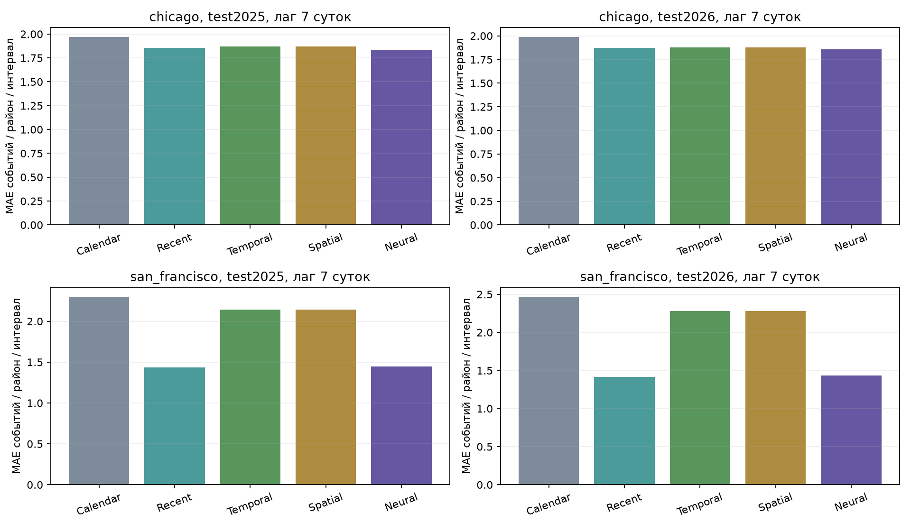
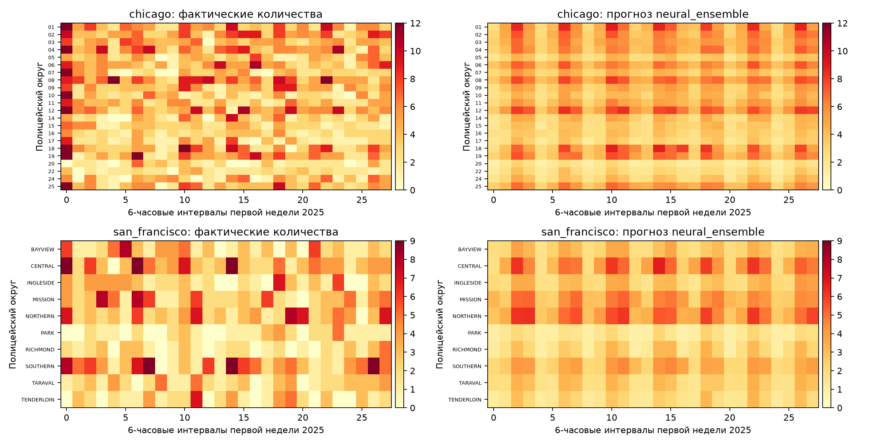

# R10. Прогноз числа происшествий по районам и времени

Цель — количество зарегистрированных происшествий выбранных категорий в следующем 6-часовом интервале для каждого полицейского округа. Это наблюдаемая целевая переменная, в отличие от скрытого коэффициента ветвления n. Всплеск определяется как строгое превышение 95% квантили исторических количеств того же района, дня недели и времени суток; квантиль оценивается только по обучению.

Использованы Chicago (22 округа) и San Francisco (10). Выбраны сопоставимые группы: кражи, кражи со взломом, грабежи, угон транспорта и нападения; Chicago Assault/Battery объединены в общую категорию нападений. Определения источников не тождественны; сравнение качества проводится внутри города. Считается одно дело/отчёт, а не потерпевший или каждая строка правонарушения. Неизвестные и конфликтующие районы исключаются с учётом в QA.

## Протокол и доступность данных

Обучение: 2019–2023 (первые 60 суток исключены для прогрева признаков). Выбор параметров: январь–июнь 2024. Калибровка тревог: июль–декабрь 2024. Веса, выбор модели и пороги фиксируются до расчёта итоговых метрик 2025 и января–сентября 2026. Случайного перемешивания будущих и прошлых временных строк нет. Внутри теста разрешены только прошлые наблюдения, по мере их появления.

Основной сценарий задаёт информационный лаг 7 суток: признаки не используют события последних семи суток до прогнозируемого интервала. Сценарий без лага показывает ретроспективный результат при более сильном предположении доступности. В San Francisco дополнительно используются реальные report_datetime: прошлые события становятся признаками лишь после регистрации, а обучающие, валидационные и калибровочные цели включают только отчёты, известные к датам соответствующего решения. Архив скачан одной современной версией, а не историческими версиями: доступность данных реконструирована не полностью. Поздние регистрации частично учтены по report_datetime SF, но исторические правки неизвестны; у Chicago время первичной регистрации отсутствует. Поэтому даже лаг 7 суток не доказывает операционную применимость в реальном времени.

chicago: 1,176,356 дел/отчётов, доля меток в полночь 2.5%.

san_francisco: 423,703 дел/отчётов, доля меток в полночь 3.1%. Доля регистрации позже 7 суток — 11.4%, позже 6 часов — 55.0%.

## Модели

Сравниваются сезонный районный фон, его адаптация к наблюдаемому уровню последних 28 суток, временная и пространственная дискретные самовозбуждающиеся модели и нейросетевой ансамбль. Фон учитывает район, день недели, слот суток и месяц. Граф районов строится по трём ближайшим центрам событий обучения 2019–2023; он фиксирован и не означает точное соседство административных границ.

В самовозбуждающейся модели среднее имеет вид μ[d,t]=c B[d,t]+a X[d,t]+b Σ W′[d,j]X[j,t]. Память экспоненциальная и сдвинута на информационный лаг. Матрица W′ масштабируется обучающими частотами районов. c оценивается свободно, a,b неотрицательны, a+b≤0.99. При постоянном фоне это ограничивает спектральный радиус дискретного ядра; коэффициенты не выдаются за истинный непрерывный n прежних экспериментов.

Нейросеть использует embedding района, календарь и причинные суммы/отношения собственных, соседних и общегородских прошлых количеств. Три заранее заданных seed, Poisson NLL, эпоха по валидации, среднее всех сетей. Для вероятностей всплеска и интервалов у каждого метода по обучению подбирается рабочая отрицательно-биномиальная дисперсия. Номинальное покрытие проверяется фактически.

Модель числа событий выбирается по валидационному NB NLL, модель всплеска — по validation average precision. Для тревоги калибруется 5% ложноположительных районно-временных ячеек среди отрицательных ячеек. Это другая единица контроля, чем хотя бы одна тревога на целую траекторию в R4–R9. Дрейф распределения может нарушить 5% на тесте; сохраняются общий и максимальный районный FPR, без заявления гарантии для будущих городов.

## Отложенные результаты, информационный лаг 7 суток

| Город / период | Метод | MAE количества | NB NLL | AP всплеска | Полнота всплеска | FPR ячеек |
|---|---|---:|---:|---:|---:|---:|
| chicago / test2025 | Календарный фон | 1.970 | 2.247 | 0.064 | 7.0% | 2.8% |
| chicago / test2025 | Фон + недавний уровень | 1.856 | 2.206 | 0.071 | 3.2% | 0.9% |
| chicago / test2025 | Временная самовозбуждающаяся | 1.868 | 2.223 | 0.064 | 6.4% | 2.1% |
| chicago / test2025 | Пространственная самовозбуждающаяся | 1.868 | 2.223 | 0.064 | 6.4% | 2.1% |
| chicago / test2025 | Нейросетевой ансамбль * | 1.837 | 2.199 | 0.067 | 1.3% | 0.5% |
| chicago / test2026 | Календарный фон | 1.988 | 2.254 | 0.062 | 6.1% | 3.4% |
| chicago / test2026 | Фон + недавний уровень | 1.871 | 2.214 | 0.079 | 4.2% | 0.9% |
| chicago / test2026 | Временная самовозбуждающаяся | 1.878 | 2.229 | 0.072 | 5.4% | 2.0% |
| chicago / test2026 | Пространственная самовозбуждающаяся | 1.878 | 2.229 | 0.072 | 5.4% | 2.0% |
| chicago / test2026 | Нейросетевой ансамбль * | 1.858 | 2.212 | 0.072 | 2.3% | 0.5% |
| san_francisco / test2025 | Календарный фон | 2.300 | 2.170 | 0.009 | 1.8% | 3.4% |
| san_francisco / test2025 | Фон + недавний уровень | 1.435 | 1.869 | 0.017 | 0.9% | 0.3% |
| san_francisco / test2025 | Временная самовозбуждающаяся | 2.142 | 2.120 | 0.010 | 1.8% | 1.4% |
| san_francisco / test2025 | Пространственная самовозбуждающаяся | 2.142 | 2.120 | 0.010 | 1.8% | 1.4% |
| san_francisco / test2025 | Нейросетевой ансамбль * | 1.444 | 1.876 | 0.017 | 0.0% | 0.0% |
| san_francisco / test2026 | Календарный фон | 2.468 | 2.223 | 0.008 | 3.2% | 3.2% |
| san_francisco / test2026 | Фон + недавний уровень | 1.415 | 1.818 | 0.016 | 0.0% | 0.1% |
| san_francisco / test2026 | Временная самовозбуждающаяся | 2.281 | 2.157 | 0.009 | 1.6% | 1.0% |
| san_francisco / test2026 | Пространственная самовозбуждающаяся | 2.281 | 2.157 | 0.009 | 1.6% | 1.0% |
| san_francisco / test2026 | Нейросетевой ансамбль * | 1.437 | 1.832 | 0.014 | 0.0% | 0.0% |

Звёздочка обозначает заранее выбранный метод количества, не победителя по тесту. Для AP базовый ориентир — фактическая доля всплесков; она записана в `test_metrics.csv`. Сценарий без информационного лага, покрытие/ширина интервалов, районные метрики и захват событий в наиболее нагруженных районах сохранены отдельно.

| Город / период | Выбранный count-метод | Разность MAE с сезонным фоном | 95% блочный интервал |
|---|---|---:|---|
| chicago / test2025 | neural_ensemble | -0.1325 | [-0.1612; -0.1049] |
| chicago / test2026 | neural_ensemble | -0.1305 | [-0.1674; -0.0930] |
| san_francisco / test2025 | neural_ensemble | -0.8555 | [-0.9074; -0.7976] |
| san_francisco / test2026 | neural_ensemble | -1.0308 | [-1.0881; -0.9655] |

Интервалы получены пересэмплированием полных 14-суточных блоков вместе со всеми районами и условны на выбранных моделях. Отрицательная разность означает меньшую ошибку. Округа и соседние временные интервалы не считаются независимыми повторениями.





График примера использует заранее заданную первую неделю января 2025. `forecast_examples.csv` содержит первые семь суток каждого теста: город, район, начало/конец будущего интервала, ожидаемое и фактическое количество, вероятность и факт всплеска. Здесь нет обещания точного момента отдельного преступления и нет вывода о математической критичности n.

## Воспроизведение

```powershell
.\.venv\Scripts\python.exe scripts/prepare_spatiotemporal_data.py
.\.venv\Scripts\python.exe -m critical_processes.spatial_experiment
.\.venv\Scripts\python.exe scripts/verify_spatiotemporal.py
```
