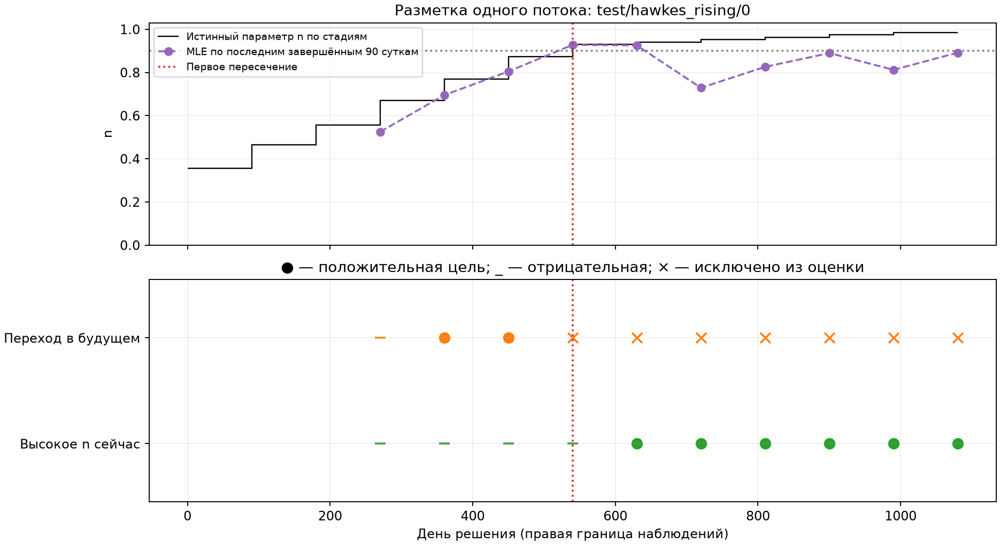
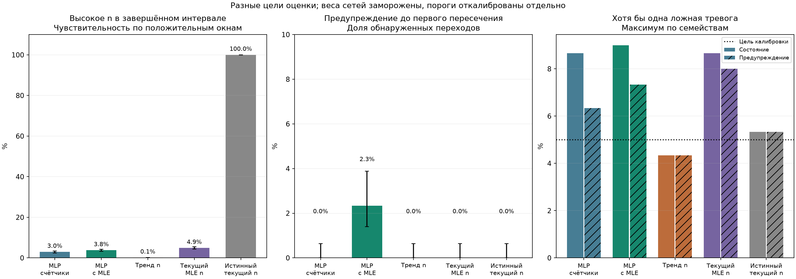

# Этап 3. Текущее высокое n и раннее предупреждение — раздельная проверка

Новые данные: 200 калибровочных и 300 тестовых потоков на каждое из 13 семейств (6500 независимых потоков всего). Seed=20261116. Дополнительно 300 независимых общих префиксов с двумя возможными продолжениями каждый. Две ветви одного префикса не считаются независимыми реализациями.

## Что именно оценивается

Порог высокого режима n*=0.9; это операционный порог ниже математической границы стационарности n=1. Пересечение n* не означает доказанного достижения n=1.

1. **Состояние.** На правой границе t очередного интервала длиной 90 суток оценивается n(t−) последнего завершённого интервала. Признаки используют события строго до t. Параметр следующей стадии не становится меткой текущего состояния. У снижающегося режима положительные метки сменяются отрицательными; постоянно высокий режим тоже включён.
2. **Предупреждение.** Для первого пересечения τ положительная метка ставится только при 0<τ−t≤180 суток. Решения при t≥τ исключены, даже если позже n снова опустился. Для каждого решения требуется полный будущий горизонт t+H≤T. Последние решения без него исключены, а не превращены в отрицательные. Изначально высокий режим не имеет наблюдаемого первого перехода и не входит в эту задачу.

Первое решение возможно после 270 суток наблюдения. Состояние размечается по завершённой стадии; первый положительный state-интервал после нового пересечения доступен через 90 суток. Это ограничение частоты решений, а не раннее обнаружение. Для режима, высокого с начала наблюдения, задержка относительно неизвестного начала не рассчитывается.

## Методы и данные

Две прежние MLP и формула тренда n используются без нового обучения и без изменения исходных весов. Веса скопированы в каталог отчёта и проверяются SHA-256. Их scores обучались для предупреждений, поэтому эта проверка не заменяет обучение отдельного классификатора состояния. Статистический ориентир — MLE n по последнему завершённому окну с неизвестным постоянным фоном и известным β=1/сутки. Коррекция фоновой сезонности из этапа 2 в эти старые признаки не добавлялась. Истинный текущий n — привилегированная диагностическая оценка, недоступная по реальным данным; она не использует будущий n.

Присутствуют плавные и внезапные пересечения, рост без пересечения, постоянные низкий, высокий и близкий к порогу режимы, снижение из высокого n и шесть пуассоновских контролей с внешним сезонным, трендовым или скачкообразным фоном. Между стадиями сохраняется возбуждение; амплитуда потомков задаётся n в момент родительского события. μ[k]=rate×(1−n[k]) сохраняет локальную стационарную среднюю, но не фиксирует реализованную интенсивность при переходах. Интенсивности выбираются от 0.2 до 50 событий/сутки с дополнительными опорными 2, 20 и 50 внутри этого диапазона.

## Раздельная калибровка и неопределённость

Для каждой задачи и метода порог выбирается только на новой калибровочной части с целью 5% траекторий хотя бы с одной ложной тревогой в каждом семействе. Берётся максимум семейных квантилей отрицательных максимумов по независимым потокам; положительные и недопустимые по временному протоколу решения исключаются. Семейства без отрицательных решений явно помечены как исключённые, их доля ложных тревог не объявляется нулевой. Если отрицательные scores насыщаются на единице, разрешён порог выше 1: такой метод воздерживается от всех сигналов.

Веса, признаки и пороги по тесту не выбирались. Цель 5% — правило калибровки, а не гарантия наблюдаемой частоты на новом тесте. Внутри потока решения зависимы: интервалы чувствительности и оконной частоты ложных тревог построены bootstrap целых траекторий. Для вероятности обнаружить переход и семейных траекторных ложных тревог применены Wilson-интервалы. AUC — описательная оценка по валидным eligible-решениям без интервала из предположения независимости окон. Пропуск MLE — явное воздержание, положительная цель при нём остаётся пропущенной. AUC исключает невалидные scores, поэтому рядом сохранена их доля.

## Основные результаты

Чувствительность состояния считается по положительным окнам; обнаружение перехода — хотя бы одно правильное предупреждение на положительную траекторию. Эти две колонки имеют разные знаменатели.

| Метод | State TPR окон | State AUC | Warning recall переходов | Warning AUC | Макс. ложные state | Макс. ложные warning |
|---|---:|---:|---:|---:|---:|---:|
| MLP: счётчики (заморожена) | 3.0% | 0.601 | 0.0% | 0.765 | 8.7% | 6.3% |
| MLP: счётчики + MLE (заморожена) | 3.8% | 0.625 | 2.3% | 0.775 | 9.0% | 7.3% |
| Тренд оконного n | 0.1% | 0.850 | 0.0% | 0.652 | 4.3% | 4.3% |
| MLE текущего n | 4.9% | 0.912 | 0.0% | 0.648 | 8.7% | 8.0% |
| Истинный текущий n (диагностика) | 100.0% | 1.000 | 0.0% | 0.771 | 5.3% | 5.3% |

Наблюдения на этом тесте:

- Текущая MLE-оценка имеет state AUC=0.912, но при откалиброванном пороге 0.9811 её чувствительность по высоким окнам — 4.9%. Высокий AUC не гарантирует полезной чувствительности в выбранной точке с ограничением ложных тревог.
- MLP с MLE-признаками обнаружила 14 из 600 будущих переходов: 2.3%, Wilson-интервал [1.4%, 3.9%]. Максимальная семейная доля траекторий с ложной тревогой — 7.3% при цели 5.0%; требуемое сочетание качества пока не подтверждено.
- Даже диагностический истинный текущий n даёт state AUC=1.000, но при этой калибровке предупреждений обнаруживает 0 будущих переходов. Это результат выбранного правила для текущего n, а не доказательство невозможности иных прогнозов.

Наибольшая тестовая доля ложных тревог каждого метода; интервалы здесь относятся к отдельному указанному семейству, а не являются одновременной областью для максимума по всем семействам.

| Метод | Задача | Семейство | Ложные / отрицательные потоки | Доля | Wilson 95% |
|---|---|---|---:|---:|---:|
| MLP: счётчики (заморожена) | state | Постоянный n рядом с порогом | 26 / 300 | 8.7% | [6.0%, 12.4%] |
| MLP: счётчики (заморожена) | warning | Постоянный n рядом с порогом | 19 / 300 | 6.3% | [4.1%, 9.7%] |
| MLP: счётчики + MLE (заморожена) | state | Постоянный n рядом с порогом | 27 / 300 | 9.0% | [6.3%, 12.8%] |
| MLP: счётчики + MLE (заморожена) | warning | Постоянный n рядом с порогом | 22 / 300 | 7.3% | [4.9%, 10.9%] |
| Тренд оконного n | state | Скачок вверх | 13 / 300 | 4.3% | [2.5%, 7.3%] |
| Тренд оконного n | warning | Скачок вверх | 13 / 300 | 4.3% | [2.5%, 7.3%] |
| MLE текущего n | state | Постоянный n рядом с порогом | 26 / 300 | 8.7% | [6.0%, 12.4%] |
| MLE текущего n | warning | Постоянный n рядом с порогом | 24 / 300 | 8.0% | [5.4%, 11.6%] |
| Истинный текущий n (диагностика) | state | Постоянный n рядом с порогом | 16 / 300 | 5.3% | [3.3%, 8.5%] |
| Истинный текущий n (диагностика) | warning | Постоянный n рядом с порогом | 16 / 300 | 5.3% | [3.3%, 8.5%] |

Вероятность хотя бы одного правильного предупреждения отдельно для плавных и внезапных переходов. Clean recall требует, чтобы первая eligible-тревога попала в положительное окно; позднее верное предупреждение не стирает предыдущую ложную тревогу.

| Метод | Плавный переход | Внезапный переход | Clean recall всех переходов | Медиана упреждения обнаруженных |
|---|---:|---:|---:|---:|
| MLP: счётчики (заморожена) | 0.0% | 0.0% | 0.0% | — |
| MLP: счётчики + MLE (заморожена) | 4.7% | 0.0% | 2.3% | 90 суток |
| Тренд оконного n | 0.0% | 0.0% | 0.0% | — |
| MLE текущего n | 0.0% | 0.0% | 0.0% | — |
| Истинный текущий n (диагностика) | 0.0% | 0.0% | 0.0% | — |

## Общая история и разные возможные будущие режимы

Для каждого дополнительного префикса n плавно растёт, оставаясь ниже порога. После одного следующего низкого интервала возможны два продолжения: пересечение порога или сохранение низкого режима. В момент решения вся наблюдаемая история одинакова, а метки будущего противоположны. Будущие события не нужны для расчёта этих scores: это проверка различимости двух допустимых режимных продолжений по одному и тому же прошлому, а не ещё один независимый тест предсказания.

| Метод | TPR в пересекающей ветви | FPR в непересекающей ветви | AUC двух возможных будущих |
|---|---:|---:|---:|
| MLP: счётчики (заморожена) | 0.7% | 0.7% | 0.500 |
| MLP: счётчики + MLE (заморожена) | 6.3% | 6.3% | 0.500 |
| Тренд оконного n | 0.0% | 0.0% | 0.500 |
| MLE текущего n | 0.3% | 0.3% | 0.500 |
| Истинный текущий n (диагностика) | 0.0% | 0.0% | 0.500 |

Равенство TPR и FPR и AUC=0.5 здесь следуют из одинакового прошлого и равного веса двух ветвей, а не из ошибки обучения. Это не доказывает невозможность прогнозирования плавных переходов при других предположениях. Оно показывает, что предупреждение требует информации о законе изменения n, помимо точной оценки текущего значения.

## Что следует из проверки

Хорошее разделение текущих высоких и низких n по AUC само по себе не является подтверждением раннего предупреждения. Ранние результаты учитываются только до первого пересечения, в заданном горизонте и вместе с ложными тревогами. Совместно следует смотреть recall, clean recall, интервалы и семейные ложные тревоги; упреждение только обнаруженных переходов не характеризует все переходы. Постоянно высокий и падающий режимы не превращаются в положительные примеры первого будущего перехода.

Следующий этап — выбор окон и признаков на обучении/валидации, обучение детекторов под явно выбранную задачу, несколько seed, новая калибровка и один новый финальный тест. Прежние тесты остаются диагностическими данными и не должны повторно называться независимым финальным подтверждением. Городские данные здесь не используются; выводы относятся к заданным синтетическим режимам.

## Артефакты

- metrics.json — раздельные метрики, интервалы, доли валидности и пороги.
- calibration.csv и thresholds.json — калибровка по задаче и семейству.
- family_test_metrics.csv и trajectory_test_metrics.csv — показатели с явными знаменателями.
- *_state_test_scores.csv и *_warning_test_scores.csv — все решения, метки и маски eligible.
- data/*.npz — новые данные, причинные признаки, scores и seed; models/*.pt — копии замороженных весов.
- shared_prefix_scores.csv и shared_prefix_summary.csv — диагностика одинакового прошлого.
- run_config.json — определения задач, допущения, версии, seed и SHA-256.

Проверка: `.\.venv\Scripts\python.exe scripts/verify_task_audit.py`. Перестроение отчёта: task_report.write_task_report без повторной генерации данных.
