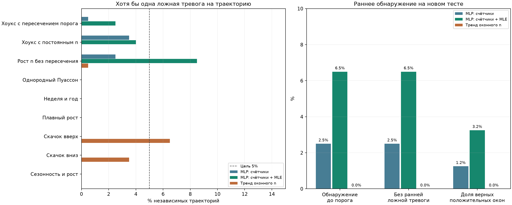

# Оконные оценки Хоукса: нейросеть и статистический ориентир

На новом тесте MLP по счётчикам обнаружила 5/200 пересечений, расширенная MLP — 13/200, индикатор тренда — 0/200. Максимальные тестовые доли траекторий с ложной тревогой: 3.5%, 8.5% и 6.5% соответственно. Большее число обнаружений расширенной MLP следует сопоставлять с превышением целевых 5% ложных тревог.

Новый эксперимент, seed=20261113. Предыдущий тест повлиял на выбор признаков, поэтому его повторная оценка не используется как независимое подтверждение. Для обучения, калибровки и нового теста сгенерированы раздельные потоки по 200, 200, 200 реализаций каждого из девяти семейств. Все три метода оцениваются на одних и тех же новых тестовых траекториях.

## Признаки и оценивание

Моменты событий Хоукса генерируются симулятором с непрерывной историей. Для пуассоновских контролей с постоянной внутри каждого дня интенсивностью времена условно на суточном счётчике равномерны; это точная генерация модели, а не восстановление неизвестных времён из реальных данных.

Из каждого завершенного 90-суточного блока оцениваются n и базовая интенсивность методом условного максимального правдоподобия. Наблюденные события до левой границы входят в память и компенсатор. Дополнительно выполняется подгонка по последним lookback блокам. Скорость затухания зафиксирована равной 1/сутки, как в генераторе: это благоприятное модельное предположение, не проверка переносимости на неизвестное ядро.

При фиксированном затухании интенсивность линейна по базовой интенсивности и n, а отрицательная log-likelihood выпукла. Используется [SciPy L-BFGS-B](https://docs.scipy.org/doc/scipy/reference/optimize.minimize-lbfgsb.html) с аналитическим градиентом. Группы совпадающих времён не возбуждают друг друга мгновенно. Нестабильные или слишком бедные событиями подгонки имеют явный флаг; такие окна не удаляются из теста. Кривизна likelihood используется как дополнительный признак неопределенности, не как доверительный интервал с гарантированным покрытием на границе n=0.

Базовая MLP получает 12 нормированных признаков счётчиков. Расширенная MLP получает 35 признаков: те же счётчики, оценки n, их кривизну, долю базовой интенсивности, прирост likelihood, признаки валидности по коротким и длинному окну, наклон n, линейную проекцию и разницу короткой/длинной оценок. Полный список сохранен в конфигурации. Истинные n, семейство, время пересечения и будущее не передаются в признаки. Нормировка по среднему/стандартному отклонению вычисляется только на обучении.

Статистический ориентир: линейная проекция текущей короткой оценки n на горизонт предупреждения по наклону последних lookback оценок. Неотрицательная проекция u преобразуется в ограниченный score u/(1+u); при невалидной подгонке score=0. Это прозрачный индикатор, не вероятность критичности и не p-value.

## Одинаковая калибровка и оценка

Для каждого метода отдельно выбран порог по максимуму отрицательных scores на калибровочной траектории. Цель — не более 5% траекторий с хотя бы одной ложной тревогой в каждом семействе при том же распределении параметров. Ранг квантили ceil((m+1)*(1-alpha)), общий порог строго выше наибольшей семейной квантили. Тест не используется для выбора эпохи, архитектуры, признаков или порога в этом эксперименте. Это маргинальная калибровка по траекториям, не гарантия для всех средних интенсивностей или фиксированного единственного порога.

Успешное предупреждение: 0 < день пересечения n=0.9 − день решения <= 180 суток. Сигналы в момент пересечения и после него не засчитываются. Чистое обнаружение дополнительно требует отсутствия предшествующей ложной тревоги. Медиана упреждения рассчитывается только среди обнаруженных случаев.

| Метод | FPR окон | Обнаружено пересечений | Чистое обнаружение | Максимум ложных тревог по траекториям | Медиана упреждения |
| --- | ---: | ---: | ---: | ---: | --- |
| MLP: счётчики | 0.14% | 5/200 (2.5%) | 2.5% | 3.5% | 90 суток |
| MLP: счётчики + MLE | 0.21% | 13/200 (6.5%) | 6.5% | 8.5% | 90 суток |
| Тренд оконного n | 0.13% | 0/200 (0%) | 0% | 6.5% | нет обнаружений |

Парная разница обнаружения расширенной MLP относительно MLP по счётчикам: 4.0 процентного пункта, 95%-интервал bootstrap по целым положительным траекториям [0.0; 8.0] п.п. Интервал включает ноль: надёжное преимущество по обнаружению не установлено этим тестом.

## По семействам

| Семейство | MLP: счётчики | MLP: счётчики + MLE | Тренд n |
| --- | ---: | ---: | ---: |
| Хоукс с пересечением порога | 0.5% | 2.5% | 0.0% |
| Хоукс с постоянным n | 3.5% | 4.0% | 0.0% |
| Рост n без пересечения | 2.5% | 8.5% | 0.5% |
| Однородный Пуассон | 0.0% | 0.0% | 0.0% |
| Неделя и год | 0.0% | 0.0% | 0.0% |
| Плавный рост | 0.0% | 0.0% | 0.0% |
| Скачок вверх | 0.0% | 0.0% | 6.5% |
| Скачок вниз | 0.0% | 0.0% | 3.5% |
| Сезонность и рост | 0.0% | 0.0% | 0.0% |

## Качество оценок и ограничения

Доля валидных коротких подгонок на тесте: 99.14%. Флаги валидности и оценки по каждому блоку сохранены в mle_test_diagnostics.csv; истинный n в этом файле используется только для аудита. Максимальная калибровочная доля ложных тревог среди всех методов/семейств: 4.5%.

Качество самих оценок сохранено в mle_quality.csv. Аудит включает все наблюденные блоки, в том числе после пересечения, и не является отдельной метрикой раннего обнаружения. Значительная положительная оценка n на сезонном Пуассоне демонстрирует ошибку спецификации постоянной базы, хотя истинный коэффициент самовозбуждения там равен нулю.

Оценка n в стационарной модели может реагировать на сезонность и тренды интенсивности. Она не является непосредственным измерением истинной критичности. Для окон с меняющимся n стационарная подгонка — локальное приближение. Первый наблюдаемый блок не содержит ненаблюденной истории прогрева; последующие окна используют только доступную наблюденную историю.

Для каждой модели фиксирован один seed обучения. Интервалы по обнаружению и семействам в metrics.json и family_test_metrics.csv отражают вариацию тестовых траекторий, но не случайность повторных обучений. Новое семейство, неизвестное затухание и городской масштаб этой проверкой не покрываются. При сравнении нельзя выбирать лучший порог по показанному тесту.

Артефакты: модели и схема признаков в models/, исходные счётчики, режимы и оконные оценки в data/*.npz, все решения, калибровочные таблицы, metrics.json, SHA-256 и параметры в run_config.json. Моменты событий можно воспроизвести по seed, индексу разбиения, семейству и номеру реализации; целиком они не сохраняются, чтобы не раздувать объем данных.

